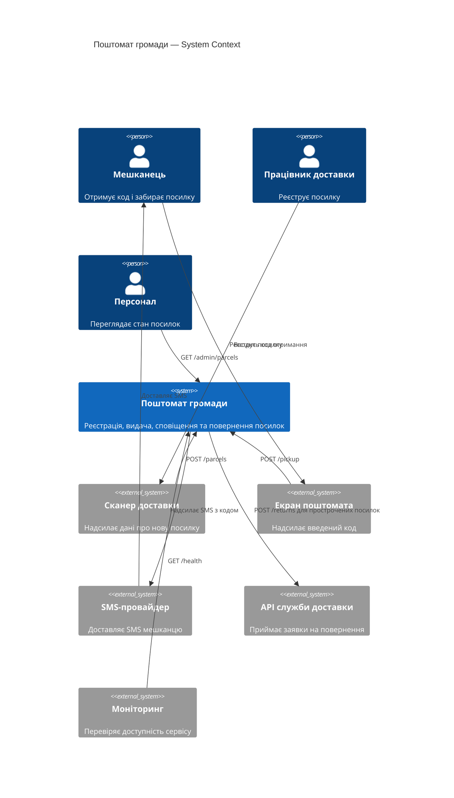
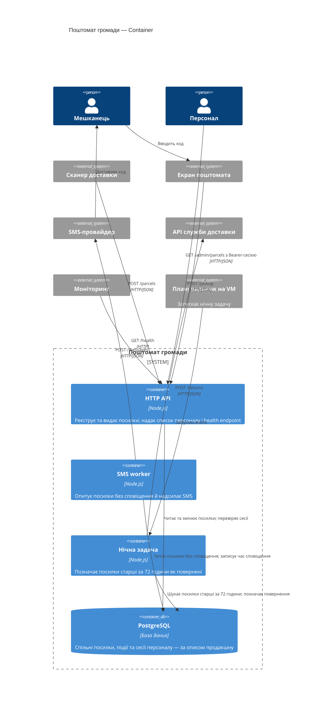

- Інструмент і модель: Codex subagent, GPT-6
- Дата: 2026-11-09
- Що бачила сесія: `../ws11-b-code/` — уся `app/` (без історії попередніх прогонів)
- Промпт (дослівно):

  > Намалюй архітектуру цієї системи як C4-діаграми в Mermaid:
  > рівень System Context і рівень Container.
  > Відповідь дай повністю в чаті; файлів не створюй і уточнювальних питань не став —
  > припущення називай явно.

---

Нижче показано **задокументовану продакшн-архітектуру**. Відмінності між документацією та наявним кодом зазначено після діаграм.

### System Context

### Container

**Важлива межа достовірності:** `app/docs/ARCHITECTURE.md` описує PostgreSQL у продакшні, але наявний `app/src/db.js` реалізує лише сховище в пам’яті. Кожен окремо запущений процес створює власне сховище; коду підключення до PostgreSQL тут немає. Отже, спільна база на діаграмі Container є **задокументованим припущенням про продакшн**, а не підтвердженою реалізацією цього репозиторію. Код також задає опитування worker кожні 10 секунд і шестизначний код, тоді як архітектурний документ зазначає 30 секунд і чотиризначний код.
