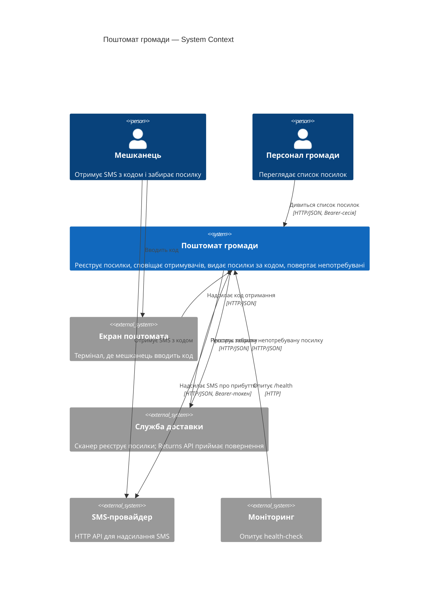
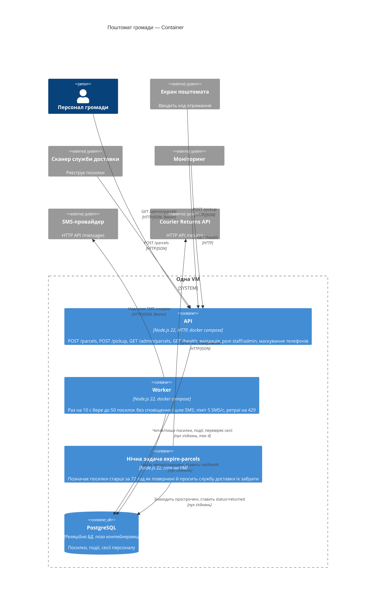

- Інструмент і модель: Claude Code (headless: `claude -p`), модель за замовчуванням, не закріплена
- Дата: 2026-11-03
- Що бачила сесія: тимчасова тека `ws11-b-code` з усією `app/` (разом з `app/README.md` і `app/docs/`). Пам'ять вимкнено (`CLAUDE_CODE_DISABLE_AUTO_MEMORY=1`), нова сесія без історії (`--no-session-persistence`), інструменти лише Read/Grep/Glob. **Лишався ввімкненим глобальний `~/.claude/CLAUDE.md`** (лише правила щодо git-комітів); `--bare` не використано — немає ANTHROPIC_API_KEY.
- Промпт (дослівно):

  > Намалюй архітектуру цієї системи як C4-діаграми в Mermaid:
  > рівень System Context і рівень Container.
  > Відповідь дай повністю в чаті; файлів не створюй і уточнювальних питань не став —
  > припущення називай явно.

---

Нижче дві діаграми: System Context і Container. Я зробив їх із коду `src/` і `bin/`, а не з `docs/ARCHITECTURE.md`, бо документ розходиться з кодом (деталі в кінці).

## Припущення

- **Екран поштомата й сканер служби доставки** — зовнішні клієнти. У репозиторії їхнього коду немає, вони лише викликають API.
- **Служба доставки** — одна зовнішня сторона. Вона реєструє посилки через сканер і приймає запити на повернення через Returns API (`courier.js`).
- **Моніторинг** опитує `GET /health`. Що саме це за система, у коді не видно.
- **PostgreSQL** — продакшн-сховище. У репозиторії є лише in-memory реалізація `db.js` з тим самим інтерфейсом. Про Postgres відомо з `ARCHITECTURE.md` і README.
- **Нічна задача** працює як cron на VM, поза `docker compose`. Так сказано в `bin/expire-parcels.js`. Чи запускається вона з того самого образу, невідомо.
- **Сесії персоналу** читаються з БД (`findSession`), але код, що їх створює, у репозиторії відсутній. Тому на діаграмі їх ніхто не створює.

## Рівень 1: System Context

## Рівень 2: Container

## Де `ARCHITECTURE.md` розходиться з кодом

- **Courier Returns API відсутній у документі.** Нічна задача викликає зовнішню службу (`courier.js`, `COURIER_BASE_URL`), а в схемі документа зовнішня система лише одна, SMS-провайдер.
- **Інтервал worker.** У документі 30 секунд, у коді `POLL_INTERVAL_MS = 10_000`.
- **Довжина коду.** У документі 4 цифри, у коді 6 (`parcels.js`).
- **Каталог `deploy/`.** Документ посилається на нього, але в цьому репозиторії його немає. Тому розкладку на `docker compose` і cron я взяв із тексту документа, а не з конфігурації.
- **Нічна задача.** Документ не пише, що вона працює через cron, а не в контейнері. Це видно лише з коментаря в `bin/expire-parcels.js`.
