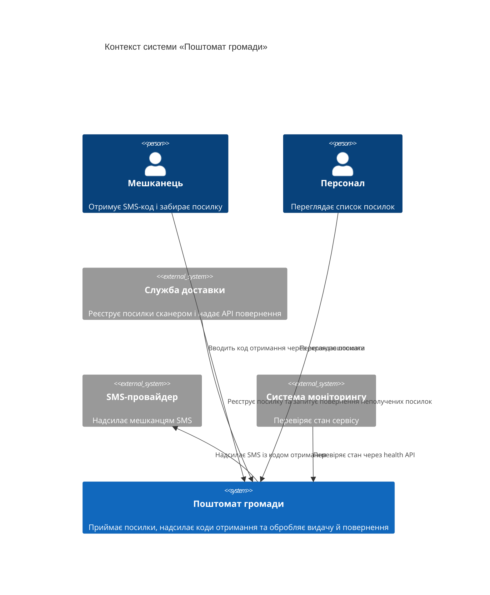
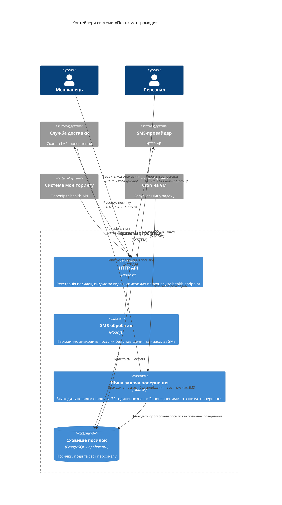

- Інструмент і модель: Codex, GPT-6
- Дата: 2026-11-03
- Стан пам'яті та глобальних інструкцій: попередню історію чату не передавали; налаштування memories і глобальних інструкцій не перевірялися й окремо не вимикалися.
- Що бачила сесія: окрема чиста projectless Codex-сесія; копія лише app/ у ws11-isolated-runs/b-code/app. Нова projectless сесія без історії поточного чату; робоча тека C:\Users\slpir\Documents\Codex\2026-11-03\ws11-b-code.
- Промпт (дослівно):

> Намалюй архітектуру цієї системи як C4-діаграми в Mermaid: рівень System Context і рівень Container.
> Відповідь дай повністю в чаті; файлів не створюй і уточнювальних питань не став — припущення називай явно.

---

Припущення: межа системи охоплює API поштомата, SMS-обробник і нічну задачу повернення посилок. У контекстній діаграмі показані зовнішні користувачі та системи, які згадані в коді або документації. У діаграмі контейнерів PostgreSQL позначено як продакшн-сховище за документацією: у наданій копії `src/db.js` використовує сховище в пам’яті.

### System Context

### Container

Документація в копії та реалізація різняться в деталях: код генерує шестизначний код і опитує чергу кожні 10 секунд; у документації вказані чотиризначний код і 30 секунд. Діаграми відображають структуру й інтеграції, а ці значення на них не деталізовано.

