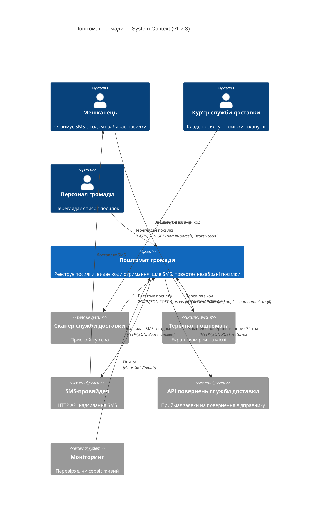
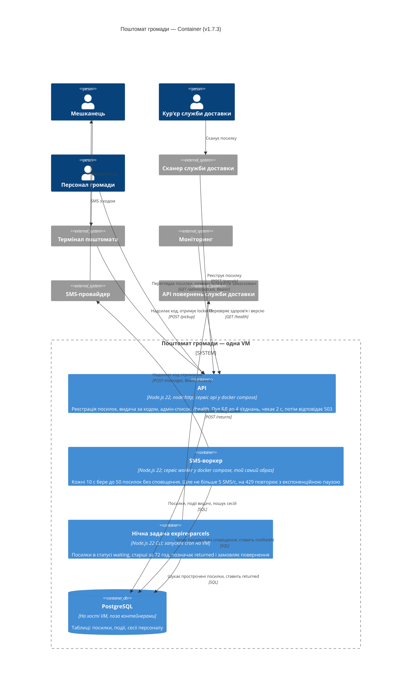

- Інструмент і модель: Claude Code (VS Code), claude-opus-5-5, effort High
- Дата: 2026-10-25
- Що бачила сесія: тимчасова тека `../ws11-b-code` — уся `app/` (код, тести, `README.md`, `docs/`; без `.git`, `AGENTS.md`, `CLAUDE.md`, `deploy/`); нова сесія, пам'ять і глобальні інструкції відсутні
- Промпт (дослівно):

```text
Намалюй архітектуру цієї системи як C4-діаграми в Mermaid:
рівень System Context і рівень Container.
Відповідь дай повністю в чаті; файлів не створюй і уточнювальних питань не став —
припущення називай явно.
```

---

Нижче дві діаграми C4 для «Поштомата громади» (v1.7.3). Я їх зібрав із коду в src/ і bin/. Документації я довіряв тільки там, де в коді цієї інформації немає. Файлів не створював.

Рівень 1 — System Context



Рівень 2 — Container



Припущення
Код важливіший за docs/ARCHITECTURE.md. Документ описує v1.5, а код — 1.7.3, і вони розходяться у трьох місцях. Я брав версію з коду:
код отримання 6-значний, а не 4-значний (parcels.js:28);
воркер опитує БД кожні 10 с, а не кожні 30 с. Якщо пачка з 50 посилок повна, наступне опитування починається одразу (worker.js:8);
у документації немає API повернень служби доставки, хоча нічна задача його викликає (expire-parcels.js:15).
PostgreSQL я взяв з документації. У репозиторії є тільки сховище в пам'яті (db.js), а в package.json немає жодної залежності, тож і драйвера PostgreSQL немає. Продакшн-версія сховища, мабуть, лежить в іншому місці. Назви таблиць теж узяв з документації.
Як усе розгорнуто, я знаю тільки з документації. Каталогу deploy/, на який посилається документація, тут немає. Тому дві служби в docker compose (api і worker) я взяв з тексту. Нічну задачу запускає cron на VM, так сказано в коментарі в коді. Я показав її окремим контейнером, бо це окремий процес. Чи запускається вона в тому самому образі, чи прямо на хості, з коду не видно.
Сканер і термінал поштомата я показав як зовнішні системи. Їхнього коду в репозиторії немає. Я припускаю, що термінал сам відкриває комірку за lockerId з відповіді на /pickup.
Сканер і API повернень належать одній службі доставки. Насправді це можуть бути різні компанії.
Інтерфейсу для персоналу немає. Немає ні вікна адміністрування, ні ендпоінта входу. Сесії тільки читаються з БД (server.js:14-20), тож хто їх створює, невідомо. На діаграмі персонал звертається до API напряму.
HTTP чи HTTPS, невідомо. Усі адреси за замовчуванням — http://localhost (config.js), тому я писав просто «HTTP/JSON». Систему моніторингу в коді ніяк не названо. Логи пишуться як JSON у stdout, і я не показував їх окремою системою.
Що варто знати з діаграм
POST /parcels і POST /pickup не перевіряють, хто їх викликає. Будь-хто, хто дістанеться до API, може зареєструвати посилку або перебирати 6-значні коди: обмеження на кількість спроб немає.
Кожен процес має свій пул до 4 з'єднань. Разом виходить до 12 одночасних з'єднань з однією PostgreSQL.
