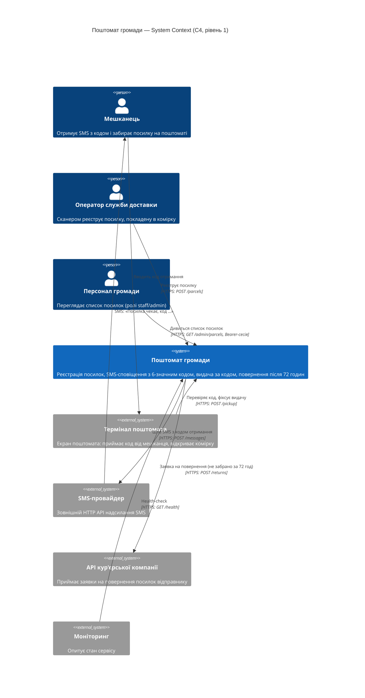
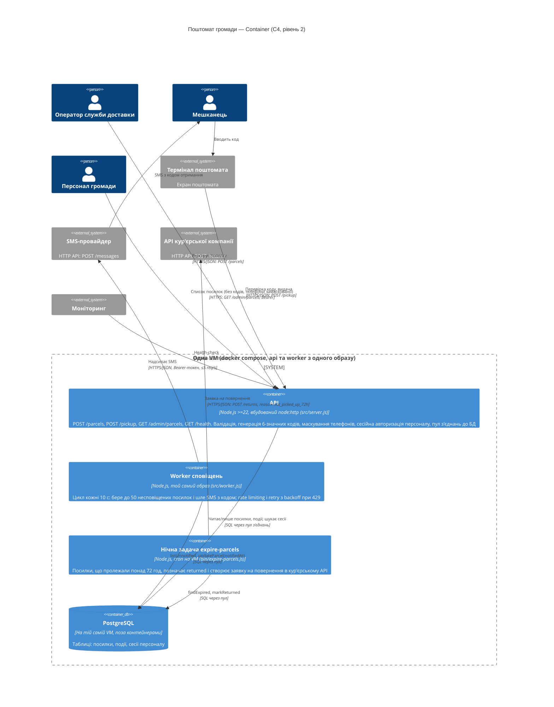

- Інструмент і модель: Claude Code (Workflow-субагент general-purpose), Claude Fable 5 (`claude-fable-5`)
- Дата: 2026-11-03
- Що бачила сесія: тимчасова тека ../ws11-b-code — уся `app/`. Прогін запускався субагентом із сесії в корені репо, тому субагенту системно підвантажувався `CLAUDE.md` репо (він посилається на `AGENTS.md`); агенту явно вказано читати лише тимчасову теку. Пам'ять між сесіями в субагентів відсутня; відповідь нижче — перша, дослівно.
- Промпт (дослівно):

  > Твоя робоча тека: C:/Users/777ma/IdeaProjects/ws11-b-code — це корінь проєкту. Читай лише файли в цій теці й не зазирай в інші теки.
  >
  > Намалюй архітектуру цієї системи як C4-діаграми в Mermaid:
  > рівень System Context і рівень Container.
  > Відповідь дай повністю в чаті; файлів не створюй і уточнювальних питань не став —
  > припущення називай явно.

---
Я прочитав усі файли в `C:/Users/777ma/IdeaProjects/ws11-b-code` (README, `docs/ARCHITECTURE.md`, `package.json`, `src/*`, `bin/expire-parcels.js`, тести). Нижче — C4-діаграми системи «Поштомат громади».

## Рівень 1 — System Context

## Рівень 2 — Container

## Явні припущення

1. **Термінал поштомата та сканер кур'єра — зовнішні клієнти.** Їхнього коду в репозиторії немає; вони лише викликають HTTP API (`POST /pickup`, `POST /parcels`), тому змодельовані як зовнішня система і актор відповідно.
2. **Сховище в продакшні — PostgreSQL.** У репозиторії `src/db.js` — in-memory store; README і ARCHITECTURE.md прямо кажуть, що в продакшні той самий інтерфейс працює поверх PostgreSQL на тій самій VM поза контейнерами. На діаграмі показано продакшн-варіант.
3. **Розбіжності коду з ARCHITECTURE.md вирішено на користь коду** (документ v1.5, код v1.7.3): інтервал опитування worker — 10 с (`POLL_INTERVAL_MS = 10_000`), а не 30 с; код отримання — 6-значний (`parcels.js`), а не 4-значний.
4. **Розгортання:** одна VM, `docker compose` з сервісами `api` і `worker` з одного образу — за ARCHITECTURE.md; згаданої там теки `deploy/` у робочій директорії немає, тому деталі compose-файлу не відомі. Нічна задача — cron на VM (коментар у `bin/expire-parcels.js`).
5. **Моніторинг** показано як зовнішню систему, бо ARCHITECTURE.md каже «моніторинг опитує `GET /health`», але сам інструмент моніторингу в репозиторії не визначено.
6. **Протокол** позначено HTTPS для зовнішніх взаємодій як типове припущення для продакшну; у коді це plain HTTP (`node:http`, `fetch` на `baseUrl` зі змінних оточення), тож TLS, імовірно, термінується поза застосунком.
7. Worker оновлює `notifiedAt` лише після успішного надсилання SMS; невдалі спроби лишаються в черзі на наступний цикл — це відображено як єдиний зв'язок worker—БД, без окремої черги повідомлень (черги в системі немає, координація — через стан у БД).
