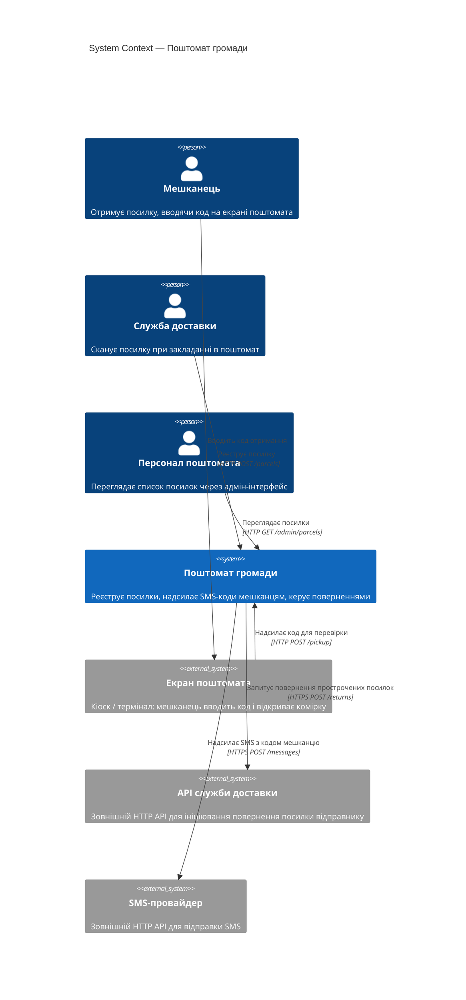
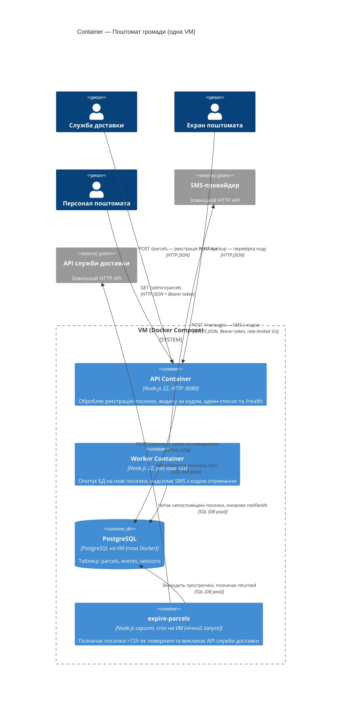

- Інструмент і модель: Claude Code CLI 2.1.304, headless-режим (`claude -p`, дозволені лише інструменти Read/Grep/Glob/LS), модель claude-sonnet-4-6
- Дата: 2026-10-26
- Що бачила сесія: тимчасова тека `../ws11-b-code/` поруч із репо — уся копія `app/`. Нова сесія без історії й без підказок; глобального `~/.claude/CLAUDE.md` немає, у батьківських теках CLAUDE.md / AGENTS.md немає. Сесію запустив агент (GitHub Copilot) з терміналу; нижче — фінальна відповідь сесії (`result` з JSON-виводу) без змін.
- Промпт (дослівно):

  > Намалюй архітектуру цієї системи як C4-діаграми в Mermaid:
  > рівень System Context і рівень Container.
  > Відповідь дай повністю в чаті; файлів не створюй і уточнювальних питань не став —
  > припущення називай явно.

---
Маю достатньо інформації. Ось C4-діаграми:

---

## C4 Level 1 — System Context

**Припущення:** поштомат має власний екран/кіоск як окрему точку взаємодії; служба доставки має свій сканер; SMS-провайдер та API служби доставки (повернення) — зовнішні SaaS-системи.

---

## C4 Level 2 — Container

**Припущення:** `docker compose` запускає `api` і `worker` як окремі контейнери з одного образу; PostgreSQL розгорнуто на тій самій VM поза Docker; `expire-parcels` запускається cron-ом безпосередньо на VM (не в контейнері).

---

**Ключові припущення, зроблені явно:**

| # | Припущення |
|---|---|
| 1 | Екран поштомата — окрема зовнішня система (кіоск), а не частина цього backend-у |
| 2 | PostgreSQL стоїть на VM поза Docker-контейнерами (як написано в ARCHITECTURE.md) |
| 3 | `expire-parcels` запускається cron-ом на VM, не всередині контейнера |
| 4 | `COURIER_BASE_URL` в конфігу — це окремий зовнішній API (не той самий `api`-контейнер) |
| 5 | Авторизація між службою доставки та API — не задокументована; показано без автентифікації |
