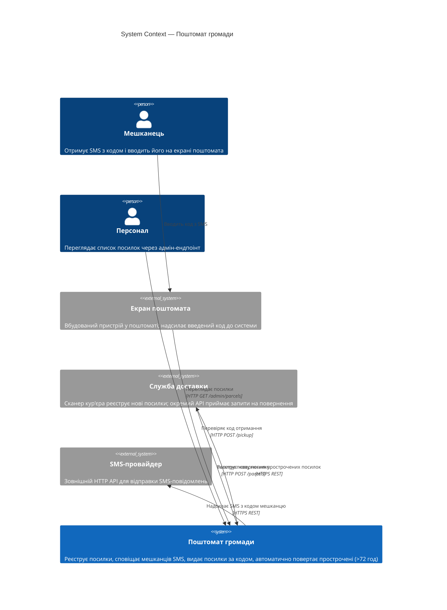

- Інструмент і модель: Claude Code 2.1.168, headless `claude -p`; модель claude-sonnet-4-6 (модель за замовчуванням CLI; haiku — службові виклики)
- Дата: 2026-11-02
- Що бачила сесія: тимчасова тека ../ws11-b-code — уся `app/`; нова сесія без історії, `--strict-mcp-config` (жодних MCP), інструменти Read/Glob/Grep/Bash. Увімкненим лишився глобальний `~/.claude/CLAUDE.md` (загальні правила керування AI-конфігурацією і ctx7, нічого про цей репо) та глобальні skills; пам'ять нової теки — порожня.
- Промпт (дослівно):

  > Намалюй архітектуру цієї системи як C4-діаграми в Mermaid:
  > рівень System Context і рівень Container.
  > Відповідь дай повністю в чаті; файлів не створюй і уточнювальних питань не став —
  > припущення називай явно.

---
Маю повну картину. Ось діаграми.

---

## Припущення

1. **Екран поштомата** — вбудований пристрій з окремим ПЗ; він сам робить HTTP-виклик до API. Мешканець фізично вводить код, але HTTP-клієнт — пристрій.
2. **Courier API (повернення)** і **сканер служби доставки** — один і той самий зовнішній суб'єкт («служба доставки»), але два незалежні потоки: сканер → Poshtomat і Poshtomat → Courier API.
3. **Нічна задача** запускається cron-ом безпосередньо на VM-хості (не в Docker), що відповідає коментарю у файлі.
4. **PostgreSQL** — на тій самій VM, поза Docker (явно зазначено в ARCHITECTURE.md).
5. Немає API-шлюзу, балансувальника чи зовнішнього публічного DNS — пряме HTTP з'єднання.
6. Аутентифікація персоналу — `Bearer`-токен із сесійної таблиці в PostgreSQL.

---

## Рівень 1 — System Context



---

## Рівень 2 — Container

```mermaid
C4Container
    title Container diagram — Поштомат громади

    Person(staff, "Персонал", "Переглядає список посилок")
    System_Ext(locker, "Екран поштомата", "Вбудований пристрій")
    System_Ext(delivery, "Служба доставки", "Сканер + API повернень")
    System_Ext(smsProvider, "SMS-провайдер", "Зовнішній HTTP API")

    Container_Boundary(vm, "VM — один хост, docker compose") {

        Container(api, "API Container", "Node.js 22 · HTTP · Docker «api»",
            "Обробляє POST /parcels, POST /pickup, GET /admin/parcels, GET /health. Сесійна аутентифікація персоналу через Bearer-токен")

        Container(worker, "Worker Container", "Node.js 22 · фоновий процес · Docker «worker»",
            "Кожні 10 с опитує БД на посилки без SMS-сповіщення; відправляє SMS батчами по 50; ретраї з exponential backoff при 429")

        Container(expire, "Expire Job", "Node.js 22 · cron-скрипт на VM-хості (поза Docker)",
            "Щоночі: знаходить посилки старші 72 год, позначає як «returned», викликає Courier API для фізичного забирання")

        ContainerDb(db, "PostgreSQL", "PostgreSQL · на VM-хості, поза Docker",
            "Таблиці: посилки (статус, код отримання, lockerId), події, сесії персоналу")
    }

    Rel(delivery, api, "Реєструє посилку", "HTTP POST /parcels")
    Rel(locker, api, "Перевіряє та активує код", "HTTP POST /pickup")
    Rel(staff, api, "Переглядає посилки (Bearer token)", "HTTP GET /admin/parcels")

    Rel(api, db, "Читає/пише посилки, перевіряє сесії", "TCP · SQL")
    Rel(worker, db, "Читає unnotified, оновлює notifiedAt", "TCP · SQL")
    Rel(worker, smsProvider, "Відправляє SMS з кодом отримання", "HTTPS REST · Bearer token")
    Rel(expire, db, "Знаходить прострочені, позначає returned", "TCP · SQL")
    Rel(expire, delivery, "Запитує фізичне повернення посилок", "HTTPS REST · Courier API")
```

---

**Ключові архітектурні рішення, що видно з діаграм:**
- **Worker і API — один Docker-образ, два сервіси** (один codebase, різні `CMD`).
- **PostgreSQL поза Docker** — прямий доступ обох контейнерів і cron-скрипта через `DATABASE_URL`.
- **Нічна задача не є окремим контейнером** — це свідомий вибір: cron на хості, а не `cron`-контейнер чи окремий сервіс.
- **Немає зворотного проксі** між клієнтами й API — пряме з'єднання на порт 8080.
