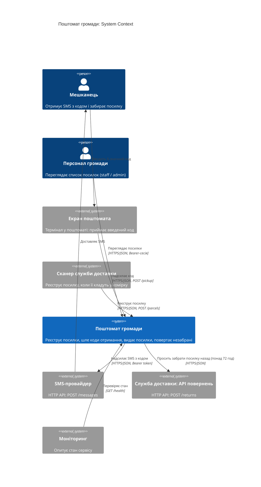
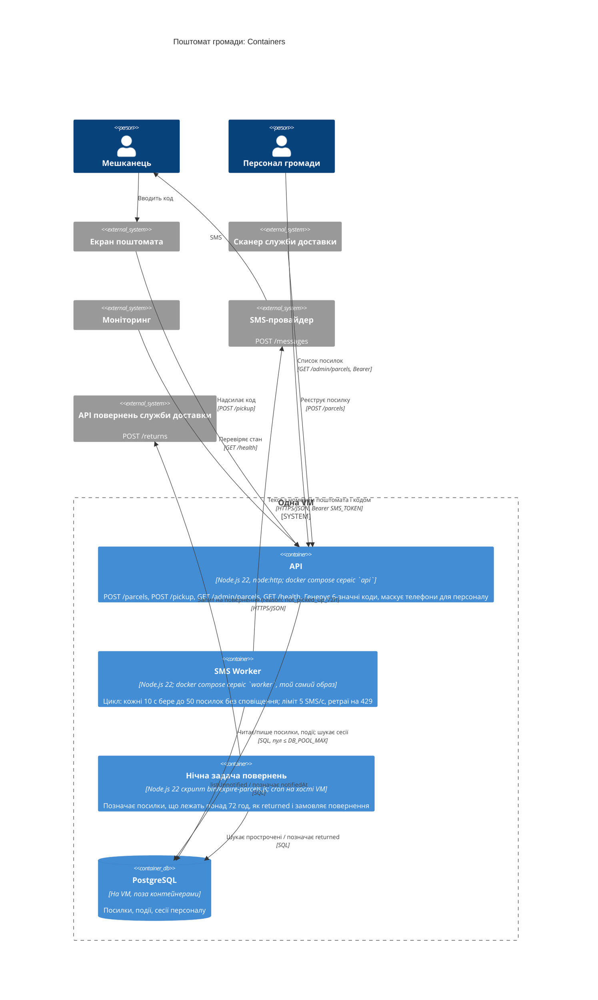

- Інструмент і модель: Claude Code 2.1.310, headless `claude -p`; модель claude-opus-5-5, effort medium
- Дата: 2026-10-24
- Що бачила сесія: тимчасова тека `../ws11-b-code/` поруч із репо, у ній лише копія всієї `app/` (перевірено `diff -r` — ідентична). Нова сесія (`--session-id c394e269-cc1c-4498-ad96-3b102bbc257a`) з прапорцями `--safe-mode --restricted --strict-mcp-config --tools "Read,Grep,Glob"`: без `CLAUDE.md`/`AGENTS.md`, пам'яті, хуків, плагінів користувача, output styles і MCP (`mcp_servers` порожній; `~/.claude/CLAUDE.md` порожній, 0 байт); файлові інструменти обмежені тимчасовою текою прапорцем `--restricted`. Усі виклики були всередині теки, відмов не було (`permission_denials` порожній). Виклики: Glob `**/*`; Read `app/docs/ARCHITECTURE.md`, `app/README.md`, `app/package.json`, 8 з 9 файлів `app/src/` — усі, крім `version.js`, — і `app/bin/expire-parcels.js`; тести не читала. Bash вимкнено.
- Промпт (дослівно):

  > Намалюй архітектуру цієї системи як C4-діаграми в Mermaid:
  > рівень System Context і рівень Container.
  > Відповідь дай повністю в чаті; файлів не створюй і уточнювальних питань не став —
  > припущення називай явно.

---

Нижче дві C4-діаграми, які я склав за кодом у `app/`. Документацію `docs/ARCHITECTURE.md` я використовував лише як допоміжне джерело: вона місцями відстає від коду (розбіжності перелічено в кінці).

## Рівень 1 — System Context

## Рівень 2 — Container

## Припущення

1. **Екран поштомата і сканер я показав як зовнішні системи.** Їхнього коду в репозиторії немає, тому вважаю їх окремим ПЗ, яке просто звертається до API.
2. **Сканер і API повернень належать одній службі доставки,** але на діаграмі це два окремі елементи, бо вони працюють різними каналами.
3. **PostgreSQL.** У репозиторії замість бази є сховище в пам'яті (`src/db.js`). Дані про PostgreSQL на тій самій VM і склад таблиць взято з документації та коментарів. Рядок `DATABASE_URL` є в `src/config.js:7`, але в коді не використовується.
4. **Розгортання.** Каталогу `deploy/` у робочій теці немає. Дані про `docker compose` з двома сервісами з одного образу взято з документації. Те, що нічна задача запускається через cron на хості, а не в контейнері, видно з коментаря в `bin/expire-parcels.js:2`.
5. **Сесії персоналу.** Ендпоінту для входу немає. Вважаю, що сесії створюються поза цією системою; API лише шукає їх у БД (`src/server.js:14`).
6. **HTTPS на зовнішніх зв'язках.** Сервер слухає звичайний HTTP на `PORT` (типово 8080). Тому вважаю, що TLS додає щось перед ним, наприклад reverse proxy, якого на діаграмі немає.

## Де документація розходиться з кодом

Діаграми побудовані за кодом:

| | `docs/ARCHITECTURE.md` (v1.5) | Код (v1.7.3) |
|---|---|---|
| Інтервал worker | 30 с | 10 с, а при повному батчі (50 посилок) одразу наступний раунд (`src/worker.js:8`) |
| Код отримання | 4 цифри | 6 цифр (`src/parcels.js:27`) |
| Повернення | лише «позначає як повернені» | ще й викликає API повернень служби доставки (`src/courier.js`) |
| Ліміт SMS | не згадано | 5 на секунду, до 4 спроб з backoff на 429 (`src/sms.js`) |

Окремо: у нічній задачі посилку спершу позначають як `returned`, а вже потім викликають служби доставки (`bin/expire-parcels.js:14-15`). Якщо цей виклик впаде, посилка лишиться позначеною як повернена, але запиту на повернення не буде. Крім того, задача зупиниться і решту посилок не обробить. На діаграмах цього не видно, але з цим зв'язком варто бути обережним.
