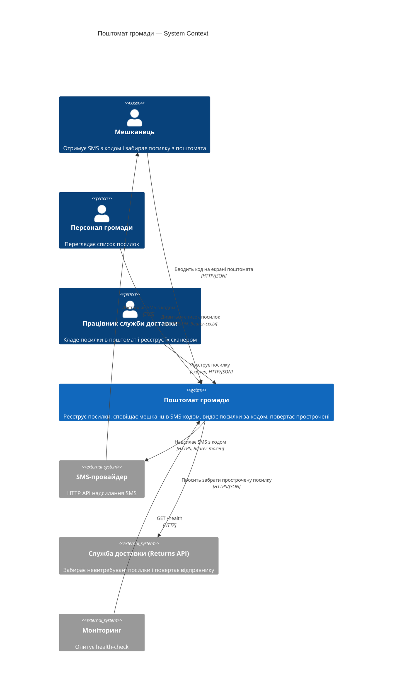
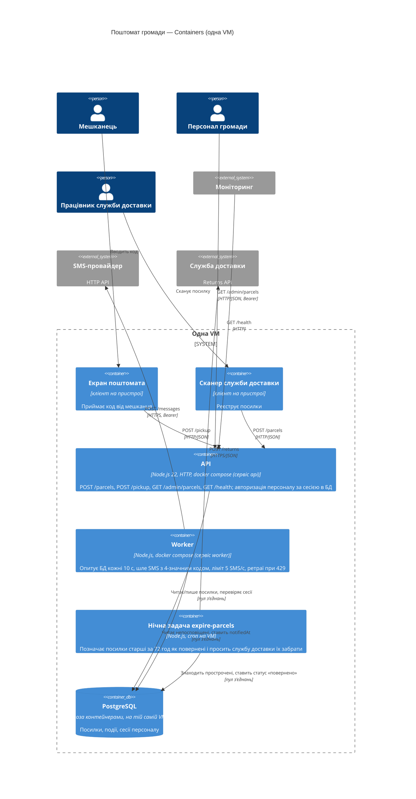

- Tool and model: Claude Code 2.1.301 (headless, `claude -p`), claude-sonnet-5-5 (the usage report also lists claude-haiku-5-5 with ~1.2k input tokens: Claude Code's background model for auxiliary calls); run with `--restricted` (user, project and local settings ignored, so no plugins or hooks; no shell tool; file tools confined to the working folder), `--strict-mcp-config` (no MCP servers), `--disable-slash-commands` (no skills), `--no-session-persistence`, auto-memory disabled; no global CLAUDE.md exists
- Date: 2026-10-30
- What the session saw: temporary folder ../ws11-b-code containing a copy of the whole `app/`
- Prompt (verbatim):

  > Намалюй архітектуру цієї системи як C4-діаграми в Mermaid:
  > рівень System Context і рівень Container.
  > Відповідь дай повністю в чаті; файлів не створюй і уточнювальних питань не став —
  > припущення називай явно.

---

Я прочитав код і `docs/ARCHITECTURE.md`. Діаграми побудовані за кодом, а не лише за документом, бо вони розходяться (деталі нижче).

## Рівень 1: System Context

## Рівень 2: Container

## Припущення

1. **«Ця система»** — це сервіс у `app/` (проєкт «Поштомат громади»). Інших систем у директорії немає.
2. **Екран поштомата і сканер** — окремі клієнти, їхнього коду в репозиторії немає. Я намалював їх як контейнери-клієнти за описом у `ARCHITECTURE.md`. Де вони працюють фізично (на поштоматі чи на пристрої кур'єра), невідомо.
3. **PostgreSQL.** У репозиторії є лише in-memory реалізація `src/db.js`. За README у продакшні той самий інтерфейс працює поверх PostgreSQL, тож на діаграмі він є.
4. **Моніторинг** — зовнішня система, яка опитує `GET /health`. Що саме це за система, у коді не сказано.
5. **Нічна задача** запускається cron-ом на VM. Це видно з коментаря в `bin/expire-parcels.js`, а не з `deploy/`, якого в наданій директорії немає.

## Розбіжності між документацією і кодом

- **Інтервал worker-а.** У `ARCHITECTURE.md` написано «кожні 30 секунд». У `src/worker.js` `POLL_INTERVAL_MS = 10_000`, тобто 10 с. На діаграмі стоїть 10 с.
- **Служба доставки як приймач.** Документ згадує службу доставки лише як джерело (сканер). Але `src/courier.js` і нічна задача викликають її Returns API (`POST /returns`). Тому на діаграмах вона є і джерелом, і зовнішньою системою, до якої йдуть виклики.
- **Версія.** Документ каже v1.5, а `package.json` — 1.7.3. `ARCHITECTURE.md` варто оновити.
