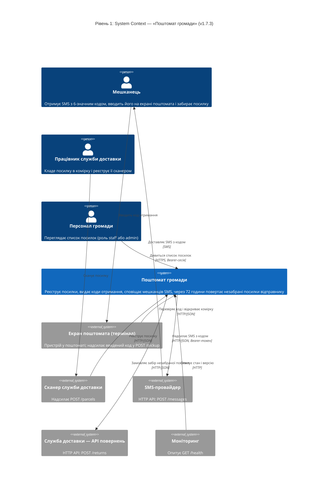
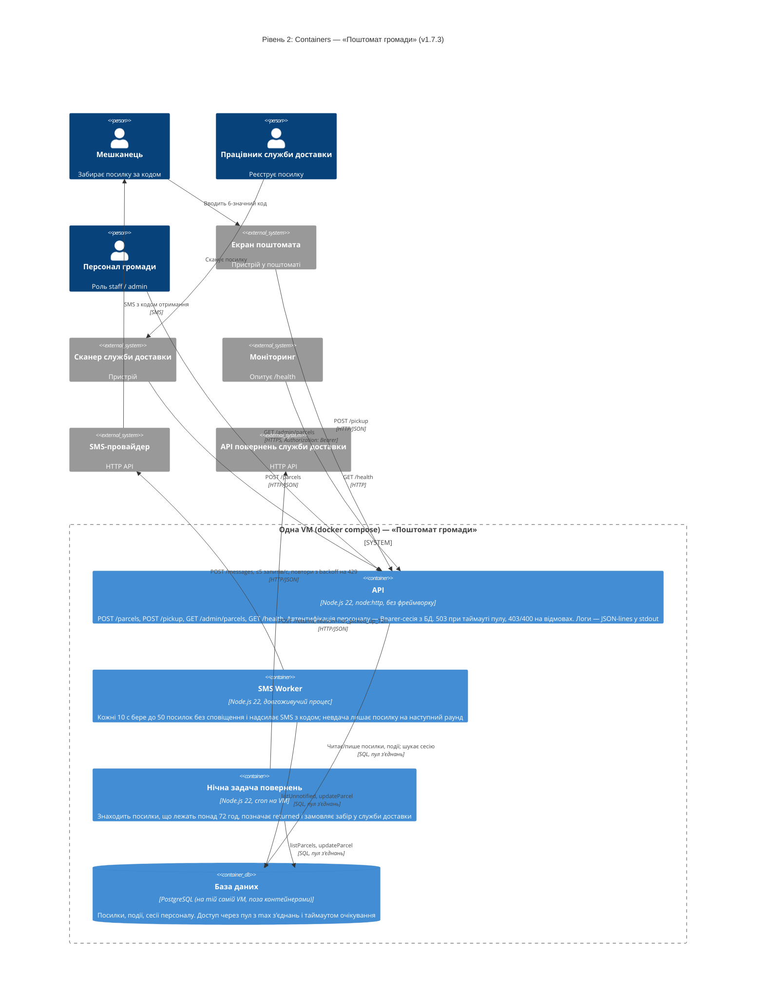

# Прогін 2 — C4 з коду

- Інструмент і модель: Claude Code (CLI, `claude -p`), Claude Opus 5 — окрема нова сесія
  без історії, прогону 1 не бачила
- Дата: 2026-11-01
- Що бачила сесія: тимчасова тека `../ws11-b-code/` — уся `app/` (`src/`, `bin/`, `test/`,
  `package.json`, `README.md`, `docs/ARCHITECTURE.md`). Створена командою з
  `docs/walkthrough.md`: `mkdir -p ../ws11-b-code && cp -r app ../ws11-b-code/`.
  Кореневих `materials/`, `docs/`, `deploy/`, `incident/` у ній немає — тому
  `deploy/compose.yaml` і `deploy/Dockerfile` сесія не бачила (вона це помітила сама,
  припущення 7).
- Чесно про контекст: прогін виконано як окремий процес `claude -p` із робочою текою
  `../ws11-b-code` — поза репозиторієм, тому кореневих `AGENTS.md`/`CLAUDE.md` цього репо
  сесія не бачила взагалі. Пам'яті між сесіями і глобального `~/.claude/CLAUDE.md` немає.
  Інструменти — лише для читання (`Read, Grep, Glob, Bash(ls|find|wc)`).
- Параметри запуску: `--model claude-opus-5 --output-format json`; 15 ходів, 96.9 с,
  $0.587, 6413 токенів виводу, session `08bcf058-5508-46aa-ac0a-0f3d21cb89d9`.
- Промпт (дослівно) — той самий, що в прогоні 1:

  > Намалюй архітектуру цієї системи як C4-діаграми в Mermaid:
  > рівень System Context і рівень Container.
  > Відповідь дай повністю в чаті; файлів не створюй і уточнювальних питань не став —
  > припущення називай явно.

---

Прочитала весь код у `app/`. Нижче — дві діаграми; побудовані **з коду**, а не з `docs/ARCHITECTURE.md`, бо документація місцями розійшлася з реальністю (розбіжності — в кінці).

## Рівень 1 — System Context

## Рівень 2 — Container

## Явні припущення

1. **Екран поштомата і сканер — зовнішні системи, не контейнери.** У репозиторії немає їхнього коду, лише HTTP-ендпоїнти, які вони викликають. Якщо прошивка терміналу розробляється в цій же команді, її варто перенести всередину межі системи.
2. **PostgreSQL** взято з `docs/ARCHITECTURE.md` і `DATABASE_URL`. У самому коді (`src/db.js`) сховище — **in-memory**, з тим самим інтерфейсом; README прямо каже, що в продакшні це Postgres. Тобто діаграма описує продакшн, а не те, що запускається з репозиторію.
3. **HTTPS / TLS-термінація** для персоналу позначена умовно. Код слухає звичайний HTTP на порту 8080; реверс-проксі в репозиторії немає. Якщо перед API є nginx/Caddy — це окремий контейнер, якого тут бракує.
4. **Моніторинг** як зовнішній актор — із документації; у коді є лише сам `GET /health`.
5. **Логи** пишуться JSON-рядками в stdout (`src/log.js`), жодного збирача логів у коді немає, тому я його не малювала. Фактично його роль виконує `docker logs` / драйвер логів.
6. **Автентифікація персоналу**: сесії читаються з БД (`findSession`), але **ендпоїнта логіну в коді немає** — сесії створює лише `db.addSession`. Припускаю, що вони заводяться поза цим сервісом (або ще не реалізовані).
7. **`deploy/` з docker compose** згадано в документації, але в наданих файлах є тільки каталог `app/` — схему розгортання (дві реплікації з одного образу, одна VM) взято з документації на віру.
8. **Cron** для нічної задачі — із комментаря в `bin/expire-parcels.js`; самого crontab у репозиторії не видно.

## Розбіжності документації з кодом (варто виправити в `ARCHITECTURE.md`)

| Документація (v1.5) | Код (v1.7.3) |
|---|---|
| Worker опитує кожні **30 с** | `POLL_INTERVAL_MS = 10_000` — **10 с**, пачками по 50; за повної пачки йде наступний раунд без паузи |
| Код отримання **4-значний** | **6-значний** (`padStart(6, "0")`, перевірка `/^\d{6}$/`) |
| Нічна задача лише «позначає посилки поверненими» | Ще й **викликає зовнішній API служби доставки** (`POST /returns`) — цілої зовнішньої системи та `COURIER_BASE_URL` у документації немає |
| `_Оновлено: червень 2026 (v1.5)_` | `package.json` — **1.7.3** |

Окремо зауважу (поза межами C4, але видно з коду): у `expire-parcels.js` посилка спершу позначається `returned`, і лише потім викликається API курьєра — якщо той запит упаде, посилка вже вважається повернутою, а забір не замовлено, і наступний запуск її не підхопить, бо `findExpired` фільтрує тільки `status === "waiting"`.