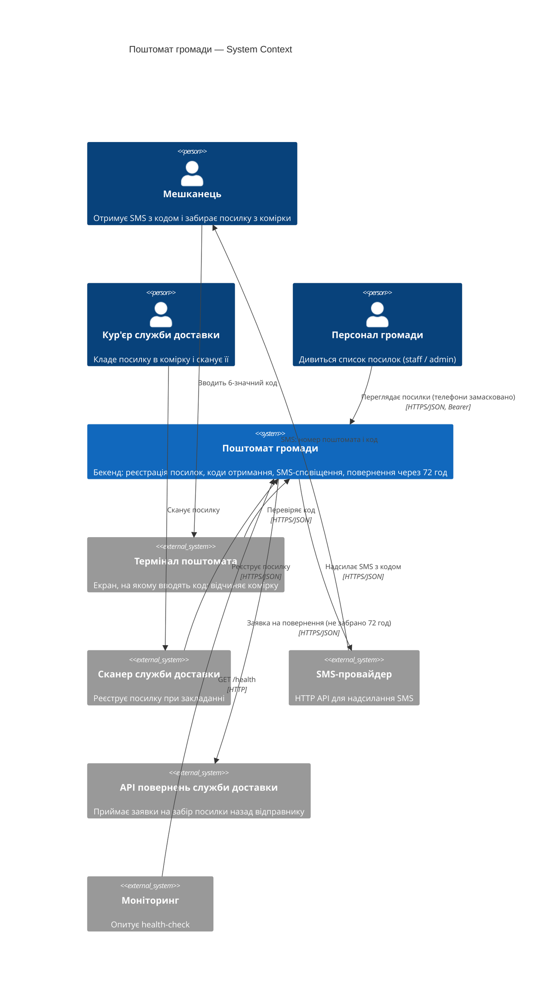
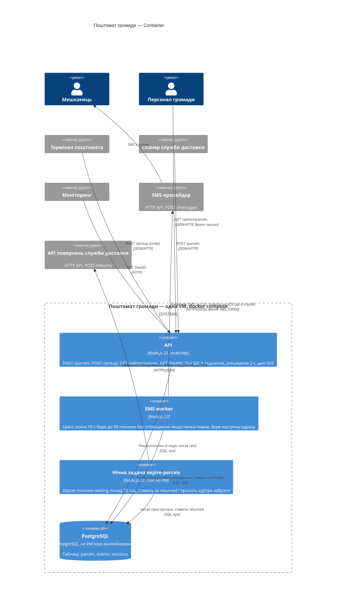

- Інструмент і модель: Claude Code 2.1.317 (`claude -p`, неінтерактивна сесія), Claude Opus 5.5 (`claude-opus-5-5`)
- Дата: 2026-11-04
- Що бачила сесія: тимчасова тека `../ws11-b-code/` з копією всієї `app/`. Нова сесія без історії; глобального `~/.claude/CLAUDE.md` немає, пам'ять для нової теки порожня. Дозволено лише читання (Read/Grep/Glob, ls/cat/grep/find); файлів сесія не створювала.
- Промпт (дослівно):

  > Намалюй архітектуру цієї системи як C4-діаграми в Mermaid:
  > рівень System Context і рівень Container.
  > Відповідь дай повністю в чаті; файлів не створюй і уточнювальних питань не став —
  > припущення називай явно.

---

Нижче дві C4-діаграми в Mermaid. Вони зібрані з коду в `app/` (версія 1.7.3). `docs/ARCHITECTURE.md` датований v1.5 і в кількох місцях уже не збігається з кодом. Де вони розходяться, я брав код; розбіжності перелічені наприкінці.

## Рівень 1 — System Context

## Рівень 2 — Container

## Припущення

1. **Термінал і сканер — зовнішні системи.** Їхнього коду в репозиторії немає, є тільки виклики `POST /pickup` і `POST /parcels`. Тому на діаграмах вони лежать за межами системи.
2. **Хто реєструє посилки і хто їх забирає назад — одна служба доставки.** Сканер (`POST /parcels`) і API повернень (`src/courier.js`) я віднес до однієї організації. У коді це прямо не сказано.
3. **Клієнта для персоналу немає.** Показано тільки виклик `GET /admin/parcels` з `Bearer`-сесією, яку API перевіряє в таблиці sessions. Ендпоінту логіну немає, тож хто і як створює сесії, невідомо.
4**Логів на діаграмах немає.** Усі процеси пишуть JSON-рядки в stdout. Куди логи потрапляють далі, невідомо.

## Де `docs/ARCHITECTURE.md` (v1.5) розходиться з кодом (1.7.3)

| Документ | Код |
|---|---|
| Worker опитує кожні 30 с | `POLL_INTERVAL_MS = 10_000`; якщо пачка з 50 повна, наступна береться одразу |
| Код отримання 4-значний | 6-значний (`parcels.js`, `/^\d{6}$/`) |
| Нічна задача тільки позначає посилки поверненими | Вона ще й викликає API повернень служби доставки (`POST /returns`) — у документі такої зовнішньої системи немає |
| Обмеження SMS не описані | До 5 SMS/с (`SMS_RATE_PER_SEC`), експоненційні повтори на 429 |

## Що варто перевірити

Це помітив, поки читав `bin/expire-parcels.js` і `src/courier.js`:

- **Посилка може «повернутися» без заявки кур'єру.** Нічна задача спершу ставить посилці `returned`, а вже потім викликає кур'єра. Якщо API кур'єра відповість помилкою, посилка лишиться позначеною як повернена, а заявку не буде створено. Решта посилок у тому прогоні теж не обробиться: помилку ніде не перехоплюють.
- **Запит до API кур'єра без автентифікації.** Він іде без жодного токена, і в конфігурації його теж немає.
