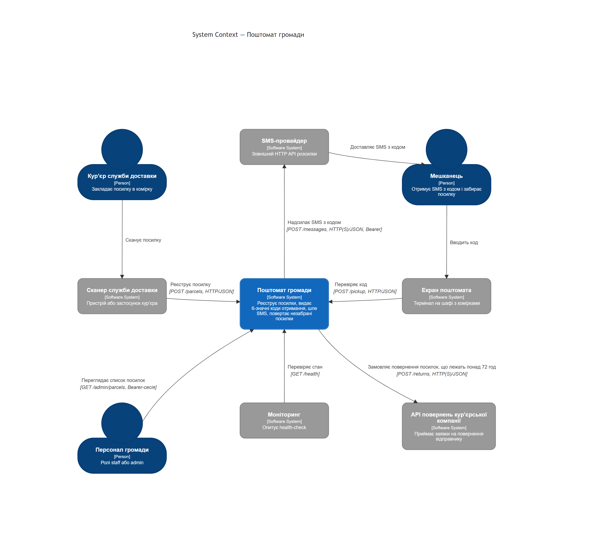
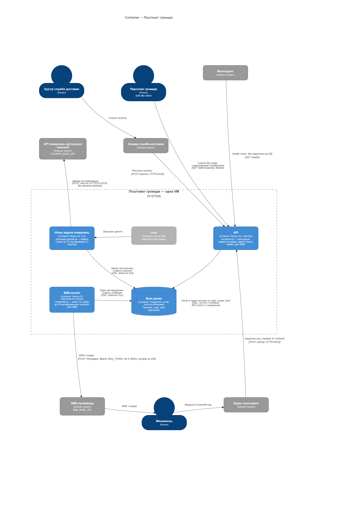
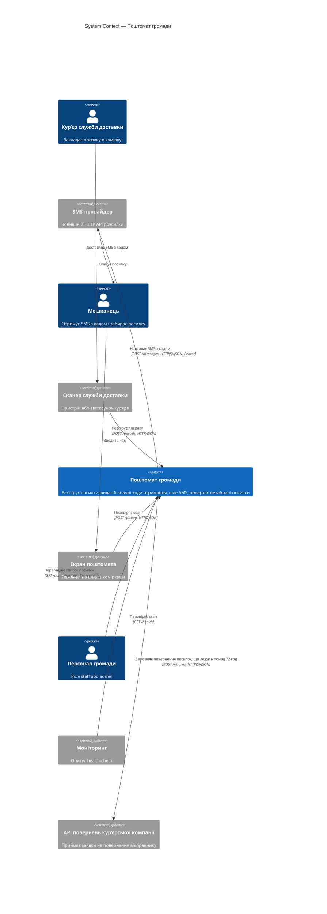

- Інструмент і модель: Claude Code, Claude Opus 5.5 (`claude-opus-5-5`)
- Дата: 2026-11-01
- Що бачила сесія: тека `ws11-b-code/`, у ній повна тека `app/` (`src/`, `bin/`, `test/`, `docs/ARCHITECTURE.md`, `README.md`, `package.json`); поза `ws11-b-code/` під час відповіді нічого не читалося.
- Промпт (дослівно):

  > Намалюй архітектуру цієї системи як C4-діаграми в Mermaid:
  > рівень System Context і рівень Container.
  > Відповідь дай повністю в чаті; файлів не створюй і уточнювальних питань не став —
  > припущення називай явно.
- Рендер діаграм: зробив той самий AI пізніше в цій сесії на прохання учасника (mermaid-cli 11,
  Mermaid 11). Обидві діаграми з відповіді рендеряться без помилок.

  

  

---

C4 для `poshtomat` v1.7.3, зібране з коду `app/`. Де документація розходиться з кодом, діаграми йдуть за кодом.

## Рівень 1 — System Context

## Рівень 2 — Container

```mermaid
---
config:
  c4:
    c4ShapeMargin: 90
---
C4Container
  title Container — Поштомат громади

  Person(courierStaff, "Кур’єр служби доставки")
  Person(staff, "Персонал громади", "staff або admin")
  System_Ext(monitoring, "Моніторинг")
  System_Ext(courierApi, "API повернень кур’єрської компанії", "COURIER_BASE_URL")
  System_Ext(scanner, "Сканер служби доставки")

  System_Boundary(poshtomat, "Поштомат громади — одна VM") {
    Container(expire, "Нічна задача повернень", "Node.js 22, CLI", "bin/expire-parcels.js — waiting старші за 72 год переводить у returned")
    Container_Ext(cron, "cron", "cron на VM", "Запускає нічну задачу")
    Container(api, "API", "Node.js 22, node:http", "src/server.js — реєстрація, видача за кодом, адмін-список, health; порт 8080")
    Container(worker, "SMS-worker", "Node.js 22, довгоживучий процес", "src/worker.js — кожні 10 с бере до 50 неповідомлених посилок і шле SMS")
    ContainerDb(db, "База даних", "PostgreSQL на VM, поза контейнерами", "Посилки, події, сесії персоналу")
  }

  Boundary(below, "", "") {
    Boundary(belowRow, "", "") {
      System_Ext(sms, "SMS-провайдер", "SMS_BASE_URL")
      Person(resident, "Мешканець")
      System_Ext(terminal, "Екран поштомата")
    }
  }
  UpdateElementStyle(below, $borderColor="none", $fontColor="none")
  UpdateElementStyle(belowRow, $borderColor="none", $fontColor="none")

  Rel(scanner, api, "Реєструє посилку", "POST /parcels, HTTP/JSON")
  Rel(courierStaff, scanner, "Сканує посилку")
  Rel(resident, terminal, "Вводить 6-значний код")
  Rel(terminal, api, "Надсилає код, отримує id і lockerId", "POST /pickup, HTTP/JSON")
  Rel(staff, api, "Список без кодів,<br/>з маскованими телефонами", "GET /admin/parcels, Bearer")
  Rel(monitoring, api, "Health-check, без звернення до БД", "GET /health")

  Rel(api, db, "Читає й пише посилки та події, шукає сесії", "SQL, пул до 4 з’єднань,<br/>503 після 2 с очікування")
  Rel(worker, db, "Бере неповідомлені,<br/>ставить notifiedAt", "SQL, власний пул")
  Rel(worker, sms, "SMS з кодом", "POST /messages, Bearer SMS_TOKEN, до 5 SMS/с, ретраї на 429")
  Rel(sms, resident, "SMS з кодом")
  Rel(cron, expire, "Запускає щоночі")
  Rel(expire, db, "Шукає прострочені,<br/>ставить returned", "SQL, власний пул")
  Rel(expire, courierApi, "Заявка на повернення", "POST /returns, HTTP(S)/JSON,<br/>без автентифікації")

  UpdateRelStyle(scanner, api, $offsetX="-275", $offsetY="-95")
  UpdateRelStyle(expire, courierApi, $offsetX="24", $offsetY="-60")
  UpdateRelStyle(monitoring, api, $offsetX="8")
  UpdateRelStyle(worker, sms, $offsetX="8")
  UpdateRelStyle(cron, expire, $offsetX="-48", $offsetY="-28")
  UpdateRelStyle(worker, db, $offsetX="-62", $offsetY="-45")
  UpdateRelStyle(resident, terminal, $offsetX="-66", $offsetY="-28")
  UpdateRelStyle(sms, resident, $offsetX="-40", $offsetY="-24")
  UpdateRelStyle(api, db, $offsetX="-75", $offsetY="150")
  UpdateRelStyle(terminal, api, $offsetX="16", $offsetY="70")

  UpdateLayoutConfig($c4ShapeInRow="3", $c4BoundaryInRow="1")
```

**Головне:** API, worker і нічна задача напряму не спілкуються — їх пов'язує лише БД; кожен процес має власний пул з'єднань.

## Припущення

Чого не видно в коді і як я це трактував:

- **PostgreSQL** — у коді лише сховище в пам'яті (`src/db.js`), драйвера немає; продакшн-БД взято з `README.md` і `docs/ARCHITECTURE.md`.
- **Розгортання** (одна VM, `docker compose` з `api` і `worker`) — лише з `docs/ARCHITECTURE.md`; теки `deploy/` у репозиторії немає.
- **cron** — лише коментар у `bin/expire-parcels.js`; як і коли запускається задача, невідомо.
- **Сканер, екран поштомата, моніторинг** — зовнішні системи, їхнього коду тут немає. Комірку, ймовірно, відкриває термінал: API повертає лише `{id, lockerId}`.
- **Служба доставки і кур'єрська компанія** — імовірно одна організація, але це дві різні інтеграції (вхідна й вихідна), тому на діаграмах окремо.
- **Сесії персоналу** — API лише перевіряє Bearer-токен у таблиці сесій; ендпоінта входу немає, хто видає сесії — невідомо.
- **Транспорт** — API слухає звичайний HTTP на порту 8080; TLS, якщо є, — зовні. Адреси зовнішніх API задаються змінними оточення, тому «HTTP(S)».
- **`POST /parcels` і `POST /pickup` без автентифікації** — припускаю, що їх захищає мережа.
- **Логи** — JSON у stdout; куди далі, невідомо, тому на діаграмах їх немає.

## Документація vs код

`docs/ARCHITECTURE.md` (v1.5) відстає від коду (v1.7.3):

| | Документація | Код |
|---|---|---|
| Інтервал worker | 30 с | 10 с; якщо пачка з 50 повна — наступна одразу |
| Код отримання | 4 цифри | 6 цифр |
| Нічна задача | лише позначає посилки поверненими | ще й надсилає `POST /returns` у кур'єрську компанію |

## Помічений баг

`bin/expire-parcels.js` ставить `returned` **до** виклику API кур'єра. Якщо виклик падає, посилка вже не `waiting`, і заявку на повернення ніхто не повторить.
