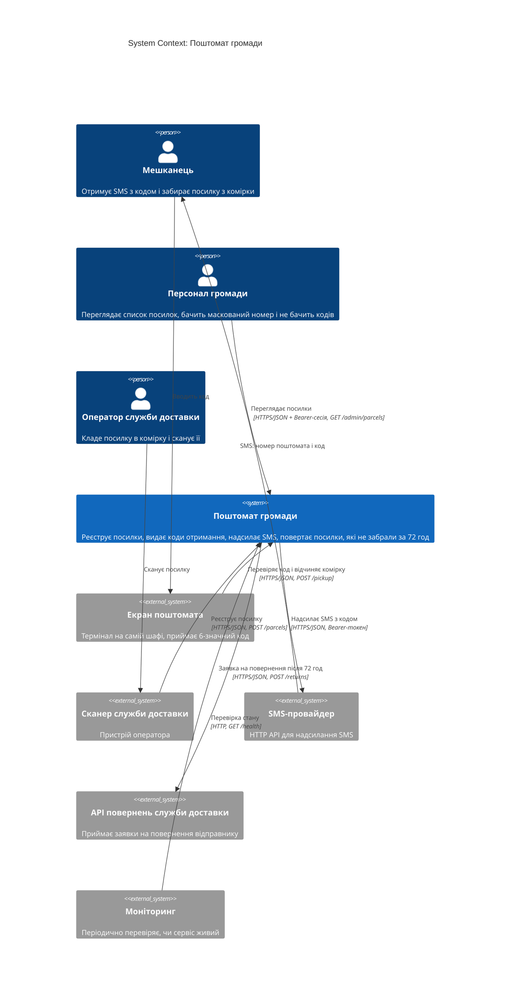
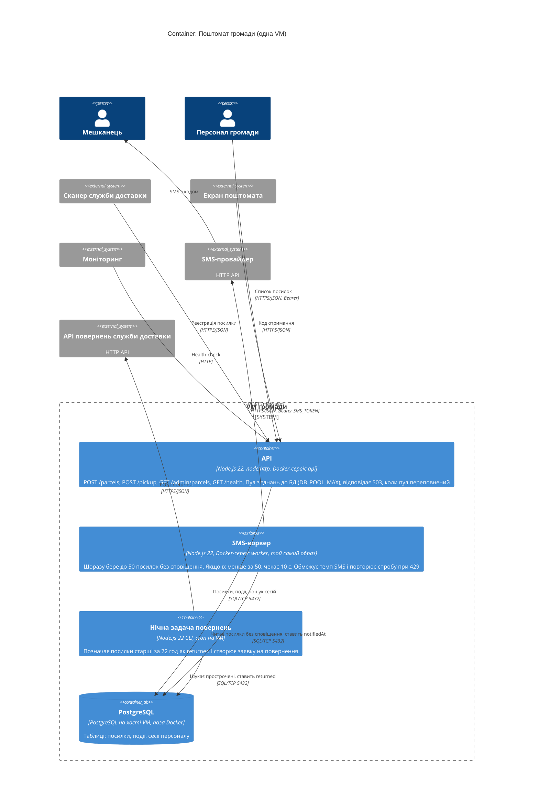

- Інструмент і модель: Claude Code 2.1.291 (CLI, `claude -p`, неінтерактивно), модель claude-opus-5-5
- Дата: 2026-11-03
- Що бачила сесія: тимчасова тека `../ws11-b-code/`: уся `app/`. Окрема нова сесія, запущена в цій теці; `--setting-sources project,local` — користувацькі налаштування й `~/.claude/CLAUDE.md` не підвантажувались; пам'ять між сесіями для цієї теки порожня (новий шлях проєкту). Дозволені інструменти: Read, Glob, Grep, Bash. Нижче — фінальна відповідь агента (журнал викликів інструментів не зберігався). Застереження: у батьківській теці `Documents/Git/` лежить чужий `AGENTS.md` (про інший проєкт) — Claude Code міг підвантажити його як контекст; паралельна сесія Task D прямо згадала його у відповіді як нерелевантний.
- Промпт (дослівно):

  > Намалюй архітектуру цієї системи як C4-діаграми в Mermaid:
  > рівень System Context і рівень Container.
  > Відповідь дай повністю в чаті; файлів не створюй і уточнювальних питань не став —
  > припущення називай явно.

---

Нижче дві C4-діаграми для «Поштомата громади» (`app/`, v1.7.3). Я будував їх за кодом у `src/` і `bin/`, бо `docs/ARCHITECTURE.md` застарів (див. розбіжності наприкінці).

## Рівень 1: System Context

## Рівень 2: Container

## Припущення

1. **Межа системи.** Система — це бекенд з цього репозиторію. Екран поштомата і сканер я вважаю зовнішніми системами, бо їхнього коду тут немає.
2. **Служба доставки.** Я вважаю, що сканер і API повернень (`COURIER_BASE_URL`) належать одній службі доставки. На діаграмі вони окремі, бо це різні точки інтеграції.
3. **Як персонал заходить в адмінку.** У коді є лише `GET /admin/parcels` з Bearer-сесією, без жодного UI. Тому на діаграмі персонал звертається до API напряму, через невідомий клієнт.
4. **HTTPS.** Сервер слухає звичайний HTTP на порту 8080. Я вважаю, що TLS додає reverse proxy або балансувальник перед VM. Його немає ні в коді, ні в документації, тому на діаграмі його теж немає.
5. **Сховище.** У репозиторії воно лежить у пам'яті (`src/db.js`). На діаграмі PostgreSQL, бо README і ARCHITECTURE.md кажуть, що в продакшні той самий інтерфейс працює поверх PostgreSQL.
6. **Розгортання.** Те, що є одна VM з `docker compose` і сервісами `api` і `worker`, а PostgreSQL стоїть поза контейнерами, я взяв з ARCHITECTURE.md. Каталогу `deploy/` у робочій директорії немає, тож перевірити це я не зміг. Що нічну задачу запускає cron на VM, сказано в коментарі в `bin/expire-parcels.js`.
7. **Логи.** Логи пишуться в stdout у форматі JSON-lines. Куди вони йдуть далі, невідомо, тому окремої системи для них на діаграмі немає.

## Де `docs/ARCHITECTURE.md` (v1.5) розходиться з кодом (v1.7.3)

- **Інтервал воркера.** У документі 30 с. У коді `POLL_INTERVAL_MS = 10_000`, і якщо батч повний, наступний раунд починається одразу.
- **Довжина коду.** У документі 4 цифри, у коді 6 (`/^\d{6}$/`).
- **API повернень.** Нічна задача звертається до API повернень служби доставки, а в документі цієї інтеграції взагалі немає.
- **Обмеження SMS.** У документі не описано, що воркер обмежує темп SMS (`SMS_RATE_PER_SEC`) і повторює спробу з затримкою при 429.

Ще одна розбіжність: `AGENTS.md` пише про `src/money.ts`, але такого файлу в робочій директорії немає. Схоже, ця інструкція стосується іншого проєкту, тому на діаграмах я її не враховував.
