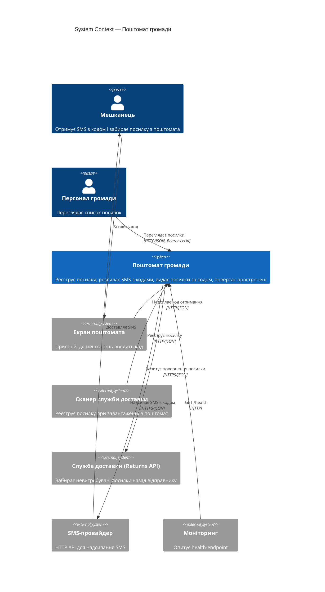
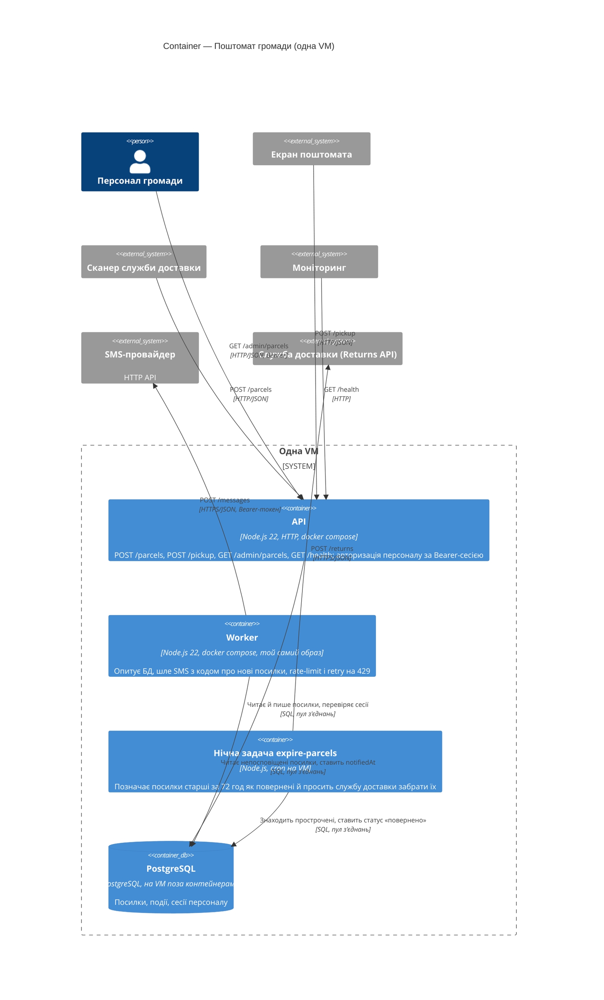

- Інструмент і модель: Claude Code 2.1.316 (headless `claude -p --model sonnet`), claude-sonnet-5-5
- Дата: 2026-11-02
- Що бачила сесія: тимчасова тека `../ws11-b-code/`: уся копія `app/`. Нова сесія (окремий процес), без історії; інструменти лише на читання (`Read, Glob, Grep, Bash`). Глобального `~/.claude/CLAUDE.md` немає; пам'ять Claude Code прив'язана до теки проєкту, для тимчасової теки вона порожня
- Вартість прогону: 11 ходів, 10 викликів інструментів (Glob × 1, Read × 9), $0.117, 25 с
- Промпт (дослівно):

  > Намалюй архітектуру цієї системи як C4-діаграми в Mermaid:
  > рівень System Context і рівень Container.
  > Відповідь дай повністю в чаті; файлів не створюй і уточнювальних питань не став —
  > припущення називай явно.

---
Нижче — дві C4-діаграми (System Context і Container) за кодом у `app/`.

## Припущення

- **Межа системи** — сервіс «Поштомат громади» (`poshtomat`). Екран поштомата, сканер служби доставки й адмін-інтерфейс персоналу вважаю зовнішніми клієнтами API. У репозиторії їхнього коду немає.
- **Нічна задача** (`bin/expire-parcels.js`) окремо від `api` і `worker`. Це cron на VM, а не сервіс у `docker compose`.
- **Служба доставки** виступає у двох ролях. Її сканер реєструє посилки через `POST /parcels`. Її Returns API приймає запити на повернення (`courier.js`). У `ARCHITECTURE.md` другу роль не названо, але код її має.
- **Моніторинг** опитує `GET /health`. Що саме це за система, невідомо, тому показую її як зовнішню.
- **PostgreSQL** розташований на тій самій VM поза контейнерами. Так сказано в документації. У цьому репозиторії замість нього in-memory `db.js` з тим самим інтерфейсом.
- **Шлях `deploy/`** згаданий у документації, але в робочій директорії його немає, тому деталей розгортання не малюю.

## Рівень 1 — System Context

## Рівень 2 — Container

## Розбіжності між документацією і кодом

- **Інтервал worker.** У `ARCHITECTURE.md` написано «кожні 30 секунд», а в `worker.js:8` `POLL_INTERVAL_MS = 10_000`, тобто 10 секунд. Якщо повний батч (50), worker іде на наступний раунд одразу. На діаграмах інтервал не вказую.
- **Виклик Returns API.** Документація його не згадує, але нічна задача його робить (`expire-parcels.js:15`). Тому на діаграмі є зовнішня система «Служба доставки (Returns API)».
- **Версія.** `ARCHITECTURE.md` каже v1.5, а `package.json` — 1.7.3. Схоже, документація не оновлювалась.
