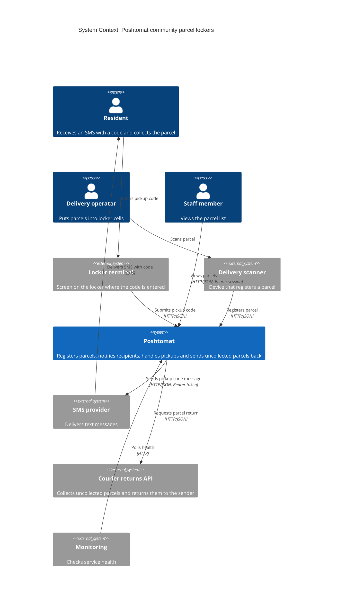
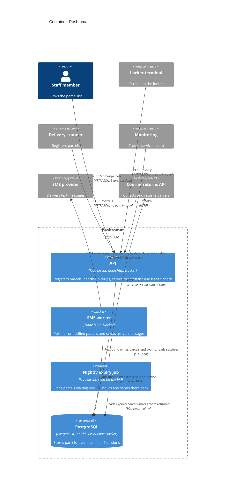

- Інструмент і модель: Claude Code, Claude Opus 5.5
- Дата: 2026-11-04
- Що бачила сесія: тимчасова тека `ws11-b-code` з копією `app/`
- Промпт (дослівно):

  > Намалюй архітектуру цієї системи як C4-діаграми в Mermaid:
  >    рівень System Context і рівень Container.
  >    Відповідь дай повністю в чаті; файлів не створюй і уточнювальних питань не став —
  >    припущення називай явно.

---

# Poshtomat: C4 diagrams

I built these from the code in `app/`, and where the docs disagreed, I followed the code. The exception is deployment and PostgreSQL, which only the docs describe. I couldn't test-render the diagrams because no Mermaid renderer is installed here, and Mermaid's C4 support is still experimental, so the layout may need adjusting.

## Level 1: System Context

## Level 2: Container

## Assumptions
1. **PostgreSQL is what runs in production:** this repo only has an in-memory store (`src/db.js`). It has no PostgreSQL driver, and `dbUrl` is loaded but never used. Run from this repo, the API, worker and job each get their own separate data.
2. **Deployment details are unverified:** one VM, `docker compose` and PostgreSQL outside the containers all come from `ARCHITECTURE.md`. The `deploy/` directory it points to isn't in this copy.
3. **The nightly job runs from cron on the VM:** a comment in `bin/expire-parcels.js` says so. I'm treating it as its own container, but whether it runs inside the Docker image is unknown.
4. **The locker terminal and scanner are external:** their code isn't in this repo, and only the API they call is. If your team owns the terminal software, it should move inside the system boundary.
5. **The delivery operator and courier API are separate:** they may be the same company, but the code doesn't say.
6. **Staff call the API directly:** the repo has no admin UI, so any client they use isn't shown.
7. **Traffic is plain HTTP:** the server has no TLS, and any reverse proxy would be defined outside this repo, so none is shown.
8. **Logs aren't shown:** services write JSON lines to stdout, and the repo doesn't show a log collector.

## Where the docs and code disagree
`ARCHITECTURE.md` says it describes v1.5, while `package.json` is at 1.7.3.

| Topic | `ARCHITECTURE.md` | Code (used in the diagrams) |
|---|---|---|
| Worker polling | Every 30 seconds | Every 10 seconds, and immediately after a full batch of 50 |
| Pickup code | 4 digits | 6 digits |
| Nightly job | Marks parcels as returned | Also calls the courier API, an external system missing from the docs |

## Gaps worth checking
- **No auth on device endpoints:** `POST /parcels` and `POST /pickup` have no authentication in the code. Unless something outside this repo restricts them, anyone who can reach the API can call them.
- **Staff session origin:** nothing in the app creates sessions, and there's no login endpoint; only the tests add them. Whatever issues them is missing from both diagrams.
