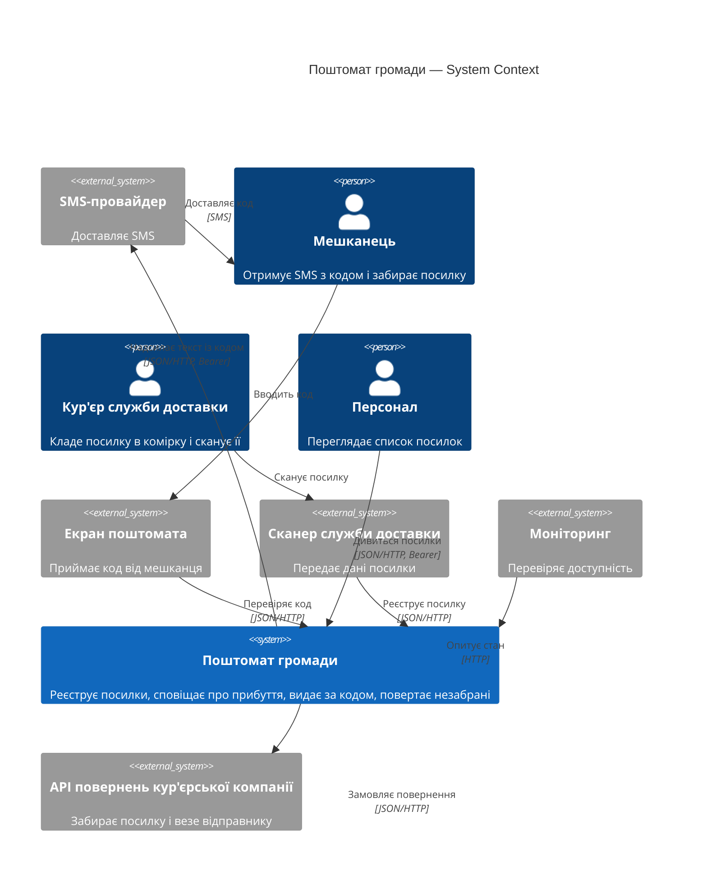
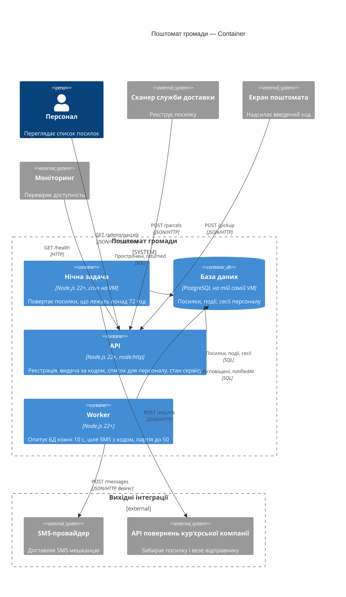

- Інструмент і модель: Claude Code, Claude Opus 5.5
- Дата: 2026-11-03
- Що бачила сесія: тимчасова тека ../ws11-b-code, у ній уся app/
- Промпт (дослівно):

  > Намалюй архітектуру цієї системи як C4-діаграми в Mermaid:
  > рівень System Context і рівень Container.
  > Відповідь дай повністю в чаті; файлів не створюй і уточнювальних питань не став —
  > припущення називай явно.

---

Нижче обидві діаграми для системи «Поштомат громади» (`poshtomat` 1.7.3). Я зібрав їх із коду в `app/`, а `docs/ARCHITECTURE.md` застарів (v1.5), тому там, де вони розходяться, спирався на код. Обидві рендеряться без помилок у mermaid-cli. Єдина відома вада — лінія `POST /returns` зачіпає кут блока Worker. C4 у Mermaid експериментальний, тому в іншій версії компонування може трохи зсунутися.

## Рівень 1: System Context

## Рівень 2: Container

## Припущення

1. **PostgreSQL і SQL:** у цій копії коду PostgreSQL немає. [db.js](app/src/db.js) зберігає дані в пам'яті, а `dbUrl` із конфігурації ніде не використовується. Базу я намалював за README та ARCHITECTURE.md.
2. **VM і cron:** теки `deploy/`, на яку посилається документація, тут немає, тому розгортання на одній VM я не перевіряв. Коментар у [expire-parcels.js](app/bin/expire-parcels.js) каже лише про cron на VM, а як саме він запускає задачу, невідомо. Тому задача показана окремим контейнером.
3. **Екран поштомата і сканер:** вони зовнішні, бо їхнього коду тут немає. Якщо це ваша розробка, перенесіть їх у межі системи.
4. **Кур'єр і кур'єрська компанія:** роль кур'єра зі сканером я вивів сам: у коді є лише сканер оператора доставки. Служба доставки та кур'єрська компанія можуть бути однією організацією; API повернень показаний окремо, бо це інша інтеграція.
5. **Персонал:** він звертається до API напряму, бо адмінінтерфейсу в репозиторії немає.
6. **Моніторинг:** конкретний продукт невідомий. У коді є лише `GET /health`, а про опитування моніторингом сказано в документації.
7. **HTTP:** TLS або проксі перед API в коді не видно, тому підписано просто HTTP.

## Де код розходиться з документацією

| Що | ARCHITECTURE.md | Код |
|---|---|---|
| Інтервал Worker | 30 с | 10 с, а після повної партії з 50 SMS наступний прохід одразу ([worker.js](app/src/worker.js#L8-L9)) |
| Код отримання | 4 цифри | 6 цифр ([parcels.js](app/src/parcels.js#L27)) |
| Нічна задача | лише позначає посилки поверненими | ще й викликає `POST /returns` у кур'єрської компанії ([courier.js](app/src/courier.js)) |

## Чого в цьому коді немає

- **Автентифікація:** `POST /parcels` і `POST /pickup` її не мають, а клієнт API повернень не надсилає токена. Захист може бути на мережевому рівні, але тут його не видно.
- **Вхід персоналу:** ендпоінта входу немає. Сесії лише шукаються в базі, а хто їх створює, з коду незрозуміло.
- **Відкриття комірки:** `/pickup` повертає лише `id` і `lockerId`, тому на діаграмах цього кроку немає.

Для перевірки рендера я тимчасово поставив mermaid-cli у тимчасову теку сесії; у проєкті нічого не змінено.