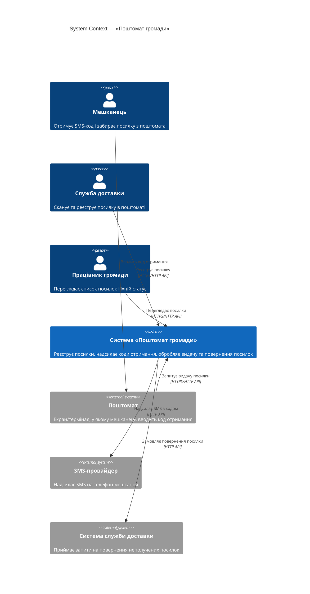
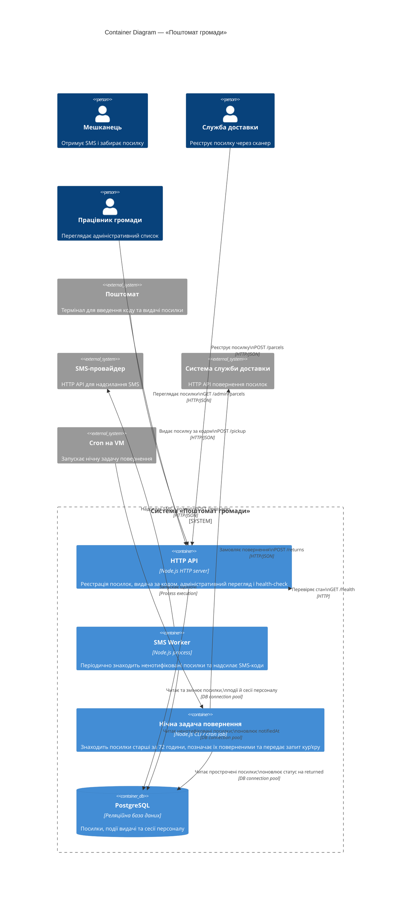
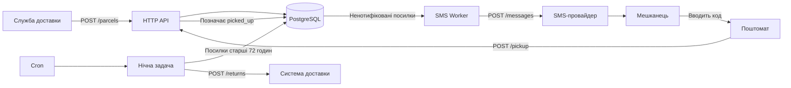

Нижче — C4-діаграми для системи «Поштомат громади».

Явні припущення:

- PostgreSQL показано як зовнішню інфраструктурну систему/сховище, хоча в документації зазначено, що в поточній реалізації використовується in-memory store.
- Екран поштомата взаємодіє з API через HTTP.
- Служба доставки має сканер, який викликає API для реєстрації посилки.
- Нічна задача запускається cron на VM і використовує той самий контейнер/код доступу до даних.
- SMS-провайдер і кур’єрська система є зовнішніми системами.

## C4 — System Context

## C4 — Container

### Основні потоки

