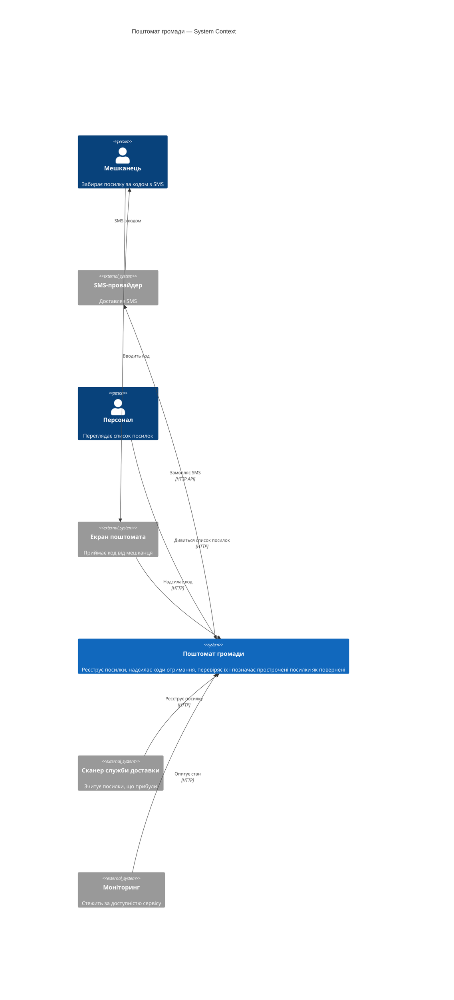
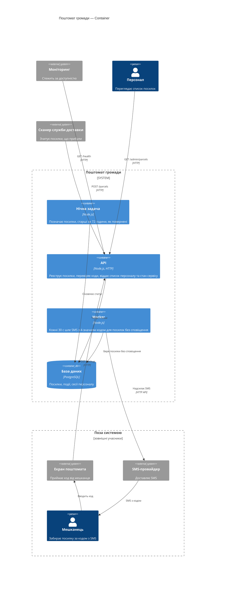

- Інструмент і модель: Claude Code, Claude Opus 5.5
- Дата: 2026-11-03
- Що бачила сесія: тимчасова тека ../ws11-b-docs, у ній лише app/README.md і app/docs/
- Промпт (дослівно):

  > Намалюй архітектуру цієї системи як C4-діаграми в Mermaid:
  > рівень System Context і рівень Container.
  > Відповідь дай повністю в чаті; файлів не створюй і уточнювальних питань не став —
  > припущення називай явно.

---

# Архітектура «Поштомата громади» у C4

**Джерело:** діаграми побудовані лише за [ARCHITECTURE.md](app/docs/ARCHITECTURE.md) (червень 2026, v1.5) і [README.md](app/README.md). Коду (`src/`, `bin/`, `deploy/`) у робочій директорії немає, тому звірити діаграми з реалізацією я не міг, а документ міг застаріти.

## Рівень 1: System Context

## Рівень 2: Container

## Припущення

1. **Екран поштомата є зовнішньою системою.** У розгортанні є лише `api` і `worker`, а окремого коду екрана документи не згадують. Якщо екран розробляє ця ж команда, його треба перенести всередину межі системи як контейнер.
2. **Службу доставки представляє її сканер.** Документи описують виклик API саме зі сканера, тому окремого кур'єра на діаграмах немає.
3. **Нічна задача є окремим контейнером і працює з базою напряму.** Для неї немає API-ендпоінта, а в `docker compose` лише два сервіси. Спосіб запуску в документах не описаний, тому планувальника на діаграмі немає.
4. **Нічна задача написана на Node.js.** Я виснував це з розширення файлу `expire-parcels.js`.
5. **Персонал звертається до API напряму.** Адмінський інтерфейс ніде не згаданий.
6. **Назви й описи зовнішніх учасників частково мої.** Наприклад, «Зчитує посилки, що прибули» для сканера прямо в документах не сказано.

## Що варто знати, читаючи діаграми

- **Контейнер у C4 не дорівнює Docker-контейнеру.** PostgreSQL працює поза Docker, але на діаграмі це контейнер C4. Одна VM і `docker compose` належать до рівня Deployment, тому тут їх немає.
- **Рамка «Поза системою» не є елементом C4.** Вона потрібна лише для розкладки, щоб ці блоки опинилися під системою.
- **Схема в `ARCHITECTURE.md` неповна.** На ній немає персоналу, моніторингу й нічної задачі, хоча в списку компонентів вони є. Я додав їх на діаграми.

## Прогалини в документації

- **Вхід персоналу:** у базі є таблиця сесій персоналу, але ендпоінта входу серед описаних немає.
- **Відкриття комірки:** не сказано, як після `POST /pickup` відкривається комірка, тому цього зв'язку на діаграмах немає.
- **Драйвер PostgreSQL:** README каже, що залежностей немає, а сховище в репозиторії працює в пам'яті. Де живе реалізація для PostgreSQL, з цих документів незрозуміло.

## Перевірка рендера

Обидві діаграми рендеряться в Mermaid 12.2.0 без помилок. Контейнерну я переглянув на екрані шириною 1366 px, контекстну на 1366 і 1920 px: стрілки не проходять крізь блоки.

Розкладка контейнерної діаграми спирається на особливість перенесення рядків у Mermaid. В іншій версії або на вужчому екрані блоки можуть розташуватися інакше, але зміст діаграми не зміниться.

Для перевірки я тимчасово створював файли у scratchpad, поза проєктом, і вже їх видалив. У проєкті нічого не змінилося.
