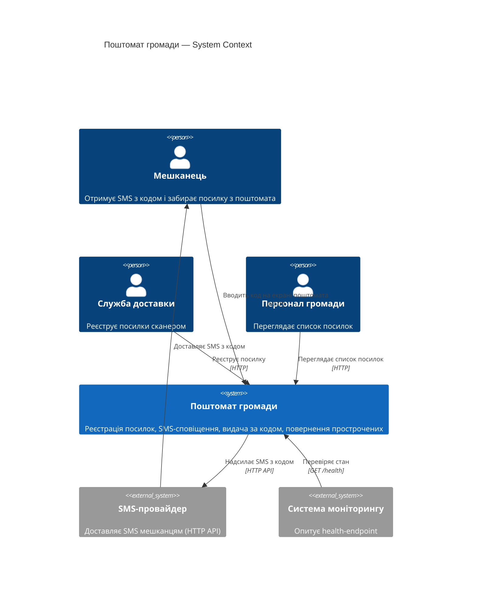
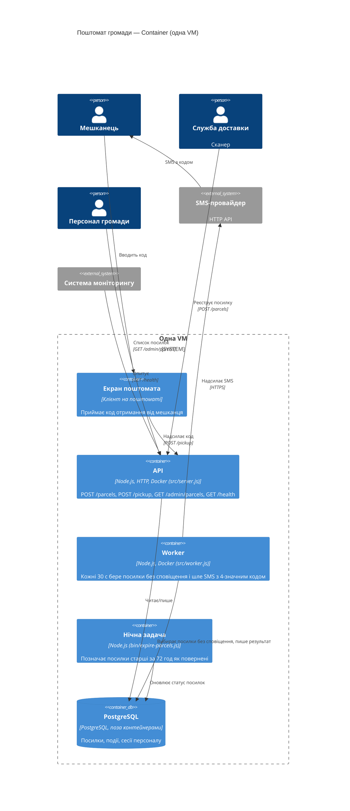

- Інструмент і модель: Claude Code (headless: `claude -p`), модель за замовчуванням, не закріплена
- Дата: 2026-11-03
- Що бачила сесія: тимчасова тека `ws11-b-docs` лише з `app/README.md` і `app/docs/`. Пам'ять вимкнено (`CLAUDE_CODE_DISABLE_AUTO_MEMORY=1`), нова сесія без історії (`--no-session-persistence`), інструменти лише Read/Grep/Glob. **Лишався ввімкненим глобальний `~/.claude/CLAUDE.md`** (лише правила щодо git-комітів); `--bare` не використано — немає ANTHROPIC_API_KEY.
- Промпт (дослівно):

  > Намалюй архітектуру цієї системи як C4-діаграми в Mermaid:
  > рівень System Context і рівень Container.
  > Відповідь дай повністю в чаті; файлів не створюй і уточнювальних питань не став —
  > припущення називай явно.

---

Я спирався лише на `README.md` і `docs/ARCHITECTURE.md`. Каталогів `src/`, `bin/` і `deploy/` у репозиторії немає, тож код і конфігурацію розгортання я не перевіряв.

## Рівень 1. System Context

## Рівень 2. Container

## Припущення

1. **Екран поштомата** — окремий клієнт, який викликає `POST /pickup`. У документах він згаданий лише на схемі, тому я показав його окремим контейнером. Де він фізично працює (на самому поштоматі чи на VM), невідомо. Я розмістив його поза межею VM, але в Mermaid-C4 це видно не дуже виразно.
2. **Нічна задача** — окремий процес на тій самій VM. Чим її запускають (cron чи `docker compose run`), не сказано. Це можна перевірити за `deploy/`.
3. **Автентифікація персоналу** — таблиця «сесії персоналу» є, але зовнішнього IdP у документах немає. Тому я вважаю, що вхід і сесії реалізовані самим API.
4. **Протокол до SMS-провайдера** — HTTP API. HTTPS я припустив сам.
5. **Моніторинг** — зовнішня система. У документах про неї сказано тільки «моніторинг опитує `GET /health`».
6. **Мешканець у рівні 1** — діаграма показує і введення коду на екрані, і SMS. Тому в одному записі «Мешканець → система» об'єднано екран поштомата й API.
7. **PostgreSQL** стоїть на тій самій VM, але поза Docker. Це видно з межі `vm` на діаграмі. Код у цьому репозиторії працює із сховищем у пам'яті (`src/db.js`), а PostgreSQL використовується лише в продакшні.

**Розбіжність у документах:** `ARCHITECTURE.md` датовано червнем 2026 (v1.5) і посилається на `deploy/` «у корені репозиторію». У робочому каталозі `deploy/` немає, а в `README` не згадано ні екран, ні нічну задачу як окремі розгортання. Якщо дасте доступ до коду, я звірю діаграми з ним.
