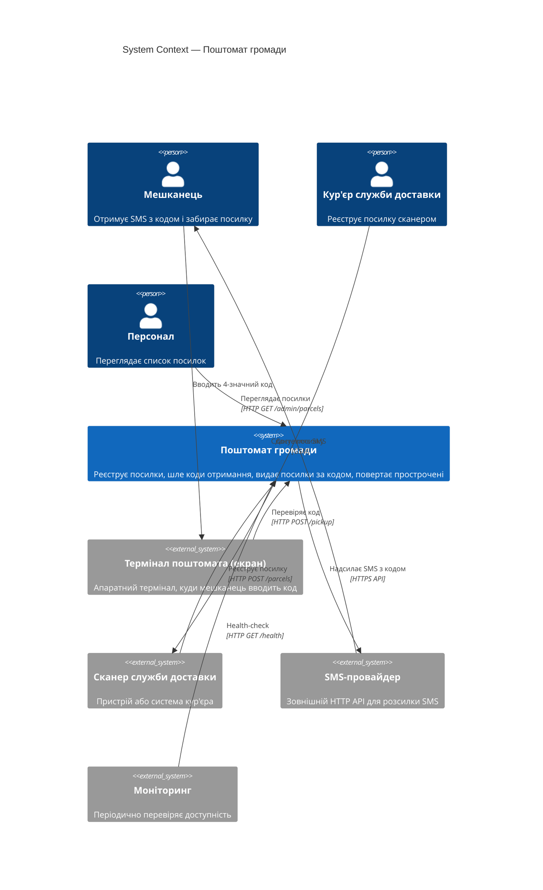
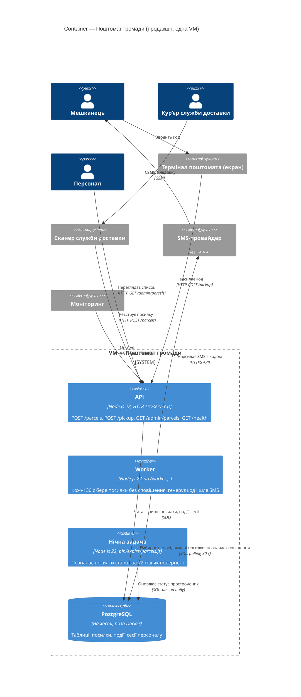

- Інструмент і модель: Claude Code 2.1.291 (CLI, `claude -p`, неінтерактивно), модель claude-opus-5-5
- Дата: 2026-11-03
- Що бачила сесія: тимчасова тека `../ws11-b-docs/`: лише `app/README.md` і `app/docs/ARCHITECTURE.md`. Окрема нова сесія, запущена в цій теці; `--setting-sources project,local` — користувацькі налаштування й `~/.claude/CLAUDE.md` не підвантажувались; пам'ять між сесіями для цієї теки порожня (новий шлях проєкту). Дозволені інструменти: Read, Glob, Grep, Bash. Нижче — фінальна відповідь агента (журнал викликів інструментів не зберігався). Застереження: у батьківській теці `Documents/Git/` лежить чужий `AGENTS.md` (про інший проєкт) — Claude Code міг підвантажити його як контекст; паралельна сесія Task D прямо згадала його у відповіді як нерелевантний.
- Промпт (дослівно):

  > Намалюй архітектуру цієї системи як C4-діаграми в Mermaid:
  > рівень System Context і рівень Container.
  > Відповідь дай повністю в чаті; файлів не створюй і уточнювальних питань не став —
  > припущення називай явно.

---

Нижче дві C4-діаграми «Поштомата громади». Я спирався лише на `app/README.md` і `app/docs/ARCHITECTURE.md`. Коду, на який вони посилаються (`src/server.js`, `src/worker.js`, `bin/expire-parcels.js`, `src/config.js`, `deploy/`), у робочій теці немає, тож діаграми показують систему так, як її описує документація, а не як вона реалізована.

## Рівень 1 — System Context

## Рівень 2 — Container

## Мої припущення

1. **Межа системи.** Термінал поштомата (екран) і сканер служби доставки я показав як зовнішні системи. Їхнього коду в репозиторії немає, документація згадує їх лише як клієнтів API.
2. **Хто генерує код.** Я вважаю, що 4-значний код створює Worker перед надсиланням SMS. Документація каже тільки, що Worker «шле SMS з кодом». Можливо, код створює API під час `POST /parcels`.
3. **Як персонал заходить в адмінку.** Є таблиця «сесії персоналу», тож я припускаю логін через API. Через який клієнт (браузер, окремий UI) — не сказано, тому окремого контейнера адмінки на діаграмі немає.
4. **Де запускається нічна задача.** У `docker compose` описано лише `api` і `worker`. Тож я вважаю, що `bin/expire-parcels.js` запускає cron на хості (можливо, з того самого образу). Показав її окремим контейнером усередині VM.
5. **Worker не ходить в API.** Він працює напряму з PostgreSQL, бо документація описує спільну БД і не згадує внутрішніх HTTP-викликів.
6. **Продакшн, а не локальний запуск.** У репозиторії сховище в пам'яті (`src/db.js`), але діаграма показує продакшн-варіант із PostgreSQL. Інтерфейс сховища той самий.
7. **Протоколи.** Протокол до SMS-провайдера (HTTPS) і формат опитування моніторингом я взяв за звичайною практикою. Документація каже лише «HTTP API».
8. **Налаштування.** Конфігурацію через змінні оточення (`src/config.js`) не малював, бо це не окремий контейнер.

**Розбіжність:** `AGENTS.md` описує зовсім інший модуль (`src/money.ts` із грошовими утилітами), якого тут немає. Для діаграм я його не враховував.
