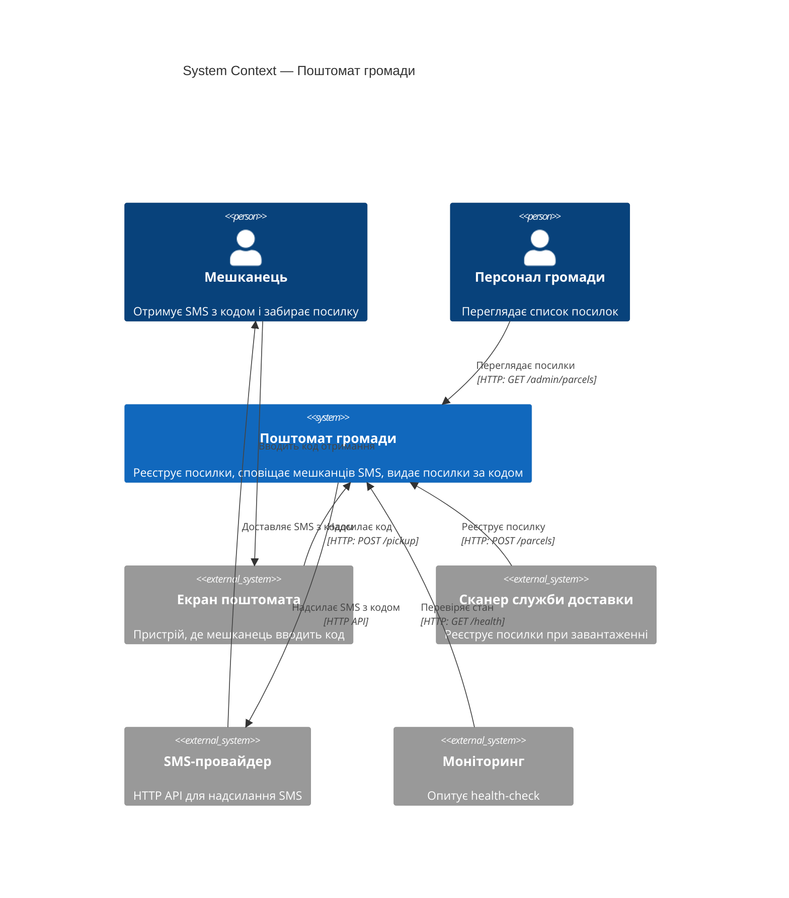
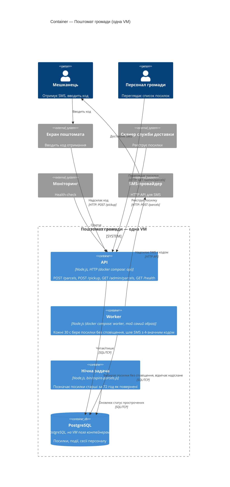

- Tool and model: Claude Code 2.1.301 (headless, `claude -p`), claude-sonnet-5-5 (the usage report also lists claude-haiku-5-5 with ~1.2k input tokens: Claude Code's background model for auxiliary calls); run with `--restricted` (user, project and local settings ignored, so no plugins or hooks; no shell tool; file tools confined to the working folder), `--strict-mcp-config` (no MCP servers), `--disable-slash-commands` (no skills), `--no-session-persistence`, auto-memory disabled; no global CLAUDE.md exists
- Date: 2026-10-30
- What the session saw: temporary folder ../ws11-b-docs containing only `app/README.md` and `app/docs/ARCHITECTURE.md`
- Prompt (verbatim):

  > Намалюй архітектуру цієї системи як C4-діаграми в Mermaid:
  > рівень System Context і рівень Container.
  > Відповідь дай повністю в чаті; файлів не створюй і уточнювальних питань не став —
  > припущення називай явно.

---

Я прочитав лише `README.md` і `docs/ARCHITECTURE.md`. Каталогів `src/`, `bin/` та `deploy/` у робочій теці немає, тому діаграми побудовані на документації (v1.5, червень 2026), а не на коді.

## Припущення

- Нічна задача `expire-parcels` запускається планувальником на VM (cron або подібним). У документації про це не сказано.
- Персонал працює з `GET /admin/parcels` через HTTP. Як саме вони автентифікуються, невідомо. Таблиця «сесії персоналу» лише натякає, що сесії є.
- Моніторинг — зовнішня система, яка опитує `GET /health`. Назви конкретного продукту немає.
- Екран поштомата й сканер служби доставки — клієнти API. Я показав їх як окремі акторів/системи, а не контейнери всередині цієї системи.
- Потік «SMS мешканцю» йде через зовнішнього SMS-провайдера. Мобільного застосунку чи інших каналів немає.
- Протокол до PostgreSQL не вказано. Я позначив його як SQL/TCP.
- Нічна задача ходить у БД напряму, а не через API. У README це окремий скрипт `bin/`.

## Рівень 1: System Context

## Рівень 2: Container

## Що варто звірити

- Чи актуальна документація: якщо у `src/` з'явилися нові інтеграції чи сервіси, діаграми треба оновити.
- Спосіб запуску нічної задачі (cron на VM чи окремий контейнер). Від цього залежить, чи малювати її всередині `docker compose`.
