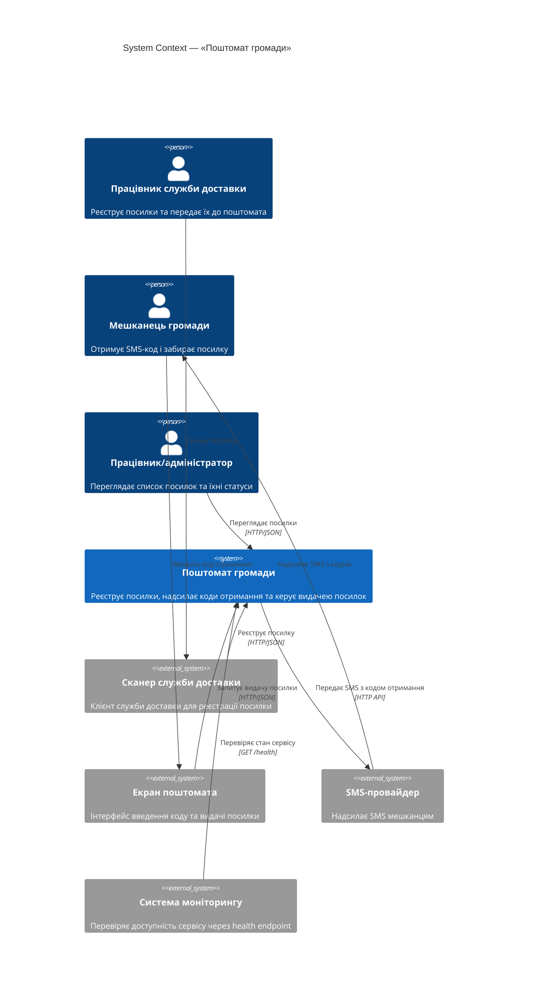
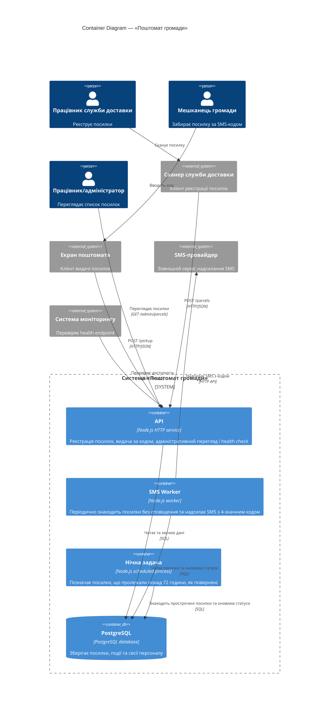

## Припущення

- «Ця система» — сервіс «Поштомат громади» з документації `README.md` та `ARCHITECTURE.md`.
- Екран поштомата та сканер служби доставки є зовнішніми клієнтами API.
- SMS-провайдер — зовнішня система.
- Нічна задача запускається планувальником на тій самій VM, але показана окремим контейнером/процесом.
- PostgreSQL у production працює поза Docker-контейнерами, на тій самій VM.

## C4: System Context

## C4: Container

### Розгортання

API, SMS Worker і нічна задача запускаються на одній VM через Docker Compose. PostgreSQL працює на цій самій VM поза контейнерами; конфігурація передається через змінні оточення.