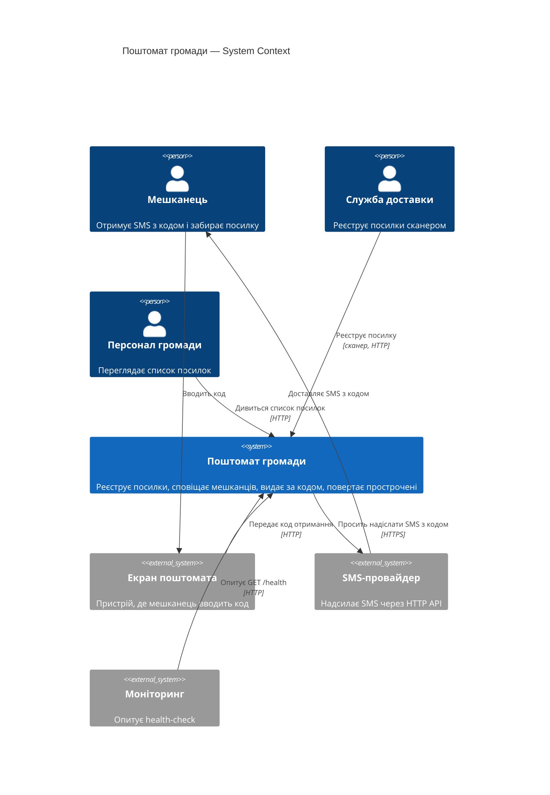
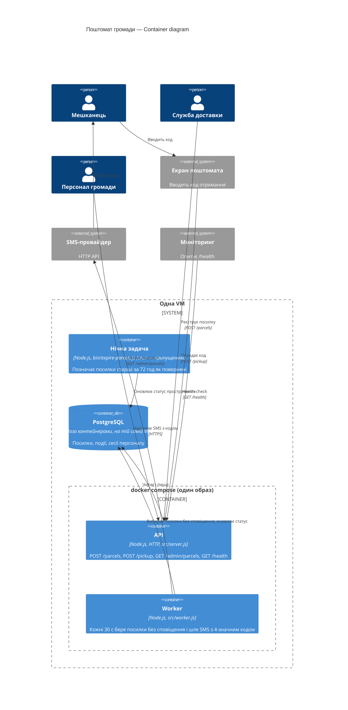

- Інструмент і модель: Claude Code 2.1.316 (headless `claude -p --model sonnet`), claude-sonnet-5-5
- Дата: 2026-11-02
- Що бачила сесія: тимчасова тека `../ws11-b-docs/`: лише `app/README.md` і `app/docs/`. Нова сесія (окремий процес), без історії; інструменти лише на читання (`Read, Glob, Grep, Bash`). Глобального `~/.claude/CLAUDE.md` немає; пам'ять Claude Code прив'язана до теки проєкту, для тимчасової теки вона порожня
- Вартість прогону: 4 ходів, 3 викликів інструментів (Glob × 1, Read × 2), $0.079, 29 с
- Промпт (дослівно):

  > Намалюй архітектуру цієї системи як C4-діаграми в Mermaid:
  > рівень System Context і рівень Container.
  > Відповідь дай повністю в чаті; файлів не створюй і уточнювальних питань не став —
  > припущення називай явно.

---
У теці є лише `README.md` і `docs/ARCHITECTURE.md` (v1.5, червень 2026). Коду `src/`, `bin/` і `deploy/` немає, тому діаграми спираються тільки на ці два документи.

## Припущення

- Екран поштомата — окремий пристрій на боці поштомата, з якого мешканець вводить код. Він не частина контейнерів сервісу.
- Нічна задача `expire-parcels` — окремий контейнер. Документ не каже, чим її запускають, тому припускаю cron на VM, а не сервіс у compose. Це розходиться з розділом «Розгортання», де сервісів лише `api` і `worker`.
- Персонал працює через `GET /admin/parcels` якимось клієнтом. Який це клієнт, документ не уточнює, тому показую на діаграмі лише API.
- «Сесії персоналу» зберігаються в PostgreSQL, тобто автентифікація персоналу робиться в API.
- Система моніторингу — зовнішня, вона опитує `GET /health`.
- Назву SMS-провайдера і протокол, крім «HTTP API», документ не вказує.

## Рівень 1 — System Context

## Рівень 2 — Container

Worker і API не викликають одне одного. Вони взаємодіють лише через PostgreSQL: API створює посилку, а worker бере ті, про які ще не сповіщено.

У `README.md` сказано, що в цьому репозиторії сховище лежить у пам'яті (`src/db.js`), а в продакшні той самий інтерфейс працює поверх PostgreSQL. Тому діаграма показує продакшн-схему.
