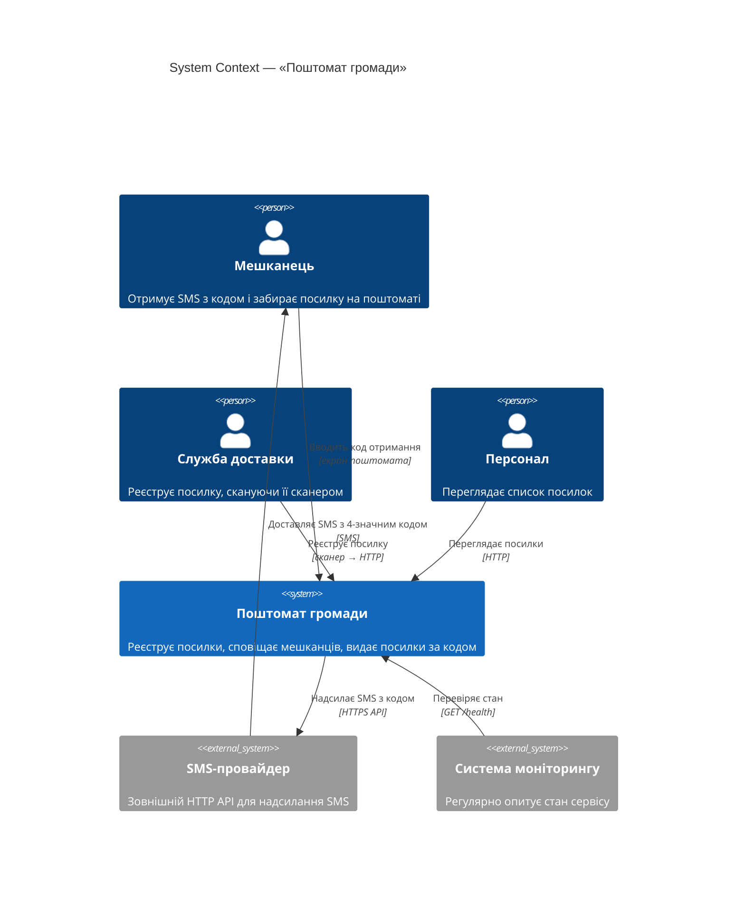
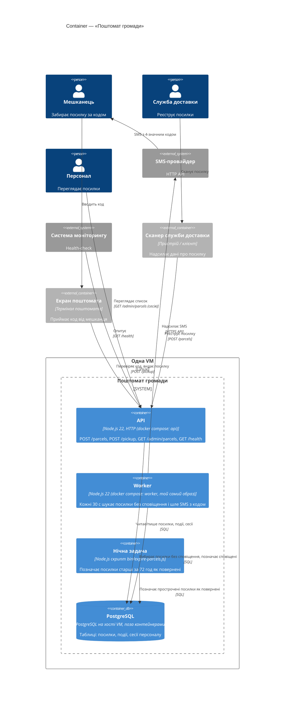

- Інструмент і модель: Claude Code 2.1.310, headless `claude -p`; модель claude-opus-5-5, effort medium
- Дата: 2026-10-24
- Що бачила сесія: тимчасова тека `../ws11-b-docs/` поруч із репо, у ній лише `app/README.md` і `app/docs/ARCHITECTURE.md`. Нова сесія (`--session-id 62b70b08-0284-46f4-9ed3-e41d86d624d0`) з прапорцями `--safe-mode --restricted --strict-mcp-config --tools "Read,Grep,Glob"`: без `CLAUDE.md`/`AGENTS.md`, пам'яті, хуків, плагінів користувача, output styles і MCP (`mcp_servers` порожній; `~/.claude/CLAUDE.md` порожній, 0 байт); файлові інструменти обмежені тимчасовою текою прапорцем `--restricted`. Усі виклики були всередині теки, відмов не було (`permission_denials` порожній). Виклики: Glob `**/*`; Read `app/docs/ARCHITECTURE.md`, `app/README.md`. Bash вимкнено.
- Промпт (дослівно):

  > Намалюй архітектуру цієї системи як C4-діаграми в Mermaid:
  > рівень System Context і рівень Container.
  > Відповідь дай повністю в чаті; файлів не створюй і уточнювальних питань не став —
  > припущення називай явно.

---

Ось C4-діаграми рівнів System Context і Container для «Поштомата громади».

**Звідки взято дані.** У робочій директорії є тільки два файли: `app/README.md` і `app/docs/ARCHITECTURE.md`. Коду (`src/`, `bin/`, `deploy/`), на який вони посилаються, тут немає. Тому діаграми побудовані лише за документацією (v1.5, червень 2026), і з кодом я їх не звіряв.

## Рівень 1: System Context

## Рівень 2: Container

## Припущення

1. **Сканер і екран поштомата я показав як зовнішні клієнти.** Вони не входять у систему, а лише звертаються до API. Якщо прошивку екрана розробляє та сама команда, екран варто зробити окремим `Container` усередині межі системи.
2. **Персонал** заходить у `GET /admin/parcels` якимось HTTP-клієнтом, напевно браузером. Окремого фронтенду в документації немає. Автентифікацію через сесії я вивів із таблиці «сесії персоналу».
3. **Нічну задачу** найімовірніше запускає cron на VM. Як саме її запускають, у документах не сказано. У `docker compose` згадано лише два сервіси (`api`, `worker`), тому задачу я показав окремим контейнером без прив'язки до compose.
4. **Систему моніторингу** в документах не названо. Відомо тільки, що вона опитує `/health`.
5. **Протоколи.** Канал до SMS-провайдера я позначив як HTTPS, а SMS доставляє мешканцю сам провайдер. У документах написано лише «HTTP API».
6. **Звідки береться номер телефону мешканця**, з документів не видно. Імовірно, його передають у `POST /parcels`, але окремого реєстру мешканців чи зовнішньої системи на схемі немає.
7. **Сховище.** README каже, що в репозиторії воно працює в пам'яті (`src/db.js`). Діаграма описує продакшн, тобто PostgreSQL.
8. **Синтаксис C4 у Mermaid досі експериментальний**, тому залежно від версії рендерера розкладка може «з'їжджати». Якщо так, параметр `UpdateLayoutConfig` можна змінити або прибрати.
