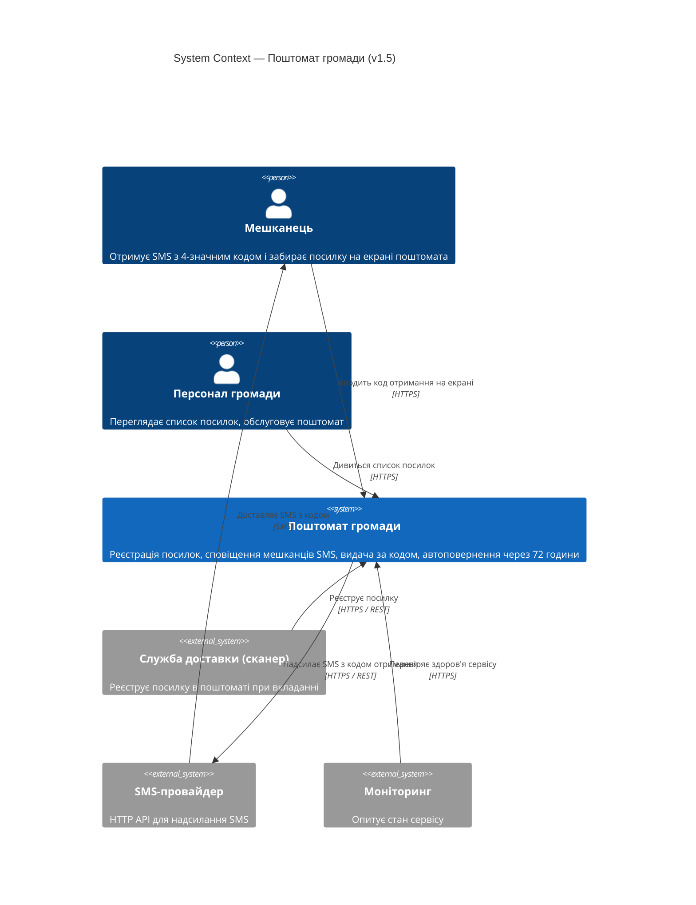
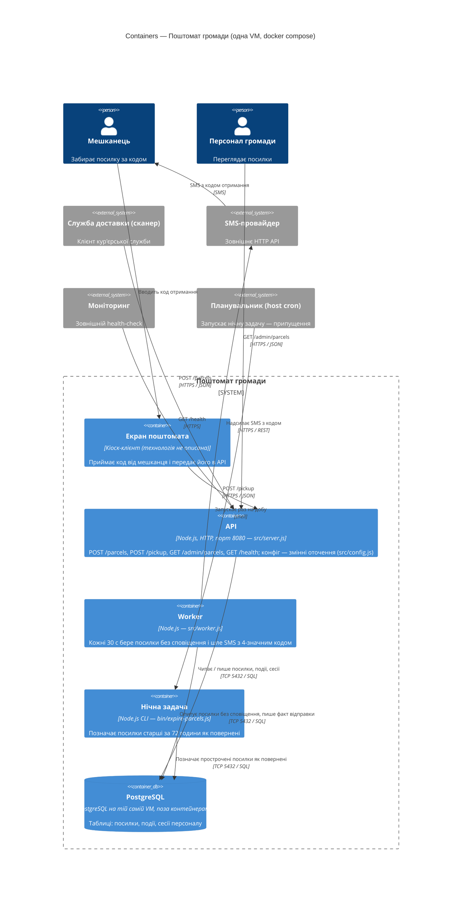

# Прогін 1 — C4 лише з документації

- Інструмент і модель: Claude Code (CLI, `claude -p`), Claude Opus 5 — окрема нова сесія
  без історії
- Дата: 2026-11-01
- Що бачила сесія: тимчасова тека `../ws11-b-docs/` — у ній лише `app/README.md` і
  `app/docs/ARCHITECTURE.md`. Створена командою з `docs/walkthrough.md`:
  `mkdir -p ../ws11-b-docs/app && cp -r app/README.md app/docs ../ws11-b-docs/app/`.
  Коду `app/src/`, `app/bin/`, `app/test/`, `app/package.json`, а також кореневих
  `materials/`, `docs/`, `deploy/`, `incident/` у ній немає.
- Чесно про контекст: прогін виконано як окремий процес `claude -p` із робочою текою
  `../ws11-b-docs` — поза репозиторієм, тому кореневих `AGENTS.md`/`CLAUDE.md` цього репо
  сесія не бачила взагалі (на відміну від прогонів Task A). Пам'ять між сесіями і
  глобального `~/.claude/CLAUDE.md` немає (файл не існує). Інструменти сесії — лише для
  читання (`Read, Grep, Glob, Bash(ls|find|wc)`), писати файли вона не могла.
- Параметри запуску: `--model claude-opus-5 --output-format json`; 5 ходів, 61.9 с,
  $0.476, 4059 токенів виводу, session `f6408a05-80d8-4489-8d2b-914e6f522939`.
- Промпт (дослівно):

  > Намалюй архітектуру цієї системи як C4-діаграми в Mermaid:
  > рівень System Context і рівень Container.
  > Відповідь дай повністю в чаті; файлів не створюй і уточнювальних питань не став —
  > припущення називай явно.

---

Репозиторій містить тільки документацію (`app/README.md`, `app/docs/ARCHITECTURE.md`) — коду немає, тому діаграми побудовані з цих двох файлів.

## Припущення (явно)

1. **Екран поштомата** — окремий тонкий клієнт (кіоск), який викликає HTTP API. У документації він згаданий лише як джерело `POST /pickup`; його технологія не описана.
2. **Сканер служби доставки** — зовнішня система кур'єрської служби, що викликає `POST /parcels`; власником вона не є.
3. **PostgreSQL** показано як продакшн-сховище (так в `ARCHITECTURE.md`). У репозиторії `src/db.js` — in-memory реалізація того ж інтерфейсу; це розбіжність «репо vs прод», а не два різних сховища.
4. **Нічна задача** `bin/expire-parcels.js` — окремий короткоживучий процес з того ж образу, запускається host-cron на тій же VM. Планувальник у документації не названий.
5. **Персонал громади** працює через `GET /admin/parcels` (є таблиця сесій персоналу → припускаю логін/сесійну автентифікацію), окремого адмін-UI в документації немає, тож він не показаний як контейнер.
6. **Моніторинг** — зовнішня система, що опитує `GET /health`.
7. Усі три процеси ходять до БД напряму (worker і нічна задача — без API), бо в схемі БД є центральним вузлом.

## Рівень 1 — System Context

## Рівень 2 — Containers

## Що варто знати про ці діаграми

- **Пакування ≠ контейнери C4.** `docker compose` має два сервіси (`api`, `worker`) з одного образу, а PostgreSQL і нічна задача живуть на VM поза контейнерами — тож «контейнерів» у сенсі C4 тут п'ять, а Docker-сервісів два. Це нормально для C4, але легко сплутати на рев'ю.
- **Єдина точка відмови** — одна VM тримає і обидва процеси, і БД. Для рівня Deployment (якщо знадобиться L3/L4) це буде один вузол із чотирма артефактами.
- **Дірки в документації**, які діаграми роблять видимими: не описані автентифікація сканера служби доставки, механізм запуску нічної задачі, та технологія екрана поштомата. Я закрив їх припущеннями 1, 4, 5 — варто підтвердити з власником сервісу.
- Mermaid-рендерер C4 (`C4Context`/`C4Container`) усе ще експериментальний: він не дає керувати розкладкою точно, тому за потреби ті самі дві діаграми можна швидко перекласти на `flowchart` зі `subgraph`-боундарі.