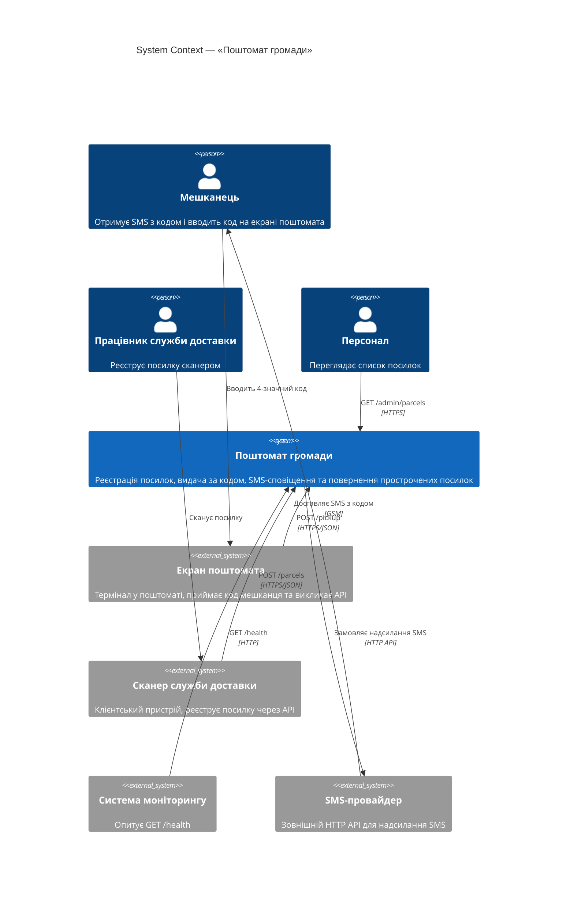
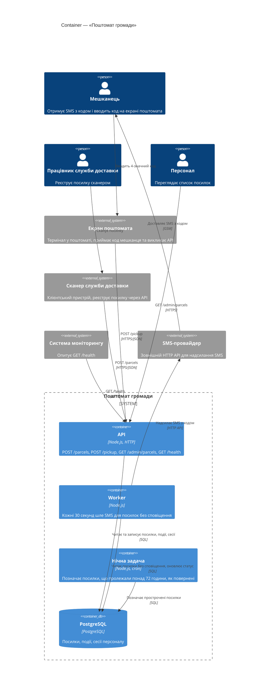

- Інструмент і модель: OpenCode, DeepSeek V4.1 Flash Free
- Дата: 2026-11-07
- Що бачила сесія: робоча тека `D:\Lessons_Selenium_Bionics\lesson1\ws11-b-docs`; у ній `app/README.md`, `app/docs/ARCHITECTURE.md` і шаблон `c4-from-docs.md`. Коду застосунку (`src/`, `bin/`, `deploy/`) у теці немає.
- Промпт (дослівно):

  > Намалюй архітектуру цієї системи як C4-діаграми в Mermaid:
  >    рівень System Context і рівень Container.
  >    Відповідь запиши в файл c4-from-docs.md; інших файлів не створюй і уточнювальних питань не став —
  >    припущення називай явно

---

# C4-діаграми: «Поштомат громади»

## Припущення

- **Джерело.** Є лише `app/README.md` та `app/docs/ARCHITECTURE.md`; вихідного коду немає, тому межі контейнерів, технології та напрямки викликів відновлено з текстового опису.
- **Межа системи.** У скоупі — серверна платформа «Поштомат громади»: API, worker, нічна задача і PostgreSQL. Екран поштомата та сканер служби доставки вважаю зовнішніми клієнтськими пристроями, бо їхнього коду в репозиторії немає.
- **PostgreSQL.** Це контейнер-сховище в межах системи; на System Context він не показаний, щоб не змішувати рівні C4. У локальній версії замість нього — in-memory сховище з тим самим інтерфейсом; діаграма відображає продакшн-конфігурацію.
- **Персонал.** Окремого адмін-інтерфейсу в документації не описано, тому персонал звертається до API напряму (`GET /admin/parcels`).
- **Нічна задача.** Запускається за розкладом (cron) на тій самій VM; у `docker compose` лише `api` і `worker`.
- **SMS-провайдер.** Зовнішня система з HTTP API; конкретний провайдер не названий.
- **Код отримання.** У документації не сказано, хто саме генерує 4-значний код; на діаграмі показано лише, що worker надсилає його через SMS-провайдера.
- **Моніторинг.** Зовнішня система, що опитує `GET /health`; її реалізація не описана.

## Рівень 1 — System Context

## Рівень 2 — Container

## Короткі пояснення

- **System Context** показує систему як чорну скриньку: три людські ролі, зовнішні пристрої/системи та SMS-потік до мешканця.
- **Container** розкриває систему на API, worker, нічну задачу та PostgreSQL. Worker і нічна задача працюють із тим самим сховищем, що й API; SMS надсилає саме worker.
- За документацією `api` і `worker` розгортаються з одного образу двома сервісами `docker compose` на одній VM; PostgreSQL — на тій самій VM поза контейнерами.
