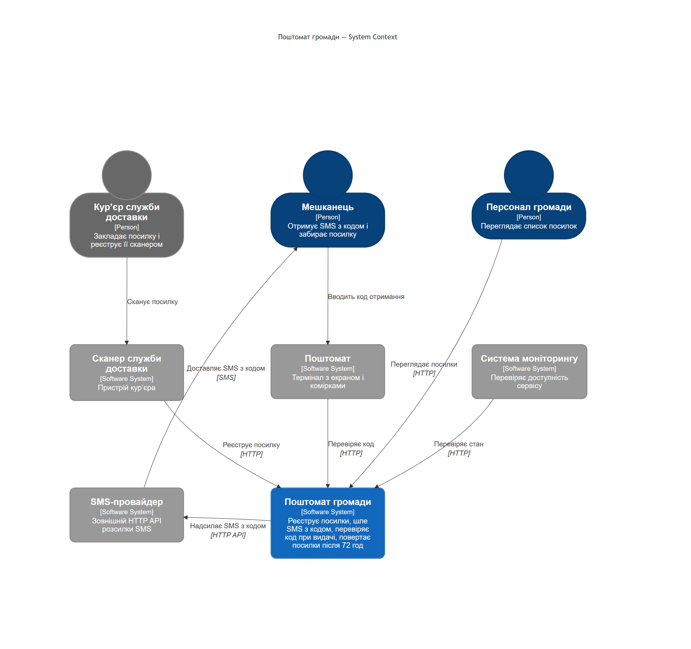
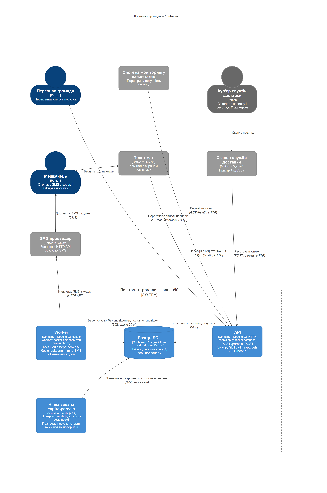
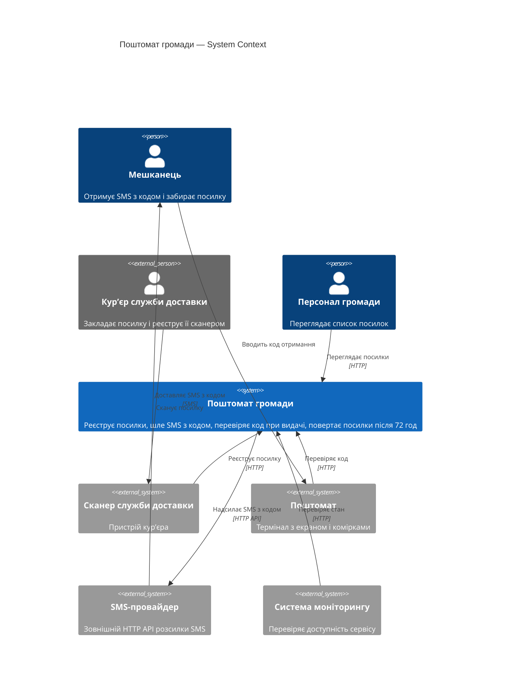
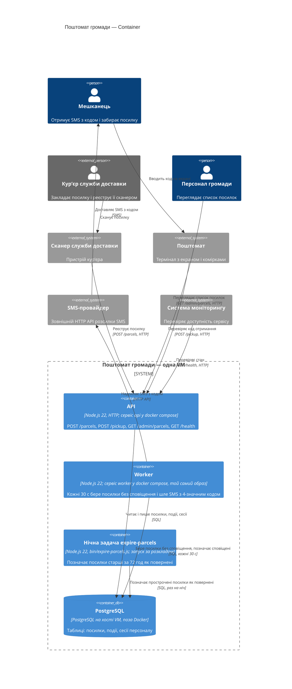

- Інструмент і модель: Claude Code, Claude Opus 5.5 (`claude-opus-5-5`)
- Дата: 2026-11-01
- Що бачила сесія: тимчасова тека `ws11-b-docs/`, у ній лише `app/README.md` і `app/docs/ARCHITECTURE.md` (без `src/`, `bin/` і `deploy/`)
- Промпт (дослівно):

  > Намалюй архітектуру цієї системи як C4-діаграми в Mermaid:
  > рівень System Context і рівень Container.
  > Відповідь дай повністю в чаті; файлів не створюй і уточнювальних питань не став —
  > припущення називай явно.

- Рендер діаграм: зробив той самий AI пізніше в цій сесії на прохання учасника (mermaid-cli 11,
  Mermaid 11). Обидві діаграми з відповіді рендеряться без помилок.

  

  

---

Усе нижче зроблено лише з `app/README.md` і `app/docs/ARCHITECTURE.md`. Коду в репозиторії немає: `src/`, `bin/` і `deploy/`, на які посилаються документи, відсутні. Тож діаграми з коду не перевірені. Документ архітектури датований червнем 2026 (v1.5), тому може бути застарілим. Діаграми я не рендерив: Mermaid CLI тут не встановлений.

## Припущення

1. **Поштомат — зовнішня система.** Коду екрана й комірок у репозиторії немає, поштомат лише викликає `POST /pickup`. Комірку він, імовірно, відчиняє сам за відповіддю API. Якщо ПЗ екрана пише ваша команда, його треба винести в окремий контейнер.
2. **Сканер служби доставки — зовнішній пристрій.** Він викликає `POST /parcels` напряму. Іншої інтеграції зі службою доставки в описі немає.
3. **Окремої адмін-панелі немає.** Персонал звертається до `GET /admin/parcels` напряму. Таблиця «сесії персоналу» означає, що є якийсь вхід, але ендпоінта для входу серед описаних немає, тому на діаграмі його нема.
4. **Нічна задача запускається за розкладом.** У `docker compose` лише два сервіси (`api`, `worker`). Тому я вважаю, що задачу запускає cron на VM з того самого образу. У C4 це окремий контейнер, бо вона запускається окремо.
5. **Код отримання зберігається в PostgreSQL**, і API звіряє з ним `POST /pickup`. Хто створює код (API під час реєстрації чи worker), не описано.
6. **Worker позначає посилку як «сповіщену».** Інакше він слав би SMS кожні 30 секунд.
7. **Нічна задача тільки змінює статус у БД.** Ні службу доставки, ні мешканця вона не сповіщає.
8. **Протокол — HTTP**, як написано в документі. Чи використовується HTTPS, не сказано.
9. **Показано продакшн.** Там дані в PostgreSQL; сховище в пам'яті (`src/db.js`) для локального запуску на діаграмах не показане.

## Рівень 1 — System Context

## Рівень 2 — Container

## Прогалини в документах

- **Розгортання.** `docs/ARCHITECTURE.md` посилається на `deploy/` «у корені репозиторію», але такої теки немає. Тому розгортання (compose, cron, PostgreSQL поза контейнерами) взято лише зі слів документа.
- **Вхід персоналу.** Таблиця сесій персоналу є, а ендпоінта для входу в переліку немає (див. припущення 3).
- **Курʼєр і комірка.** Не описано, як курʼєр отримує й відчиняє комірку, щоб закласти посилку. Тому на діаграмах між курʼєром і поштоматом немає звʼязку.

Mermaid C4 ще експериментальний, тож розташування блоків може знадобитися підправити: змінити `$c4ShapeInRow` або порядок оголошення елементів.
