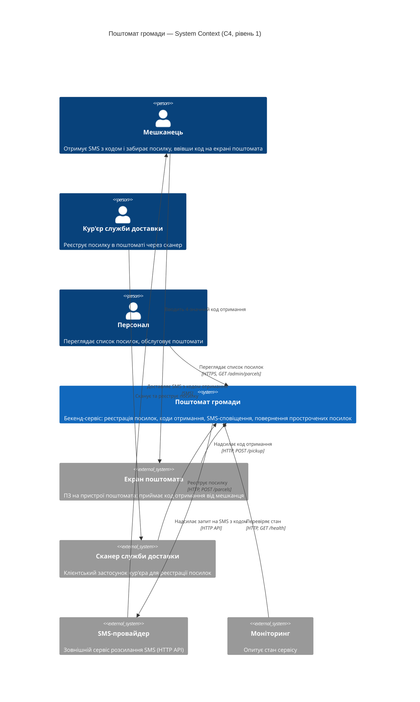
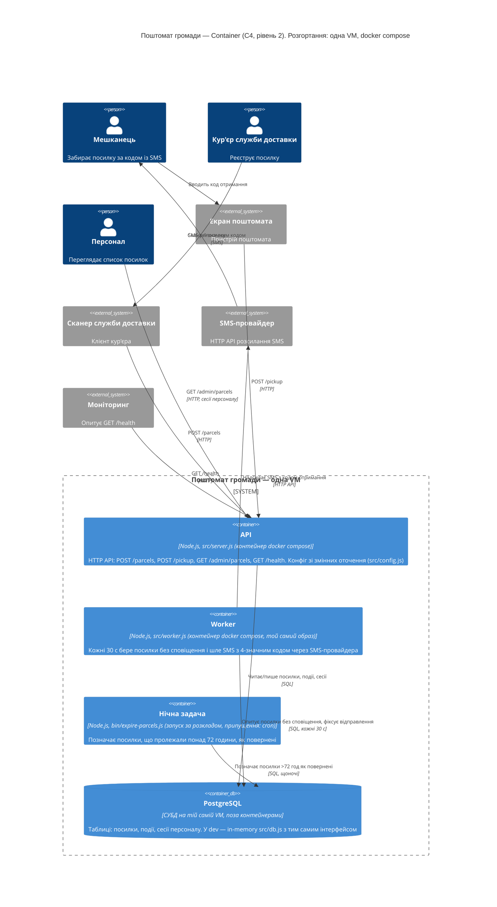

- Інструмент і модель: Claude Code (Workflow-субагент general-purpose), Claude Fable 5 (`claude-fable-5`)
- Дата: 2026-11-03
- Що бачила сесія: тимчасова тека ../ws11-b-docs — лише `app/README.md` і `app/docs/`. Прогін запускався субагентом із сесії в корені репо, тому субагенту системно підвантажувався `CLAUDE.md` репо (він посилається на `AGENTS.md`); агенту явно вказано читати лише тимчасову теку. Пам'ять між сесіями в субагентів відсутня; відповідь нижче — перша, дослівно.
- Промпт (дослівно):

  > Твоя робоча тека: C:/Users/777ma/IdeaProjects/ws11-b-docs — це корінь проєкту. Читай лише файли в цій теці й не зазирай в інші теки.
  >
  > Намалюй архітектуру цієї системи як C4-діаграми в Mermaid:
  > рівень System Context і рівень Container.
  > Відповідь дай повністю в чаті; файлів не створюй і уточнювальних питань не став —
  > припущення називай явно.

---
Я прочитав обидва файли в робочій теці (`C:/Users/777ma/IdeaProjects/ws11-b-docs/app/README.md` та `C:/Users/777ma/IdeaProjects/ws11-b-docs/app/docs/ARCHITECTURE.md`) — інших файлів у теці немає. Нижче — C4-діаграми рівнів System Context і Container у Mermaid.

## Припущення (у теці лише README та ARCHITECTURE.md, коду немає)

1. **Система** = бекенд-сервіс «Поштомат громади» (API, worker, нічна задача, PostgreSQL). ПЗ екрана поштомата і сканер служби доставки — окремі клієнтські системи/пристрої поза цим репозиторієм, тому моделюю їх як зовнішні системи.
2. **Персонал** дивиться `GET /admin/parcels` через браузер/HTTP-клієнт з авторизацією (в БД є таблиця «сесії персоналу»).
3. **Нічна задача** `bin/expire-parcels.js` запускається планувальником (cron) на VM — механізм запуску в документах не вказано.
4. **Моніторинг** — зовнішня система, що опитує `GET /health` (яка саме — не вказано).
5. Діаграми показують **продакшн-вигляд**: сховище — PostgreSQL на тій самій VM поза контейнерами (у репозиторії для розробки — in-memory `src/db.js` з тим самим інтерфейсом).
6. API і Worker — два сервіси `docker compose` з одного образу на одній VM (за розділом «Розгортання»); worker не має HTTP-інтерфейсу, він опитує БД кожні 30 с.
7. SMS-провайдер надає HTTP API; worker шле через нього SMS із 4-значним кодом мешканцю.

## Рівень 1 — System Context

## Рівень 2 — Container

### Короткі пояснення

- **System Context**: три ролі людей (мешканець, кур'єр, персонал), одна система «Поштомат громади» та чотири зовнішні системи (екран поштомата, сканер, SMS-провайдер, моніторинг). Межу системи проведено по репозиторію: клієнтські пристрої — зовні (припущення 1).
- **Container**: усередині межі — чотири контейнери в сенсі C4: `API` і `Worker` (два docker-compose-сервіси з одного образу), `Нічна задача` (скрипт за розкладом) і `PostgreSQL` (на тій самій VM, поза Docker). Усі три процеси спілкуються лише через спільну БД; єдиний вихідний інтеграційний канал — HTTP API SMS-провайдера з боку Worker.

Джерела: `C:/Users/777ma/IdeaProjects/ws11-b-docs/app/README.md`, `C:/Users/777ma/IdeaProjects/ws11-b-docs/app/docs/ARCHITECTURE.md`. Файлів не створював.
