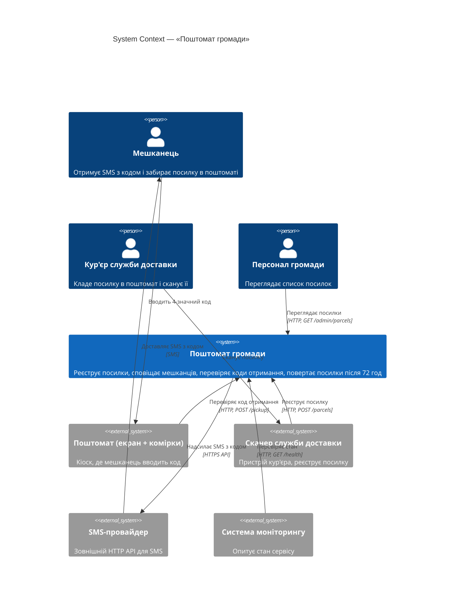
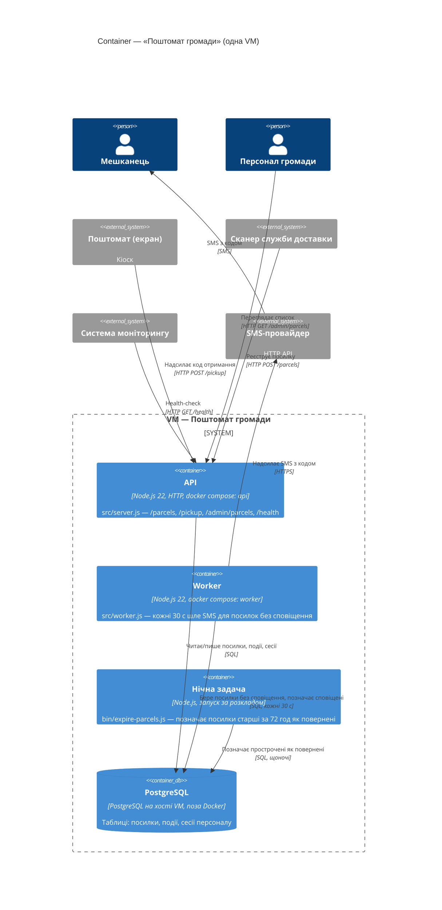

- Інструмент і модель: Claude Code 2.1.317 (`claude -p`, неінтерактивна сесія), Claude Opus 5.5 (`claude-opus-5-5`)
- Дата: 2026-11-04
- Що бачила сесія: тимчасова тека `../ws11-b-docs/` лише з `app/README.md` і `app/docs/`. Нова сесія без історії; глобального `~/.claude/CLAUDE.md` немає, пам'ять для нової теки порожня. Дозволено лише читання (Read/Grep/Glob, ls/cat/grep/find); файлів сесія не створювала.
- Промпт (дослівно):

  > Намалюй архітектуру цієї системи як C4-діаграми в Mermaid:
  > рівень System Context і рівень Container.
  > Відповідь дай повністю в чаті; файлів не створюй і уточнювальних питань не став —
  > припущення називай явно.

---

Я розглянув лише два файли в робочій директорії: `app/README.md` і `app/docs/ARCHITECTURE.md`. Файлів, на які вони посилаються (`src/server.js`, `src/worker.js`, `bin/expire-parcels.js`, `src/config.js`, `deploy/`), тут немає. Тому діаграми побудовані за документацією (v1.5, червень 2026) і з кодом не звірені.

## Рівень 1 — System Context

## Рівень 2 — Container

## Мої припущення

1. **Межі системи.** Екран поштомата і сканер кур'єра я вважаю зовнішніми системами-клієнтами. У README сказано «сервіс *для* поштоматів», а їхнього коду в описі немає.
2. **Хто відкриває комірку.** Документи цього не пояснюють. Я припускаю, що поштомат сам відкриває комірку, коли `POST /pickup` повертає успішну відповідь. Окремої команди від сервісу до поштомата на схемі немає.
3. **Персонал.** Припускаю, що персонал звертається до `GET /admin/parcels` напряму через браузер або HTTP-клієнт. Окремого адмін-фронтенду в документах немає, тож і контейнера для нього я не малював. Те, що в БД є таблиця сесій, означає, що API має якусь автентифікацію персоналу.
4. **Моніторинг.** У документах сказано тільки, що він «опитує `/health`». Яка це система, невідомо, тож вона зовнішня.
5. **Сховище.** На діаграмі показано продакшн із PostgreSQL. За README, у репозиторії сховище працює в пам'яті (`src/db.js`) через той самий інтерфейс. Це стосується локального запуску й тестів, тому на діаграму я його не виносив.

Синтаксис C4 у Mermaid досі експериментальний. GitHub і mermaid.live рендерять ці діаграми, але розкладку елементів підібрано вручну, тож вона може виглядати тісно.
