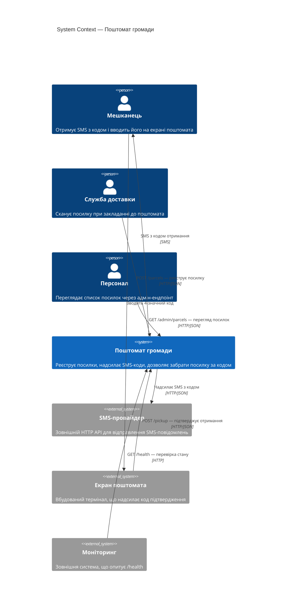
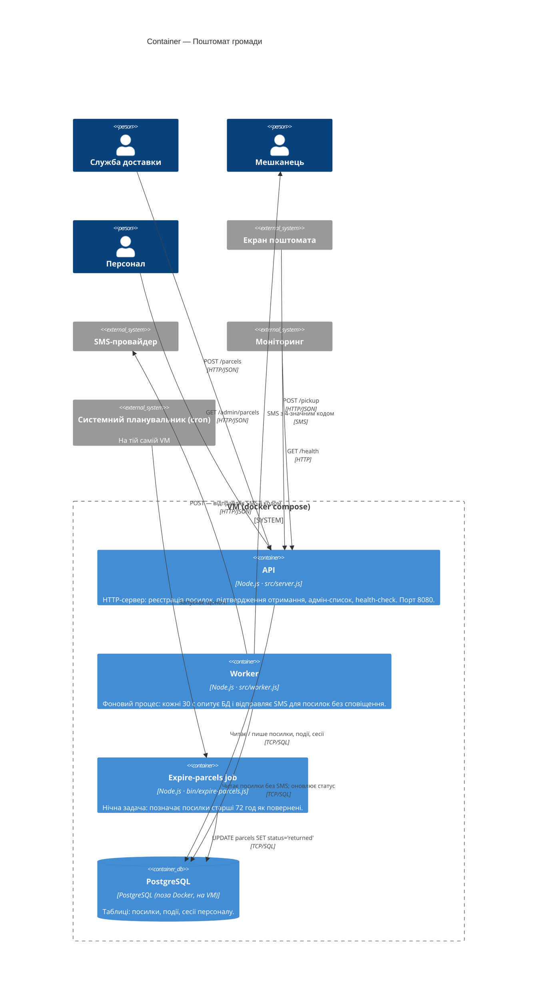

- Інструмент і модель: Claude Code 2.1.168, headless `claude -p`; модель claude-sonnet-4-6 (модель за замовчуванням CLI; haiku — службові виклики)
- Дата: 2026-11-02
- Що бачила сесія: тимчасова тека ../ws11-b-docs — лише `app/README.md` і `app/docs/`; нова сесія без історії, `--strict-mcp-config` (жодних MCP), інструменти Read/Glob/Grep/Bash. Увімкненим лишився глобальний `~/.claude/CLAUDE.md` (загальні правила керування AI-конфігурацією і ctx7, нічого про цей репо) та глобальні skills; пам'ять нової теки — порожня.
- Промпт (дослівно):

  > Намалюй архітектуру цієї системи як C4-діаграми в Mermaid:
  > рівень System Context і рівень Container.
  > Відповідь дай повністю в чаті; файлів не створюй і уточнювальних питань не став —
  > припущення називай явно.

---
Усе зрозуміло. Ось C4-діаграми.

---

**Припущення:**

- Персонал (адмін) дивиться список посилок через той самий API, а не через окремий UI.
- SMS-провайдер — зовнішня система (наприклад, Twilio або аналог), деталі не відомі.
- Нічна задача (`expire-parcels`) запускається через `cron` або системний планувальник на тій самій VM.
- In-memory DB (`src/db.js`) — лише для локальної розробки; у продакшні — PostgreSQL на тій самій VM, поза Docker.
- Моніторинг — зовнішня система (наприклад, Uptime-кролик / Prometheus-агент), яка опитує `/health`.

---

## Рівень 1 — System Context

---

## Рівень 2 — Container

---

**Ключові спостереження по архітектурі:**

- `api` і `worker` — окремі контейнери, але зібрані з одного образу; shared-state йде виключно через PostgreSQL.
- PostgreSQL живе поза Docker на тій самій VM — це точка єдиного відмову і потенційна проблема при масштабуванні.
- Немає черги повідомлень між `api` і `worker` — worker поллінгує БД кожні 30 с, що додає затримку до SMS.
