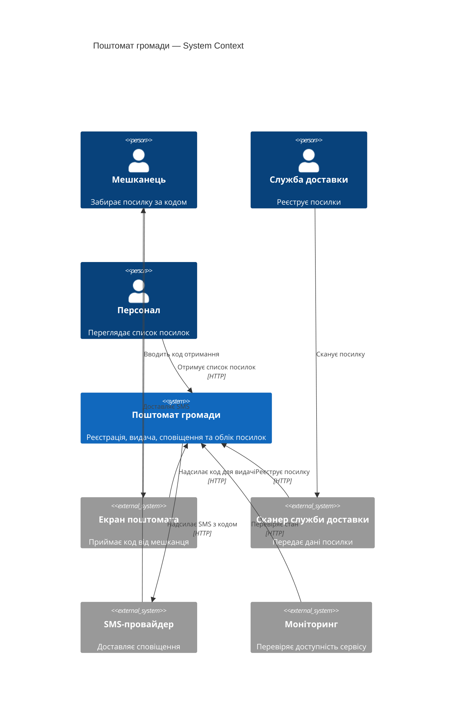
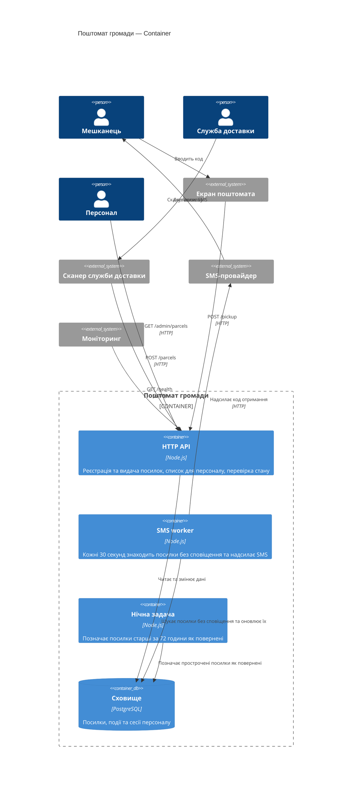

- Інструмент і модель: Codex subagent, GPT-6
- Дата: 2026-11-09
- Що бачила сесія: `../ws11-b-docs/` — лише `app/README.md` і `app/docs/` (без історії попередніх прогонів)
- Промпт (дослівно):

  > Намалюй архітектуру цієї системи як C4-діаграми в Mermaid:
  > рівень System Context і рівень Container.
  > Відповідь дай повністю в чаті; файлів не створюй і уточнювальних питань не став —
  > припущення називай явно.

---

Нижче межа системи означає **серверну частину «Поштомата громади»**. Екран поштомата, сканер служби доставки, SMS-провайдер і моніторинг показані як зовнішні системи.

### System Context

### Container

**Припущення:** клієнт персоналу не описаний, тому окремий контейнер для нього не показано. Спосіб запуску нічної задачі також не вказаний. Для продакшну показано PostgreSQL; у локальній версії репозиторію сховище працює в пам’яті. API та worker розгортаються в Docker Compose на одній VM, а PostgreSQL працює на цій VM поза контейнерами.
