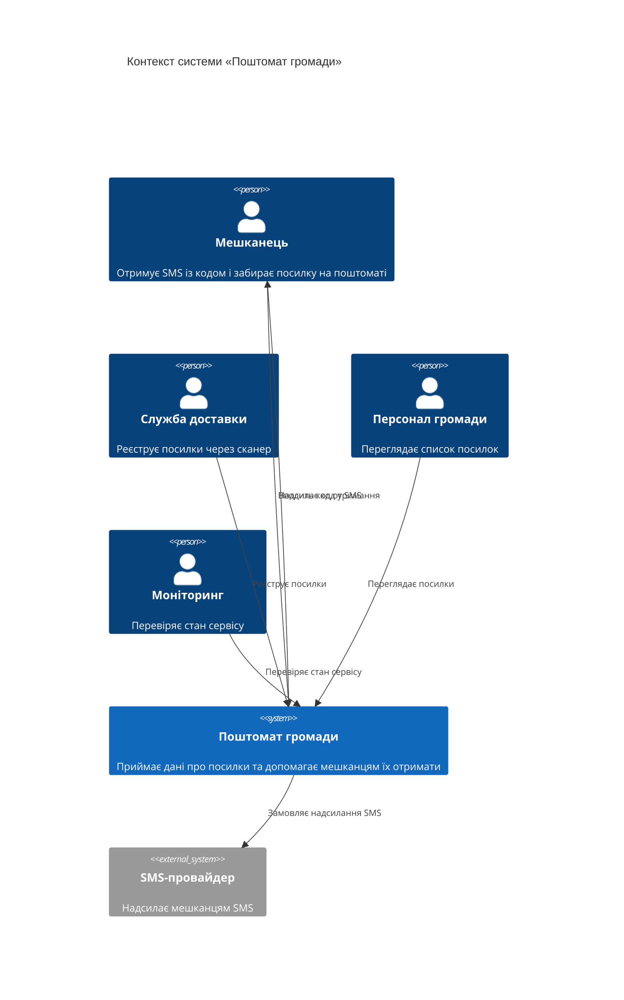
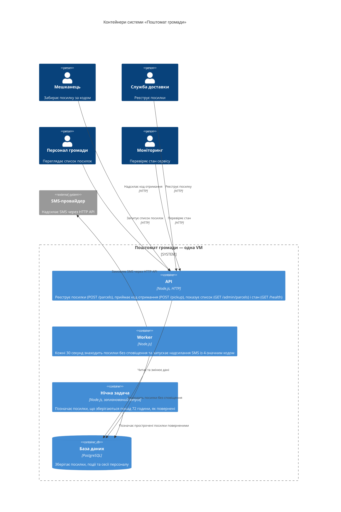

- Інструмент і модель: Codex, GPT-6
- Дата: 2026-11-03
- Стан пам'яті та глобальних інструкцій: попередню історію чату не передавали; налаштування memories і глобальних інструкцій не перевірялися й окремо не вимикалися.
- Що бачила сесія: окрема чиста projectless Codex-сесія; лише app/README.md і app/docs/ARCHITECTURE.md у ws11-isolated-runs/b-docs. Нова projectless сесія без історії поточного чату; робоча тека C:\Users\slpir\Documents\Codex\2026-11-03\ws11-b-docs.
- Промпт (дослівно):

> Намалюй архітектуру цієї системи як C4-діаграми в Mermaid: рівень System Context і рівень Container.
> Відповідь дай повністю в чаті; файлів не створюй і уточнювальних питань не став — припущення називай явно.

---

### System Context

### Container

**Припущення:** екран поштомата представлено як клієнт мешканця, що взаємодіє з API; окремий екран чи пристрій у документах не описаний. Нічну задачу показано як окремий контейнер із запланованим запуском. PostgreSQL — виробнича база даних; у локальному середовищі сховище працює в пам’яті.

