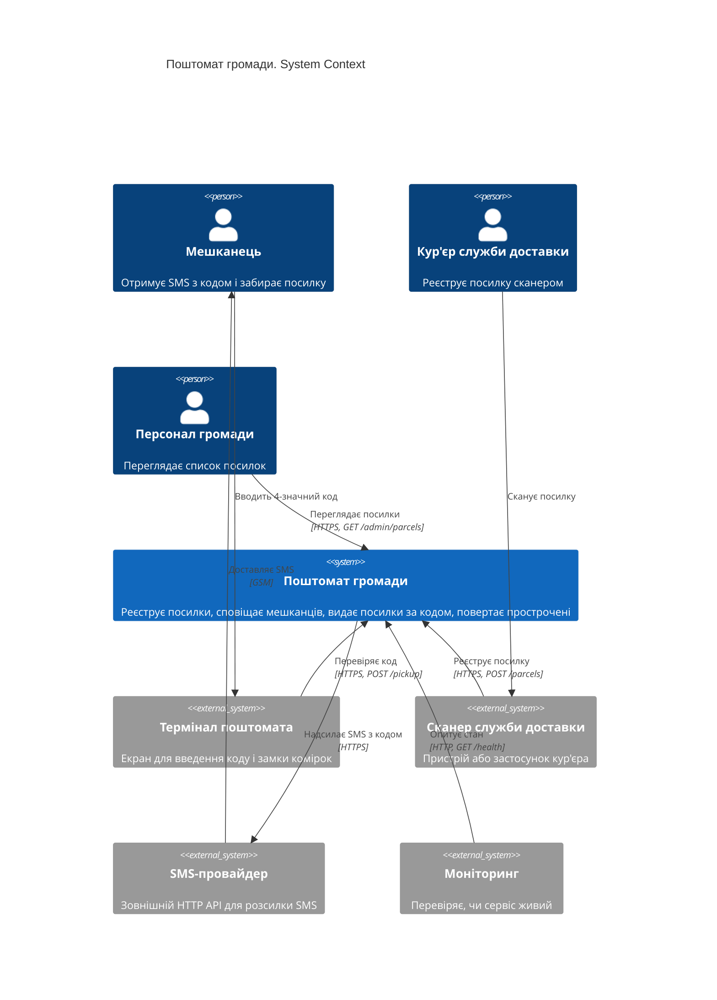
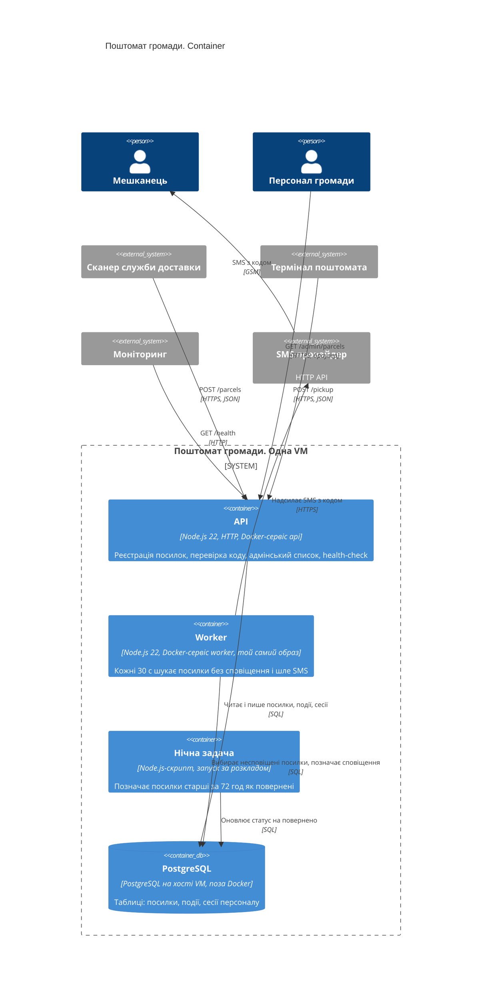

- Інструмент і модель: Claude Code (VS Code), claude-opus-5-5, effort Medium
- Дата: 2026-10-25
- Що бачила сесія: тимчасова тека `../ws11-b-docs` — лише `app/README.md` і `app/docs/ARCHITECTURE.md` (без коду, `.git`, `AGENTS.md`, `CLAUDE.md`); нова сесія, пам'ять і глобальні інструкції відсутні
- Промпт (дослівно):

```text
Намалюй архітектуру цієї системи як C4-діаграми в Mermaid:
рівень System Context і рівень Container.
Відповідь дай повністю в чаті; файлів не створюй і уточнювальних питань не став —
припущення називай явно.
```

---

Діаграми побудовані лише з документації. У робочій теці є тільки два файли: app/README.md і app/docs/ARCHITECTURE.md. Тек src/ і deploy/, на які вони посилаються, немає, тож звірити схему з кодом я не зміг.

Рівень 1. System Context



Рівень 2. Container



Припущення
Термінал і сканер зовнішні. Їхнього коду в репозиторії немає, тому вони стоять поза межею системи. Якщо екран поштомата розробляє та сама команда, його треба перенести всередину межі як окремий контейнер.
Комірку відчиняє термінал. API лише перевіряє код і відповідає, а замком керує термінал.
Код генерує API. Код отримання створюється і зберігається під час реєстрації посилки, а worker лише читає його з бази. Документація каже тільки, що worker шле SMS з кодом.
Телефон мешканця передає сканер. Інакше незрозуміло, звідки worker бере номер.
Worker і нічна задача працюють з базою напряму. Вони не ходять через API.
Нічну задачу запускає cron на VM. Імовірно, через одноразовий запуск того самого образу. У Docker Compose її серед сервісів немає, а розклад ніде не описано.
Персонал автентифікується. На це вказує таблиця сесій персоналу. Проте ендпоінта входу серед задокументованих немає, тож або документація неповна, або сесії створюються інакше.
Зовнішній трафік іде через HTTPS. Документація згадує лише HTTP, тож TLS, імовірно, термінується перед API.
Локальне сховище не показане. У репозиторії воно в пам'яті, а на діаграмах зображено продакшн-варіант з PostgreSQL.
