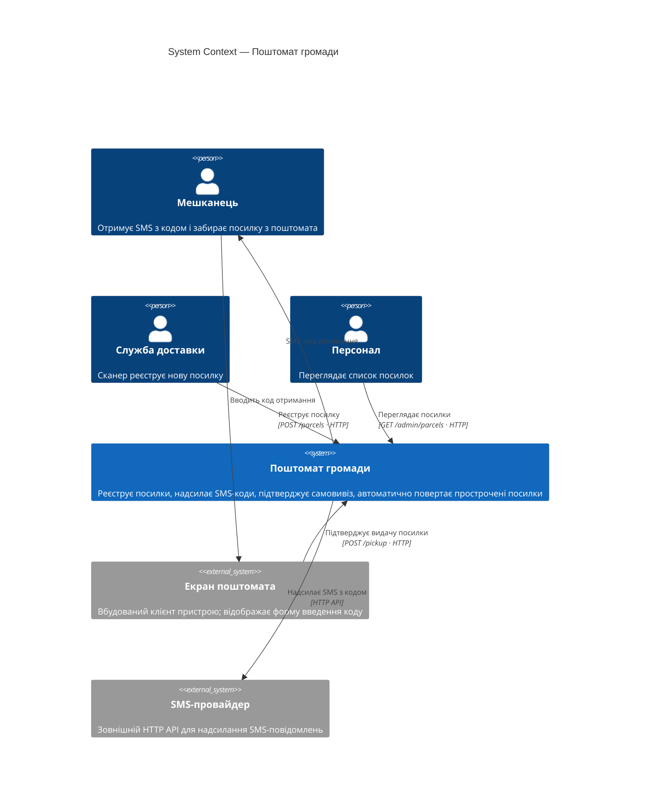
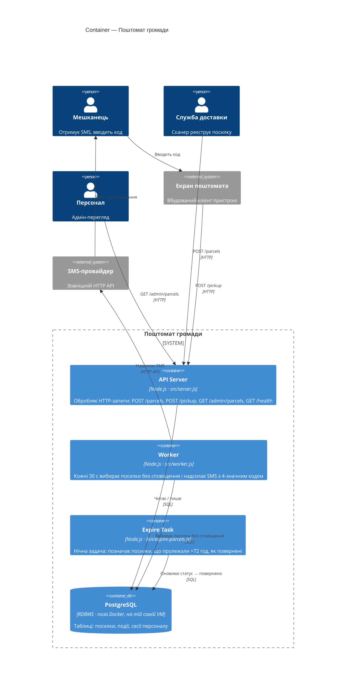

- Інструмент і модель: Claude Code CLI 2.1.304, headless-режим (`claude -p`, дозволені лише інструменти Read/Grep/Glob/LS), модель claude-sonnet-4-6
- Дата: 2026-10-26
- Що бачила сесія: тимчасова тека `../ws11-b-docs/` поруч із репо — лише `app/README.md` і `app/docs/ARCHITECTURE.md`. Нова сесія без історії й без підказок; глобального `~/.claude/CLAUDE.md` немає, у батьківських теках CLAUDE.md / AGENTS.md немає. Сесію запустив агент (GitHub Copilot) з терміналу; нижче — фінальна відповідь сесії (`result` з JSON-виводу) без змін.
- Промпт (дослівно):

  > Намалюй архітектуру цієї системи як C4-діаграми в Mermaid:
  > рівень System Context і рівень Container.
  > Відповідь дай повністю в чаті; файлів не створюй і уточнювальних питань не став —
  > припущення називай явно.

---
Ось C4-діаграми в Mermaid.

---

**Припущення:**
- «Екран поштомата» — вбудований клієнт апаратного пристрою (поза межами програмної системи), він викликає API по HTTP.
- «Служба доставки» — мобільний сканер або сторонній клієнт (теж зовнішній).
- Персонал звертається до `GET /admin/parcels` безпосередньо (CLI / Postman / окремий UI — в документації не вказано, тому вважаємо зовнішнім актором без окремого контейнера).
- Worker і Expire Task читають БД самостійно (не через API).

---

## Рівень 1 — System Context

---

## Рівень 2 — Container

---

**Ключові спостереження по діаграмах:**
- Worker і API — окремі процеси з одного Docker-образу; обидва тримають пряме з'єднання з PostgreSQL (немає черги повідомлень — потенційне місце ризику при масштабуванні).
- Expire Task запускається окремо (cron / ручний запуск) і не проходить через API — пряма залежність від БД.
- SMS-провайдер — єдина зовнішня залежність на рівні контейнерів.
