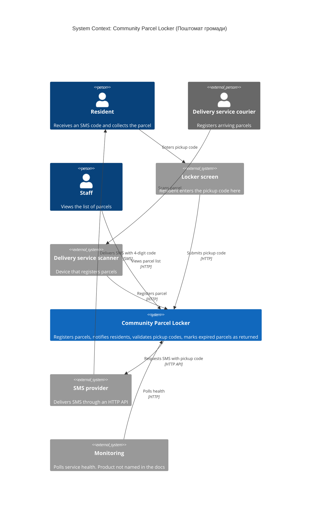
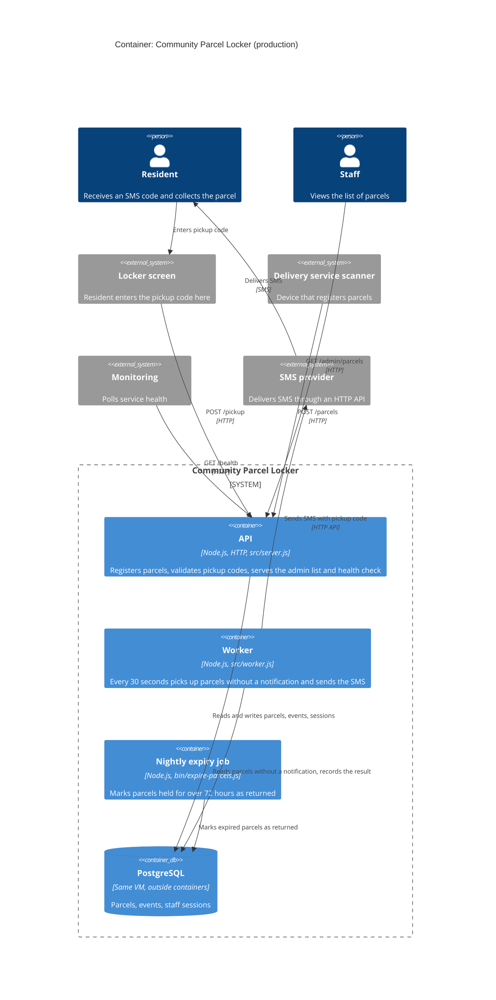

- Інструмент і модель: Claude Code, Claude Opus 5.5
- Дата: 2026-11-04
- Що бачила сесія: temporary folder `ws11-b-docs` containing only `app/README.md` and `app/docs/ARCHITECTURE.md`. The session also listed the sibling folders in `hw/` and ran a name search across them, so it saw their file names and the paths of matching files, but it did not open those files.
- Промпт (дослівно):

  > Намалюй архітектуру цієї системи як C4-діаграми в Mermaid:
  >    рівень System Context і рівень Container.
  >    Відповідь дай повністю в чаті; файлів не створюй і уточнювальних питань не став —
  >    припущення називай явно.

---

Both diagrams below describe the system as documented, because the code wasn't checked. `ws11-b-docs` contains only `app/README.md` and `app/docs/ARCHITECTURE.md` (v1.5, June 2026), and the `src/`, `bin/` and `deploy/` paths they cite aren't there. I also haven't rendered the Mermaid, so the syntax is untested.

## Level 1: System Context

## Level 2: Container

**Deployment:** one VM runs `docker compose` with `api` and `worker`, both from the same image. PostgreSQL runs on the VM outside the containers.

## Assumptions

| # | Assumption | Basis | If it's wrong |
|---|---|---|---|
| 1 | The locker screen and scanner are outside the system. | The README calls this a service "for" lockers. Neither device appears in the components or deployment. | Move the screen, or both devices, into the boundary as containers. |
| 2 | The nightly job writes directly to PostgreSQL. | It marks parcels as returned, but the docs' diagram omits it and its connection isn't described. | Change the relationship, for example to go through the API. |
| 3 | The nightly job is a separate container. | It has its own entry point and isn't one of the two compose services. | Merge it into `api` or `worker` if it runs inside one of them. |
| 4 | The worker records the result in PostgreSQL. | It must somehow stop re-selecting notified parcels, but the docs don't describe the write. | Adjust the label on that relationship. |
| 5 | The worker and job are Node.js. | The docs state Node.js only for the API, but the worker shares its image and the job is a `.js` file. | Update the technology labels. |
| 6 | Staff call the API directly. | No admin UI is documented. | Add a UI as a separate container. |
| 7 | The diagrams show production. | The README says the repo's store is in-memory (`src/db.js`) and production uses PostgreSQL. | Local runs have no PostgreSQL container. |

## Gaps in the docs
- **Staff login:** a staff sessions table exists, but no login endpoint is listed, so staff authentication isn't shown.
- **Nightly job scheduling:** the docs don't say what triggers the job or where it runs.
- **Transport security:** the docs say only "HTTP", so I didn't show TLS. The PostgreSQL protocol isn't stated either, so those relationships have no technology label.

## Possible outdated docs
While looking for the missing code, I searched the sibling folders in `hw/`, including `ws11-b-code`. I only saw file names and didn't open or use any of those files.

The names suggest the docs may be behind the code: `ws11-a-with` has `src/courier.js`, and `2026-udc-11-architecture-devops-hw` has `docs/adr/0001-notifications.md` and `incident/changes/v1.8.0.diff`. A courier integration or a changed notification flow would alter both diagrams, but I can't confirm either from names alone.

I stayed out of those folders because `ws11-b-docs` looks deliberately docs-only, and those copies may be different versions of the system. To check the diagrams against the code, run the same prompt in `ws11-b-code`.
