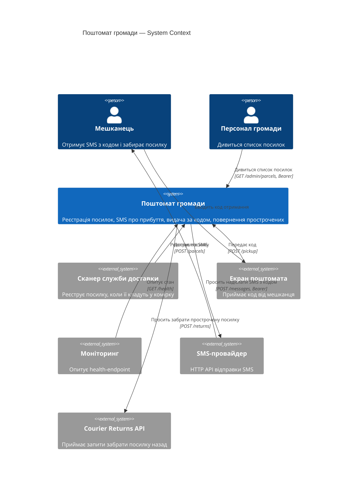
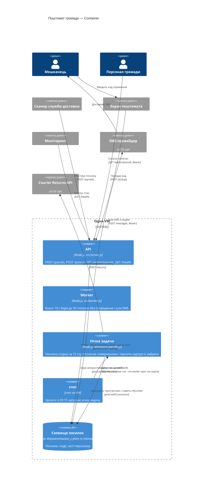

# Архітектура «Поштомата громади» — C4

> Task B. Діаграми показують систему **такою, якою вона є в коді** (`app/`), а не такою, якою її описує
> документація. Кожна стрілка має доказ у таблиці нижче. `app/` не редагувалась.
>
> **Що в коді є лише як припущення.** Екран поштомата, сканер служби доставки, моніторинг, SMS-провайдер і
> Courier Returns API — зовнішні; їхнього коду в репо немає, про них відомо лише з того, як `app/` до них
> звертається або з коментарів (`app/src/parcels.js:34`, `:58`). PostgreSQL — це документація
> (`app/README.md:23-24`, `app/docs/ARCHITECTURE.md:20`); у репо сховище в пам'яті (`app/src/db.js:1-2`).

## Рівень 1 — System Context

## Рівень 2 — Container

**Чого діаграма не доводить.** Кожен із трьох процесів створює власний пул, а разом із ним і власне
сховище в пам'яті (`app/src/db.js:63`; `app/src/server.js:91`, `app/src/worker.js:43`,
`app/bin/expire-parcels.js:24`), тож у самому репо API, worker і нічна задача **не бачать спільних даних**.
Змінна `dbUrl` читається (`app/src/config.js:7`), але ніде не використовується (`grep -rn dbUrl app/src app/bin app/test`
знаходить лише це визначення). Спільна PostgreSQL на діаграмі — це те, що стверджує документація, а не те, що
можна показати кодом із репо.

## Стрілки і докази

Один рядок — одна стрілка з моїх діаграм; рівень у дужках — на якій діаграмі вона є («AI мав рацію?»:
**є** — AI намалював цю стрілку; **пропустив** — у його діаграмі її немає). Усі номери рядків перевірено
командою `sed -n '<рядок>p' <файл>`.

| # | Стрілка (звідки → куди: що і як) | Доказ (`файл:рядок`) | AI з документації (`ai-runs/c4-from-docs.md`) | AI з коду (`ai-runs/c4-from-code.md`) |
|---|---|---|---|---|
| 1 | Сканер служби доставки → API: реєструє посилку, `POST /parcels` (L1, L2) | `app/src/server.js:38`; хто викликає — `app/src/parcels.js:34` | є | є |
| 2 | Екран поштомата → API: передає код, `POST /pickup` (L1, L2) | `app/src/server.js:42`; хто викликає — `app/src/parcels.js:58` | є | є |
| 3 | Мешканець → екран поштомата: вводить код (L1, L2) | `app/src/parcels.js:58` (коментар; коду екрана в репо немає), `app/README.md:4` | є | є (лише L1; на L2 мешканця немає) |
| 4 | Персонал → API: `GET /admin/parcels`, Bearer-сесія (L1, L2) | `app/src/server.js:47`, `:14-18` | є | є |
| 5 | Моніторинг → API: `GET /health` (L1, L2) | `app/src/server.js:37` | є | є |
| 6 | API → сховище: реєструє, видає за кодом, читає список, шукає сесію (L2) | `app/src/parcels.js:43`, `:61`, `:74`; `app/src/server.js:18`. PostgreSQL — лише `app/README.md:23-24` | є | є |
| 7 | Worker → сховище: вибирає непросповіщені, пише `notifiedAt` (L2) | `app/src/worker.js:24`, `:33` | є | є |
| 8 | Worker → SMS-провайдер: `POST /messages`, Bearer-токен (L1 як «система → SMS», L2) | `app/src/sms.js:31`, `:33`; виклик — `app/src/worker.js:28` | є | є |
| 9 | SMS-провайдер → мешканець: SMS з кодом (L1, L2) | `app/src/worker.js:12`, `:28` (текст із кодом іде на `recipientPhone`; сама доставка — зовнішня) | є | є (лише L1, напрям обернено: «мешканець → SMS-провайдер») |
| 10 | cron → нічна задача: щоночі запускає (L2) | `app/bin/expire-parcels.js:2`; спосіб запуску — `docs/ops/backup-runbook.md:18-19` | пропустив — каже, що чим запускають, «не сказано» (`c4-from-docs.md:73`) | пропустив — cron є лише в тексті технології контейнера (`c4-from-code.md:67`), стрілки немає |
| 11 | Нічна задача → сховище: знаходить прострочені, ставить `returned` (L2) | `app/bin/expire-parcels.js:12`, `:14` | є | є |
| 12 | Нічна задача → Courier Returns API: просить забрати посилку, `POST /returns` (L1 як «система → кур'єр», L2) | `app/bin/expire-parcels.js:15`; `app/src/courier.js:7` | пропустив — кур'єра немає в жодному документі (`grep -ni "кур.єр\|courier\|returns" app/README.md app/docs/ARCHITECTURE.md` нічого не знаходить) | є |

## Що AI вигадав / пропустив

| Прогін | Вигадав — стрілки й компоненти, яких у коді немає (і чим це перевірили) | Пропустив — стрілки з таблиці вище, яких немає в AI |
|---|---|---|
| з документації | **Стрілок — 0**: усі його 16 стрілок (6 на L1, 10 на L2) відповідають рядкам 1–9 і 11. **Помилкові факти** (не стрілки): (а) worker «кожні 30 с» і «4-значним кодом» (`c4-from-docs.md:53`) — це помилка документації (`app/docs/ARCHITECTURE.md:18-19`), у коді `POLL_INTERVAL_MS = 10_000` (`app/src/worker.js:8`) і код з 6 цифр (`app/src/parcels.js:27`); (б) «Екран поштомата» намальований усередині межі `vm` (`c4-from-docs.md:50-51`), хоча у припущенні 1 він сам пише, що розмістив його поза VM (`c4-from-docs.md:72`), а де працює екран, у репо не сказано — місце не перевірене; (в) протокол до SMS «HTTPS» — його припущення (`c4-from-docs.md:75`), код протокол не фіксує: `smsBaseUrl` за замовчуванням `http://localhost:9001` (`app/src/config.js:11`). | 10, 12 |
| з коду | **Стрілок — 0**: усі його 17 стрілок (8 на L1, 9 на L2) відповідають рядкам 1–9, 11, 12. **Помилкові факти:** (а) нічна задача «працює як cron на VM, поза `docker compose`. Так сказано в `bin/expire-parcels.js`» (`c4-from-code.md:21`) — у файлі лише «cron on the VM» (`app/bin/expire-parcels.js:2`), а «поза docker compose» суперечить runbook-у: `docker compose run --rm worker npm run expire` (`docs/ops/backup-runbook.md:18-19`; цього файлу в його теці не було); (б) сканер і Courier Returns API злито в одну «Службу доставки» (`c4-from-code.md:18`, `:36`) — код цього не стверджує (`app/src/parcels.js:34` говорить про «delivery operator's scanner», `app/src/courier.js:1` — про «courier company's returns API»); не перевірено. **Що зробив правильно:** виявив Courier Returns API, якого немає в документації (`c4-from-code.md:86`), і те, що код створення сесій персоналу відсутній (`c4-from-code.md:22`; `grep -rn addSession app/src app/bin` знаходить лише `app/src/db.js:52`). | 10 |

**Разом:** з документації — вигадано 0 стрілок (і 3 помилкові факти), пропущено 2 з 12 (рядки 10, 12);
з коду — вигадано 0 стрілок (і 2 помилкові факти), пропущено 1 з 12 (рядок 10).

## Запропоноване (з ADR)

Не додавав: діаграми показують систему як є. Таблиця завдань і зміни воркера з ADR — у
`docs/adr/0001-notifications.md`, розділи «Рішення» §1–§2.
