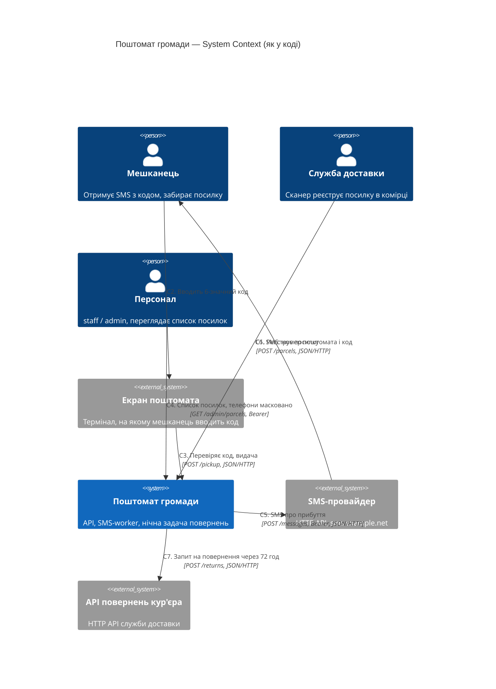
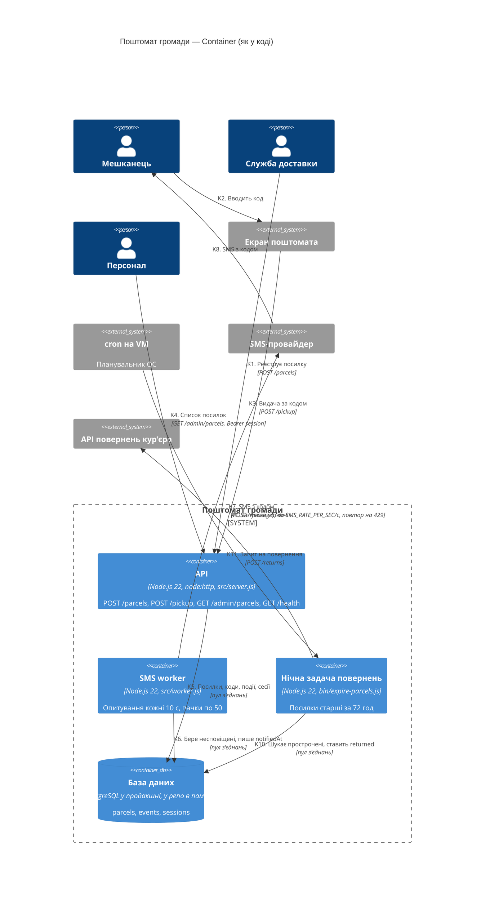
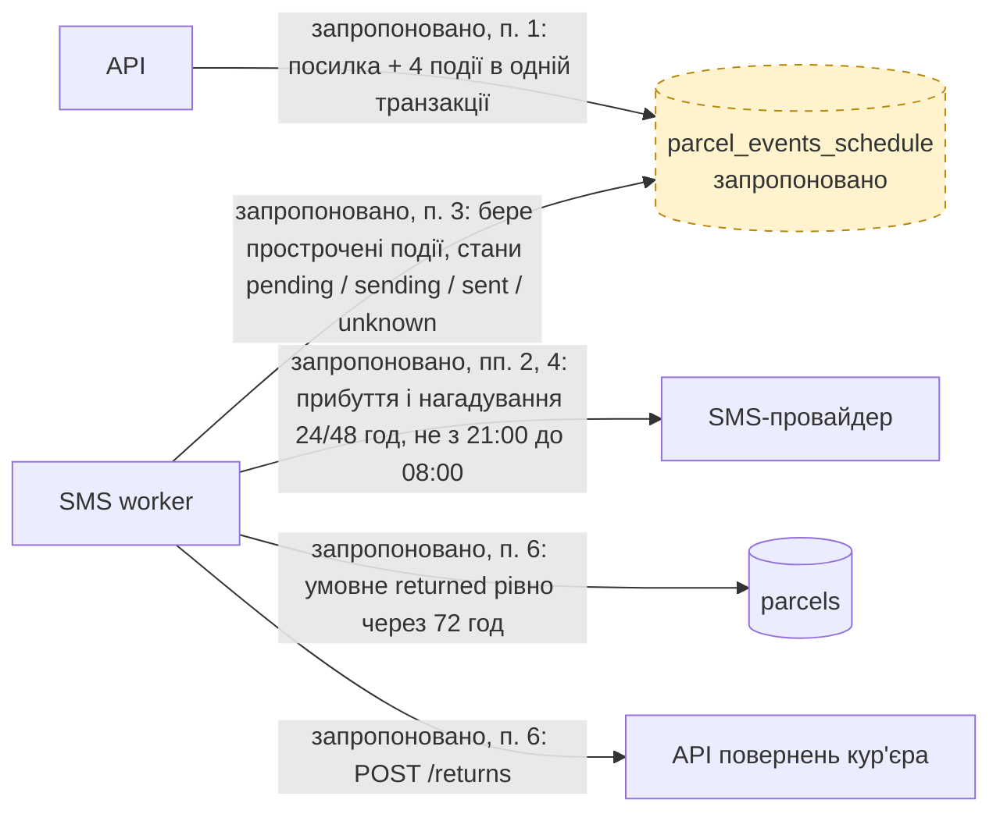

# Архітектура «Поштомата громади» — C4

Діаграми — такі, якою система є **в коді** `app/` (не в `app/docs/ARCHITECTURE.md`). Кожна
стрілка — рядок таблиці нижче з доказом `файл:рядок`. `app/` не змінювався.

Зауваження до всіх стрілок у БД: у репо сховище в пам'яті, «у продакшні той самий інтерфейс
сидить на PostgreSQL» (`app/src/db.js:1-2`); `DATABASE_URL` читається в конфіг
(`app/src/config.js:7`), але в коді `app/` більше ніде не використовується — підключення до
PostgreSQL у цьому коді не видно. Тому БД на діаграмі — PostgreSQL за коментарем, а доказ
стрілки — виклик сховища через пул `withConnection`.

## Рівень 1 — System Context

## Рівень 2 — Container

`GET /health` (`app/src/server.js:37`) існує, але хто його викликає, у коді `app/` не видно —
тому стрілки до нього немає.

## Стрілки і докази

«AI мав рацію?»: **є** — AI намалював цю стрілку; **пропустив** — у його діаграмі її немає.

| # | Стрілка (звідки → куди: що і як) | Доказ (`файл:рядок`) | AI з документації (`ai-runs/c4-from-docs.md`) | AI з коду (`ai-runs/c4-from-code.md`) |
|---|---|---|---|---|
| C1 | Служба доставки → Система: реєстрація посилки, `POST /parcels` | `app/src/parcels.js:34-35`, `app/src/server.js:38-40` | є | є |
| C2 | Мешканець → Екран поштомата: вводить код | `app/src/parcels.js:58` («The locker terminal sends the code the person typed») | є | є |
| C3 | Екран поштомата → Система: `POST /pickup` з кодом | `app/src/parcels.js:58-62`, `app/src/server.js:42-45` | є | є |
| C4 | Персонал → Система: `GET /admin/parcels`, Bearer-сесія, лише staff/admin | `app/src/server.js:13-19`, `app/src/server.js:47-49`, `app/src/parcels.js:15,71-75` | є | є |
| C5 | Система → SMS-провайдер: `POST /messages`, Bearer-токен | `app/src/sms.js:31-35`, `app/src/worker.js:28` | є | є |
| C6 | SMS-провайдер → Мешканець: SMS з номером поштомата і кодом | `app/src/worker.js:11-13`, `app/src/worker.js:28` (`parcel.recipientPhone`) | є (як «Система → Мешканець») | пропустив |
| C7 | Система → API повернень кур'єра: `POST /returns` | `app/src/courier.js:6-18`, `app/bin/expire-parcels.js:15` | пропустив | є |
| K1 | Служба доставки → API: `POST /parcels` | `app/src/server.js:38-40` | є | є |
| K2 | Мешканець → Екран поштомата: вводить код | `app/src/parcels.js:58` | є | пропустив (мешканця на рівні Container немає) |
| K3 | Екран поштомата → API: `POST /pickup` | `app/src/server.js:42-45` | є | є (але екран намальовано як Person) |
| K4 | Персонал → API: `GET /admin/parcels`, `Authorization: Bearer <session>` | `app/src/server.js:13-19`, `app/src/server.js:47-49` | є | є |
| K5 | API → БД: вставка посилки, пошук за кодом, оновлення статусу, події, сесії | `app/src/parcels.js:43-55`, `app/src/parcels.js:61-67`, `app/src/parcels.js:74`, `app/src/server.js:18` | є | є |
| K6 | Worker → БД: `listUnnotified`, потім `updateParcel(… notifiedAt)` | `app/src/worker.js:24`, `app/src/worker.js:33` | є (лише читання — запис `notifiedAt` не показано) | є |
| K7 | Worker → SMS-провайдер: `POST /messages`, паузи `SMS_RATE_PER_SEC`, повтор на `429` | `app/src/worker.js:28`, `app/src/worker.js:44-49`, `app/src/sms.js:20-41`, `app/src/config.js:13` | є | є |
| K8 | SMS-провайдер → Мешканець: SMS з кодом | `app/src/worker.js:11-13`, `app/src/worker.js:28` | є | пропустив |
| K9 | cron на VM → Нічна задача: запуск щоночі | `app/bin/expire-parcels.js:2-3` («Nightly job (cron on the VM)») | пропустив (cron лише в тексті під діаграмою) | пропустив (cron лише в описі контейнера) |
| K10 | Нічна задача → БД: `findExpired` (усі посилки), `markReturned` | `app/bin/expire-parcels.js:12-14`, `app/src/parcels.js:78-88` | є | є |
| K11 | Нічна задача → API повернень кур'єра: `POST /returns` | `app/bin/expire-parcels.js:15`, `app/bin/expire-parcels.js:26`, `app/src/courier.js:6-18` | пропустив | є |

Як повторити пошук зовнішніх викликів: `grep -rn "fetch(" app/src app/bin` → лише
`app/src/sms.js:31` і `app/src/courier.js:7`. Черг і кешів немає:
`grep -rni "redis\|kafka\|queue" app/src app/bin` → лише коментар про чергу очікування пулу
в `app/src/db.js:62`.

## Що AI вигадав / пропустив

| Прогін | Вигадав — стрілки й компоненти, яких у коді немає (і чим це перевірили) | Пропустив — стрілки з таблиці вище, яких немає в AI |
|---|---|---|
| з документації | Стрілок і компонентів не вигадав. Хибні деталі, узяті із застарілої `app/docs/ARCHITECTURE.md` (v1.5): «кожні 30 с» — у коді 10 с (`app/src/worker.js:8`); «4-значним кодом» — код 6-значний (`app/src/parcels.js:27`, `app/src/parcels.js:60`); нічна задача лише «позначає … як повернені» — насправді ще кличе API кур'єра (`app/bin/expire-parcels.js:15`). | C7, K9, K11 |
| з коду | Стрілок і компонентів не вигадав. Хибні деталі: «Екран поштомата» на рівні Container — `Person`, хоча на рівні Context той самий AI зробив його `System_Ext`; припущення «`expire-parcels` запускається cron-ом безпосередньо на VM (не в контейнері)» — у коді цього не видно, а `docs/ops/backup-runbook.md:18-19` каже `docker compose run --rm worker npm run expire`, тобто в контейнері; «rate-limited 5/s» — лише значення за замовчуванням (`app/src/config.js:13`), у продакшн-конфігу `20` (`deploy/compose.yaml:20,34`). | C6, K2, K8, K9 |

**Разом:** з документації — вигадано 0 стрілок (3 хибні деталі), пропущено 3 з 18; з коду —
вигадано 0 стрілок (3 хибні деталі), пропущено 4 з 18.

Що з цього випливає: прогін з документації пропустив **інтеграцію з кур'єром** — єдину
зовнішню систему, про яку документація мовчить, — і переніс у діаграму застарілі цифри.
Прогін з коду знайшов усі інтеграції й точні параметри, але «загубив» людину на кінці
ланцюжка (мешканця, який отримує SMS і вводить код) на рівні Container.

## Запропоноване (з ADR) — не реалізовано

Окрема діаграма, щоб не змішувати з тим, що є в коді. Усе на ній — **запропоновано** в
`docs/adr/0001-notifications.md` (розділ «Рішення», пп. 1–4, 6); доказу в коді поки немає.

