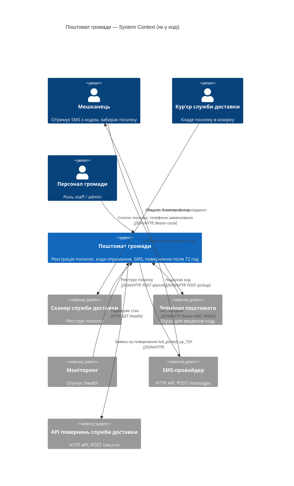
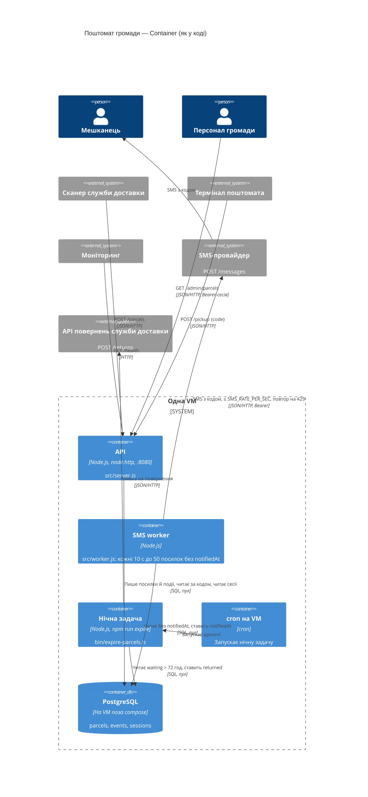
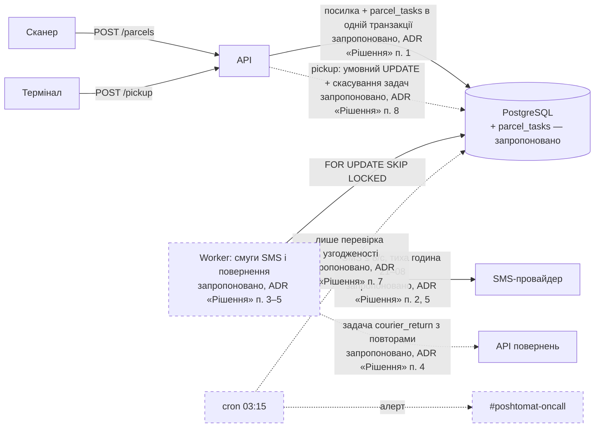

# Архітектура «Поштомата громади» — C4

> Task B. Діаграми — такою, якою система є **в коді** `app/` (версія 1.7.3,
> `app/package.json:3`). Кожна стрілка — рядок таблиці нижче з `файл:рядок`.
> Прогін з документації — `ai-runs/c4-from-docs.md`, з коду — `ai-runs/c4-from-code.md`.

## Рівень 1 — System Context

## Рівень 2 — Container

Протоколи: у коді — звичайний HTTP-сервер (`app/src/server.js:93-95`), а схема зовнішніх
URL задається змінними оточення (`app/src/config.js:11`, `:14`). Тому на діаграмах «HTTP»,
без твердження про TLS. У репо сховище в пам'яті з тим самим інтерфейсом, що й PostgreSQL у
продакшні (`app/src/db.js:1-2`); на діаграмі — продакшн.

## Стрілки і докази

Один рядок — одна стрілка. Рівень: L1 — System Context, L2 — Container (на L1 контейнери
згорнуті в «Поштомат громади»). **є** — AI намалював цю стрілку; **пропустив** — немає.

| # | Стрілка (звідки → куди: що і як) | Рівень | Доказ (`файл:рядок`) | AI з документації (`ai-runs/c4-from-docs.md`) | AI з коду (`ai-runs/c4-from-code.md`) |
|---|---|---|---|---|---|
| 1 | Кур'єр → Сканер: сканує посилку при закладанні | L1 | `app/src/parcels.js:34` («Called by the delivery operator's scanner when a parcel goes into a cell») | є (`:32`) | є (`:33`) |
| 2 | Сканер → API: `POST /parcels` з `lockerId`, `recipientPhone`, `sender` | L1, L2 | `app/src/server.js:38-41`, `app/src/parcels.js:35-41` | є (`:33`, `:64`) | є (`:34`, `:68`) |
| 3 | Мешканець → Термінал: вводить **6-значний** код | L1 | `app/src/parcels.js:58`, `:60` (`/^\d{6}$/`), `:27` | є, але з хибним підписом «4-значний код» (`:34`) | є (`:35`) |
| 4 | Термінал → API: `POST /pickup {code}` | L1, L2 | `app/src/server.js:42-46`, `app/src/parcels.js:58-69` | є (`:35`, `:65`) | є (`:36`, `:69`) |
| 5 | Персонал → API: `GET /admin/parcels`, `Authorization: Bearer <session>`, роль staff/admin, телефони маскуються | L1, L2 | `app/src/server.js:13-19`, `:47-50`; `app/src/parcels.js:71-76` | є (`:36`, `:66`) | є (`:37`, `:70`) |
| 6 | Моніторинг → API: `GET /health` | L1, L2 | `app/src/server.js:37` (ендпоінт); хто опитує — лише `app/docs/ARCHITECTURE.md:17` | є (`:37`, `:67`) | є (`:38`, `:71`) |
| 7 | API → PostgreSQL: insert посилки, пошук за кодом, `picked_up` + подія, список для адмінки, сесії | L2 | `app/src/parcels.js:43-54`, `:61-67`, `:74`; `app/src/server.js:18` | є (`:69`) | є (`:73`) |
| 8 | Worker → PostgreSQL: `listUnnotified(50)`, потім `notifiedAt` | L2 | `app/src/worker.js:24`, `:33`; `app/src/db.js:40-45` | є, але «кожні 30 с» замість 10 с (`:70`) | є (`:74`) |
| 9 | Worker → SMS-провайдер: `POST {SMS_BASE_URL}/messages`, Bearer-токен, темп `ratePerSec`, повтори на 429 | L1, L2 | `app/src/worker.js:28`; `app/src/sms.js:21-44`; `app/src/config.js:11-13` | є (`:38`, `:72`) | є (`:39`, `:77`) |
| 10 | SMS-провайдер → Мешканець: «Посилка чекає у поштоматі №… Код: …» | L1, L2 | `app/src/worker.js:11-13`, `:28` | є (`:39`, `:73`) | є (`:40`, `:78`) |
| 11 | cron на VM → Нічна задача: запуск `npm run expire` | L2 | `app/bin/expire-parcels.js:2` («Nightly job (cron on the VM)»); `app/package.json:11` | пропустив — лише «запуск за розкладом» в описі контейнера (`:60`), стрілки немає | пропустив — лише «cron на VM» в описі контейнера (`:64`), стрілки немає |
| 12 | Нічна задача → PostgreSQL: `waiting` старші за 72 год → `returned` | L2 | `app/bin/expire-parcels.js:12-14`; `app/src/parcels.js:78-88` | є (`:71`) | є (`:75`) |
| 13 | Нічна задача → API повернень служби доставки: `POST {COURIER_BASE_URL}/returns`, `reason: not_picked_up_72h` | L1, L2 | `app/bin/expire-parcels.js:15`; `app/src/courier.js:7-17`; `app/src/config.js:14` | пропустив — зовнішньої системи повернень немає взагалі | є (`:41`, `:79`) |

Рядки в колонках AI — номери рядків у відповідних файлах `ai-runs/` (разом із шапкою).
Перевірка, що інших вихідних викликів у коді немає:
`grep -rn "fetch(" app/src app/bin` → лише `app/src/courier.js:7` і `app/src/sms.js:31`;
`grep -rn "withConnection" app/src app/bin` → API (`parcels.js`, `server.js:18`) і worker
(`worker.js:24`, `:33`); нічна задача ходить у БД через `parcels.findExpired`/`markReturned`.

## Що AI вигадав / пропустив

| Прогін | Вигадав — стрілки й компоненти, яких у коді немає (і чим це перевірили) | Пропустив — стрілки з таблиці вище, яких немає в AI |
|---|---|---|
| з документації | **Стрілок не вигадав** (усі 11 його стрілок є в таблиці). Хибні підписи, взяті із застарілого `app/docs/ARCHITECTURE.md`: «4-значний код» — у коді 6 цифр (`app/src/parcels.js:27`, `:60`); «кожні 30 с» — у коді 10 с (`app/src/worker.js:8`); нічна задача «позначає як повернені» — насправді ще й викликає API повернень (`app/bin/expire-parcels.js:15`). Протоколи «HTTPS» і «Node.js 22» — сам позначив як припущення. | 11, 13 |
| з коду | **Стрілок не вигадав** (усі 12 його стрілок є в таблиці). Підписи-припущення: «HTTPS/JSON» на L1 — у коді лише `http.createServer` (`app/src/server.js:93`), TLS не видно (сам визнав, припущення 4); термінал «відчиняє комірку» — у коді API лише повертає `{id, lockerId}` (`app/src/server.js:44-45`), про комірки ні слова; «пул: 4 з'єднання» — це лише значення за замовчуванням (`app/src/config.js:9`), у продакшні його задає оточення. | 11 |

**Разом:** з документації — вигадано 0, пропущено 2 (і 3 хибні підписи); з коду — вигадано 0,
пропущено 1.

Головна різниця: з документації AI не побачив цілої зовнішньої системи — API повернень служби
доставки (рядок 13), бо `app/docs/ARCHITECTURE.md:22-23` описує нічну задачу як таку, що лише
«позначає посилки як повернені». Код (`app/src/courier.js`) це спростовує.

## Запропоноване (з ADR) — необов'язково

Зміни з `docs/adr/0001-notifications.md` (статус «запропоновано»). Пунктир і позначка
«запропоновано» — нове; решта лишається як на рівні 2. Доказ — розділ ADR, а не код.

Що змінюється відносно рівня 2: заявку кур'єру шле worker, а не нічна задача (рядок 13 →
worker); нічна задача більше не пише в БД (рядок 12 зникає); з'являється алерт у
#poshtomat-oncall.
