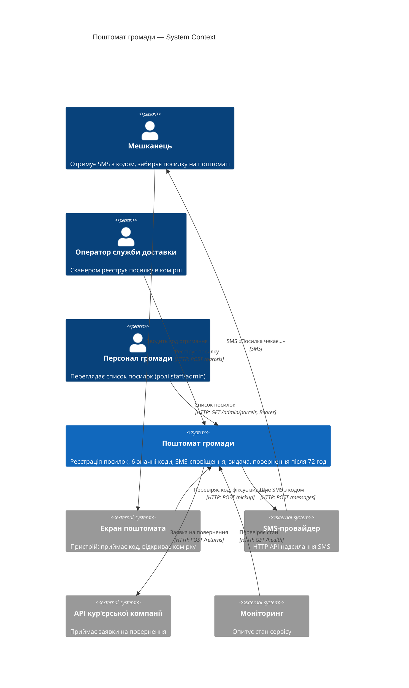

# Архітектура «Поштомата громади» — C4

Діаграми — система такою, якою вона є в коді `app/` (стан гілки `main`). Кожна стрілка
має доказ у таблиці нижче. Прогони AI: `ai-runs/c4-from-docs.md` (лише `app/README.md`
і `app/docs/`), `ai-runs/c4-from-code.md` (уся `app/`).

## Рівень 1 — System Context



## Рівень 2 — Container

```mermaid
C4Container
  title Поштомат громади — Container (одна VM, docker compose; PostgreSQL поза контейнерами)
  Person(resident, "Мешканець")
  Person(operator, "Оператор служби доставки")
  Person(staff, "Персонал громади")
  System_Ext(terminal, "Екран поштомата")
  System_Ext(sms, "SMS-провайдер")
  System_Ext(courier, "API кур'єрської компанії")
  System_Ext(monitoring, "Моніторинг")
  System_Boundary(vm, "VM poshtomat-prod-1") {
    Container(api, "API", "Node.js, src/server.js", "POST /parcels, POST /pickup, GET /admin/parcels, GET /health; пул з'єднань БД; сесійна авторизація персоналу")
    Container(worker, "Worker", "Node.js, src/worker.js (той самий образ)", "Кожні 10 с: до 50 несповіщених посилок → SMS з кодом; pacing і retry на 429")
    Container(expire, "Нічна задача", "Node.js, bin/expire-parcels.js (cron)", "Посилки, що пролежали >72 год → returned + заявка кур'єру")
    ContainerDb(db, "PostgreSQL", "На VM, поза compose", "Посилки, події, сесії персоналу")
  }
  Rel(operator, api, "Реєструє посилку", "HTTP: POST /parcels")
  Rel(resident, terminal, "Вводить код")
  Rel(terminal, api, "Перевірка коду, видача", "HTTP: POST /pickup")
  Rel(staff, api, "Список без кодів, телефони масковано", "HTTP: GET /admin/parcels, Bearer")
  Rel(monitoring, api, "Health-check", "HTTP: GET /health")
  Rel(api, db, "Читає/пише посилки, події, сесії", "SQL, через пул")
  Rel(worker, db, "listUnnotified / updateParcel(notifiedAt)", "SQL, через пул")
  Rel(worker, sms, "Надсилає SMS", "HTTP: POST /messages, Bearer")
  Rel(sms, resident, "SMS з кодом отримання", "SMS")
  Rel(expire, db, "findExpired / markReturned", "SQL, через пул")
  Rel(expire, courier, "Заявка на повернення", "HTTP: POST /returns")
```

## Стрілки і докази

| # | Стрілка (звідки → куди: що і як) | Доказ (`файл:рядок`) | AI з документації (`ai-runs/c4-from-docs.md`) | AI з коду (`ai-runs/c4-from-code.md`) |
|---|---|---|---|---|
| 1 | Оператор доставки → API: реєстрація посилки, `POST /parcels` | `app/src/server.js:38-41` | є | є |
| 2 | Екран поштомата → API: перевірка коду і видача, `POST /pickup` | `app/src/server.js:42-46` | є | є |
| 3 | Персонал → API: список посилок, `GET /admin/parcels` з Bearer-сесією | `app/src/server.js:47-50`, `:14-20` | є | є |
| 4 | Моніторинг → API: `GET /health` | `app/src/server.js:37` | є | є |
| 5 | API → PostgreSQL: посилки, події, сесії через пул | `app/src/server.js:91-93`, `app/src/parcels.js:43`, `:64-67` | є | є |
| 6 | Worker → PostgreSQL: вибірка несповіщених і фіксація `notifiedAt` | `app/src/worker.js:24`, `:33` | є (але «кожні 30 с» — застаріла цифра з доків; у коді 10 с: `app/src/worker.js:8`) | є (10 с, виправив доки явно) |
| 7 | Worker → SMS-провайдер: `POST {SMS_BASE_URL}/messages`, Bearer-токен | `app/src/sms.js:31-35`, `app/src/worker.js:28` | є | є |
| 8 | SMS-провайдер → Мешканець: SMS «Посилка чекає…, Код: N» | `app/src/worker.js:11-13` (текст повідомлення) | є (але «4-значний код» — застаріла цифра з доків; у коді 6 цифр: `app/src/parcels.js:27`) | є (6-значний) |
| 9 | Нічна задача → PostgreSQL: `findExpired` / `markReturned` | `app/bin/expire-parcels.js:12-14`, `app/src/parcels.js:78-88` | є | є |
| 10 | Нічна задача → API кур'єра: `POST /returns`, `reason=not_picked_up_72h` | `app/bin/expire-parcels.js:15`, `app/src/courier.js:7-16` | **пропустив** | є |
| 11 | Мешканець → екран поштомата: вводить код (клієнт поза цим репо) | `app/README.md:3-4` (опис потоку; коду термінала в репо немає) | є | є |

## Що AI вигадав / пропустив

| Прогін | Вигадав — стрілки й компоненти, яких у коді немає (і чим це перевірили) | Пропустив — стрілки з таблиці вище, яких немає в AI |
|---|---|---|
| з документації | стрілок не вигадав — усі 10 намальованих існують у коді. Успадкував від застарілих доків два хибні атрибути: «4-значний код» (`app/docs/ARCHITECTURE.md:19`; у коді 6 цифр — `app/src/parcels.js:27`: `padStart(6, "0")`) і «worker кожні 30 с» (`app/docs/ARCHITECTURE.md:18`; у коді `POLL_INTERVAL_MS = 10_000` — `app/src/worker.js:8`) | № 10 — повернення через API кур'єра: `grep -in courier app/docs/ARCHITECTURE.md app/README.md` → нічого; документація згадує лише «позначає як повернені», зовнішнього виклику в ній немає |
| з коду | нічого: кожна стрілка обох його діаграм має відповідник у таблиці; розбіжності доків з кодом він помітив і вирішив на користь коду (його «припущення 3») | нічого |

**Разом:** з документації — вигадано 0, пропущено 1 (плюс 2 хибні атрибути, успадковані
з застарілого `ARCHITECTURE.md` v1.5); з коду — вигадано 0, пропущено 0.

Висновок прогонів: діаграма «з документації» точна рівно настільки, наскільки точна
документація — вона мовчки успадкувала її прогалину (кур'єр) і застарілі цифри; код
дав повну картину.

## Запропоноване (з ADR) — необов'язково

За `docs/adr/0001-notifications.md` (розділ «Рішення») до контейнера PostgreSQL
додається таблиця-розклад `notifications`, а worker стає її виконавцем (нагадування
24/48 год і повернення рівно через 72 год); нічна задача після перехідного релізу
зникає. Нових контейнерів і нових зовнішніх систем ця зміна не додає, тому на
діаграмах вище її не показано; доказ — сам ADR, розділи «Рішення» і «Наслідки».
