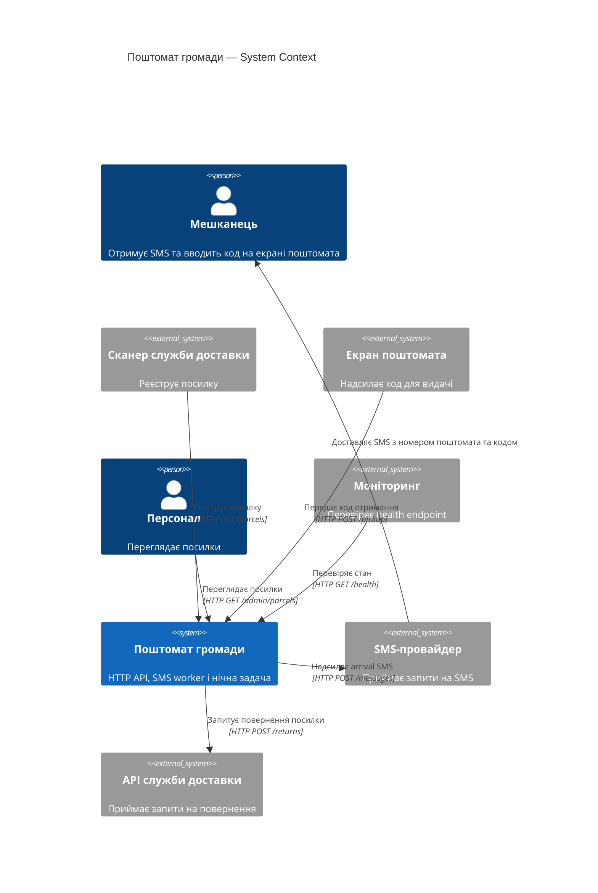
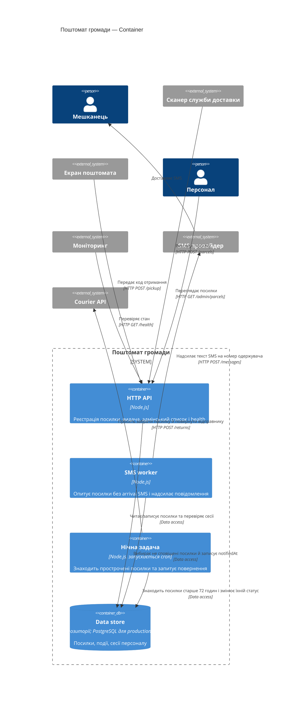

# Архітектура «Поштомата громади» — C4

Діаграми відображають реалізацію в `app/`. Зовнішні клієнти показані лише там, де їхню взаємодію видно в HTTP-обробниках або коментарях коду. Часова задача запускається зовнішнім cron; сам cron не є частиною процесу застосунку.

## Рівень 1 — System Context

## Рівень 2 — Container

## Стрілки і докази

Кожен рядок відповідає взаємодії на діаграмах. Деякі зовнішні взаємодії повторюються на обох рівнях. Докази наведено за кодом застосунку.

| # | Стрілка (звідки → куди: що і як) | Доказ (`файл:рядок`) | AI з документації | AI з коду |
|---|---|---|---|---|
| 1 | Сканер доставки → API: реєструє посилку, `POST /parcels` | `app/src/server.js:38-40`; коментар про scanner: `app/src/parcels.js:34-35` | Є | Є |
| 2 | Екран поштомата → API: надсилає код, `POST /pickup` | `app/src/server.js:42-45`; `app/src/parcels.js:58-61` | Є | Є |
| 3 | Персонал → API: читає список, `GET /admin/parcels` | `app/src/server.js:47-49` | Є | Є |
| 4 | Моніторинг → API: перевіряє `GET /health` | `app/src/server.js:36-37` | Є | Є |
| 5 | API → сховище: читає/записує посилки та перевіряє сесії | `app/src/server.js:13-19,38-49`; `app/src/parcels.js:43-55,61-75` | Є | Є |
| 6 | Worker → сховище: вибирає не сповіщені та записує `notifiedAt` | `app/src/worker.js:23-34`; реалізація списку `app/src/db.js:40-44` | Є | Є |
| 7 | Worker → SMS-провайдер: надсилає номер і текст через HTTP | `app/src/worker.js:26-34`; `app/src/sms.js:27-44` | Є | Є |
| 8 | SMS-провайдер → мешканець: доставляє arrival SMS | `app/src/worker.js:11-13,28`; клієнт передає `to` і `text`: `app/src/sms.js:31-35` | Пропустив — у прогоні є лише `locker → resident`, не `sms → resident` | Пропустив |
| 9 | Нічна задача → сховище: знаходить прострочені, позначає поверненими | `app/bin/expire-parcels.js:11-14`; `app/src/parcels.js:78-87` | Є | Є |
| 10 | Нічна задача → Courier API: просить забрати посилку (`POST /returns`) | `app/bin/expire-parcels.js:15`; `app/src/courier.js:3-18` | Пропустив | Є |

## Що AI вигадав / пропустив

| Прогін | Вигадав — стрілки й компоненти, яких у коді немає | Пропустив — стрілки з таблиці вище, яких немає у відповіді AI |
|---|---|---|
| З документації | 1 стрілку: мешканець → екран поштомата («вводить код»). Документація показує цей крок, але код доводить лише передачу введеного коду терміналом до `POST /pickup`; дії людини на екрані в коді немає. | 2 стрілки: SMS-провайдер → мешканець (№8) і нічна задача → Courier API (№10). У прогоні є `locker → resident`, а не `sms → resident`; у `app/bin/expire-parcels.js:15` задача викликає повернення, а `app/src/courier.js:7-18` виконує HTTP-запит, якого архітектурна документація не показує. |
| З коду | Немає стрілок без опори в коді. | 1 стрілку: SMS-провайдер → мешканець (№8). Показує виклик провайдера, але не доставку повідомлення мешканцю. |

Окремо від стрілок: документаційний прогін повторив застарілі параметри — poll кожні 30 секунд і 4-значний код. Код встановлює 10 секунд (`app/src/worker.js:8,65-66`) та генерує 6 цифр (`app/src/parcels.js:25-28`). Також документація називає PostgreSQL фактичною БД, тоді як `app/src/db.js:1-2` каже, що у цьому репозиторії store in-memory; PostgreSQL описаний як production реалізація того самого інтерфейсу.

**Разом:** з документації — вигадано 1 стрілку, пропущено 2; з коду — вигадано 0, пропущено 1.

## Перевірка меж діаграми

- У коді є `GET /admin/parcels` для персоналу, але немає окремої взаємодії відправника з інтерфейсом статусу повернення; тому такого клієнта на діаграмі немає.
- Worker надсилає arrival SMS. Нагадувань через 24/48 годин у поточному `app/` немає; цієї майбутньої функції на діаграмі немає.
- `app/` не змінювався.
