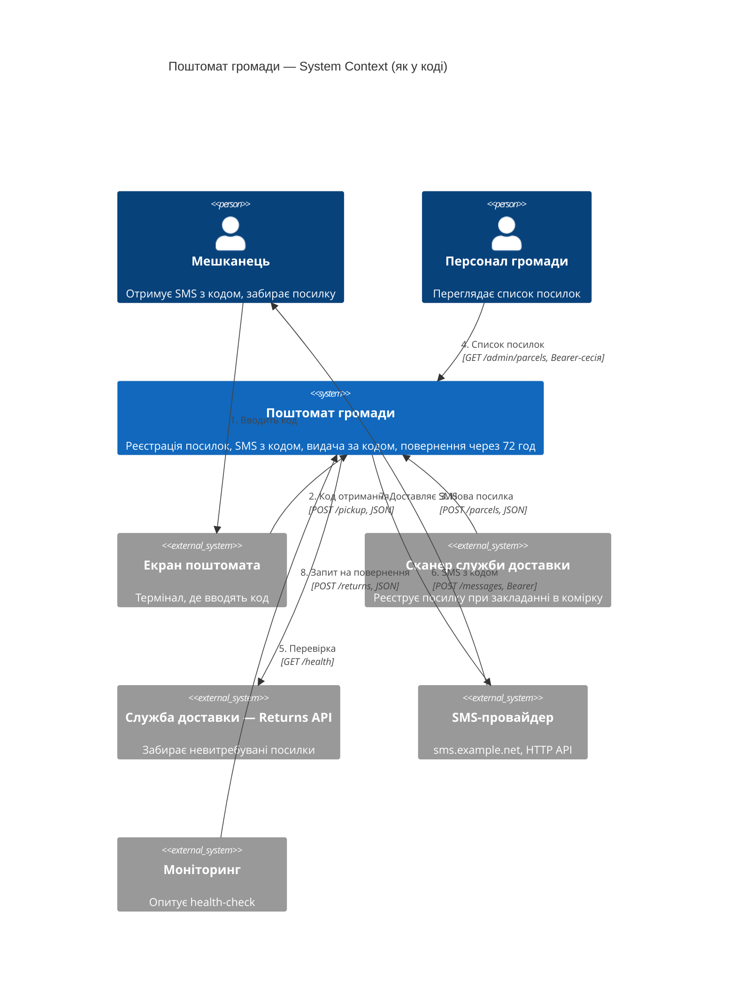
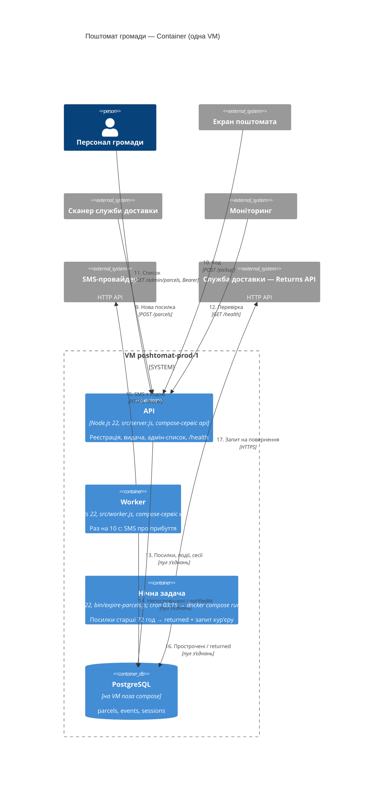
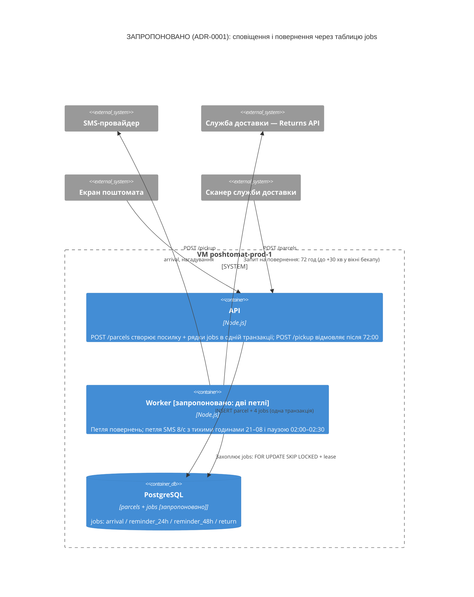

# Архітектура «Поштомата громади» — C4

> Діаграми — такою, якою система є **в коді** `app/` (v1.7.3). Кожна стрілка має рядок у
> таблиці доказів. Частина з ADR — окремою діаграмою з позначкою «запропоновано».

## Рівень 1 — System Context

## Рівень 2 — Container

## Стрілки і докази

«є» — AI намалював цю стрілку; «пропустив» — у його діаграмі її немає.

| # | Стрілка (звідки → куди: що і як) | Доказ (`файл:рядок`) | AI з документації (`ai-runs/c4-from-docs.md`) | AI з коду (`ai-runs/c4-from-code.md`) |
|---|---|---|---|---|
| 1 | Мешканець → Екран: вводить код | поза кодом; `app/src/parcels.js:58` («The locker terminal sends the code the person typed») | є | є |
| 2 | Екран → система: `POST /pickup` | `app/src/server.js:42-46` → `app/src/parcels.js:59` | є | є |
| 3 | Сканер служби доставки → система: `POST /parcels` | `app/src/server.js:38-41`; `app/src/parcels.js:34-35` («Called by the delivery operator's scanner») | є (як Person «Служба доставки») | є |
| 4 | Персонал → система: `GET /admin/parcels`, `Authorization: Bearer <сесія>` | `app/src/server.js:47-50`, `app/src/server.js:13-19` | є | є |
| 5 | Моніторинг → система: `GET /health` | `app/src/server.js:37`. Хто саме опитує, у коді не видно (припущення обох прогонів і моє) | є | є |
| 6 | Система → SMS-провайдер: `POST {SMS_BASE_URL}/messages`, Bearer-токен | `app/src/sms.js:31-35`, `app/src/worker.js:28`, `app/src/config.js:11-12` | є | є |
| 7 | SMS-провайдер → Мешканець: SMS | поза кодом; текст — `app/src/worker.js:12` | є | є |
| 8 | Система → Returns API служби доставки: `POST {COURIER_BASE_URL}/returns` | `app/src/courier.js:7-17`, `app/bin/expire-parcels.js:15`, `app/src/config.js:14` | **пропустив**: документація про кур'єра мовчить | є |
| 9 | Сканер → API: `POST /parcels` | `app/src/server.js:38` | є | є |
| 10 | Екран → API: `POST /pickup` | `app/src/server.js:42` | є | є |
| 11 | Персонал → API: `GET /admin/parcels` | `app/src/server.js:47-48` | є | є |
| 12 | Моніторинг → API: `GET /health` | `app/src/server.js:37` | є | є |
| 13 | API → PostgreSQL: посилки, події, сесії | `app/src/parcels.js:43-67`, `app/src/server.js:18`, `app/src/server.js:91` (`createPool`). PostgreSQL лише за коментарем `app/src/db.js:1-2`: у репо сховище в пам'яті, а `config.dbUrl` (`app/src/config.js:7`) ніде не використовується (`grep -rn dbUrl app/src app/bin` → лише `config.js`) | є | є |
| 14 | Worker → PostgreSQL: `listUnnotified`, `notifiedAt` | `app/src/worker.js:24`, `app/src/worker.js:33` | є | є |
| 15 | Worker → SMS-провайдер | `app/src/worker.js:28`, `app/src/worker.js:44-49` | є | є |
| 16 | Нічна задача → PostgreSQL: `findExpired`, `markReturned` | `app/bin/expire-parcels.js:12,14`, `app/src/parcels.js:78-88` | є | є |
| 17 | Нічна задача → Returns API | `app/bin/expire-parcels.js:15`, `app/bin/expire-parcels.js:26` | **пропустив** | є |

Стрілки діаграми «Запропоноване» (нижче). У коді їх немає. Доказом є розділ ADR, а AI-прогонам їх не ставили, бо обидва малювали поточну систему:

| # | Стрілка (звідки → куди: що і як) — **запропоновано** | Доказ (розділ `docs/adr/0001-notifications.md`) | AI з документації | AI з коду |
|---|---|---|---|---|
| 18 | Сканер → API: `POST /parcels` (без змін) | `docs/adr/0001-notifications.md:48-50` («Рішення», п. 1); поточна реалізація — стрілка 9 | не стосується (запропоновано) | не стосується (запропоновано) |
| 19 | Екран → API: `POST /pickup`, відмова після 72:00 | `docs/adr/0001-notifications.md:51-54` («Рішення», п. 2) | не стосується (запропоновано) | не стосується (запропоновано) |
| 20 | API → PostgreSQL: `INSERT` посилки + 4 рядки `jobs` в одній транзакції | `docs/adr/0001-notifications.md:48-50` («Рішення», п. 1) | не стосується (запропоновано) | не стосується (запропоновано) |
| 21 | Worker → PostgreSQL: захоплення `jobs` (`FOR UPDATE SKIP LOCKED` + lease) | `docs/adr/0001-notifications.md:48-50`, `docs/adr/0001-notifications.md:59-64`, `docs/adr/0001-notifications.md:69` («Рішення», пп. 1, 4, 6) | не стосується (запропоновано) | не стосується (запропоновано) |
| 22 | Worker → SMS-провайдер: `arrival` і нагадування, 8/с, тихі години | `docs/adr/0001-notifications.md:55-58`, `docs/adr/0001-notifications.md:59-64`, `docs/adr/0001-notifications.md:65-68` («Рішення», пп. 3, 4, 5) | не стосується (запропоновано) | не стосується (запропоновано) |
| 23 | Worker → Returns API: запит на повернення через 72 год (до +30 хв, якщо 72-га година припадає на вікно бекапу 02:00–02:30; код недійсний рівно з 72:00 — це стрілка 19) | `docs/adr/0001-notifications.md:51-54`, `docs/adr/0001-notifications.md:69`, `docs/adr/0001-notifications.md:111-113` («Рішення», пп. 2, 6; «Обмеження, які ми свідомо не виконуємо») | не стосується (запропоновано) | не стосується (запропоновано) |

Перевірка, що інших вихідних викликів немає: `grep -rn "fetch(" app/src app/bin` → лише `app/src/sms.js:31` і `app/src/courier.js:7`. API не кличе ні SMS-провайдера, ні кур'єра: `grep -n "sms\|courier" app/src/server.js` → 0.

## Що AI вигадав / пропустив

| Прогін | Вигадав — стрілки й компоненти, яких у коді немає (і чим це перевірили) | Пропустив — стрілки з таблиці вище, яких немає в AI |
|---|---|---|
| з документації | **Стрілок не вигадав.** Але переніс із застарілої `app/docs/ARCHITECTURE.md` хибні властивості контейнера: worker «кожні 30 с» і «SMS з 4-значним кодом». У коді `POLL_INTERVAL_MS = 10_000` (`app/src/worker.js:8`), код `padStart(6, "0")` (`app/src/parcels.js:27`). Нічна задача в нього лише «позначає… як повернені», хоча вона ще й кличе кур'єра | **8, 17**: уся інтеграція з Returns API служби доставки |
| з коду | **Стрілок не вигадав.** Одне хибне припущення про контейнер: «Нічна задача… cron на VM, **а не** сервіс у docker compose». Насправді cron запускає її **через compose в образі worker**: `docker compose run --rm worker npm run expire` (`docs/ops/backup-runbook.md:18-19`). Цього документа прогін не бачив, тож це припущення, позначене як таке | — |

**Разом:** з документації — вигадано 0, пропущено 2; з коду — вигадано 0, пропущено 0.

Окремо: обидва прогони намалювали `PostgreSQL` як факт. Це правда для продакшну за документацією, але не для коду в репо (рядок 13). Діаграма з коду мала б принаймні позначити це як припущення.

## Запропоноване (з ADR)

Доказ — `docs/adr/0001-notifications.md`, розділ «Рішення», пп. 1–8. На поточній діаграмі цього **немає**.

