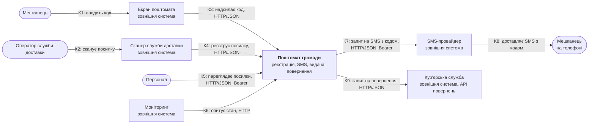
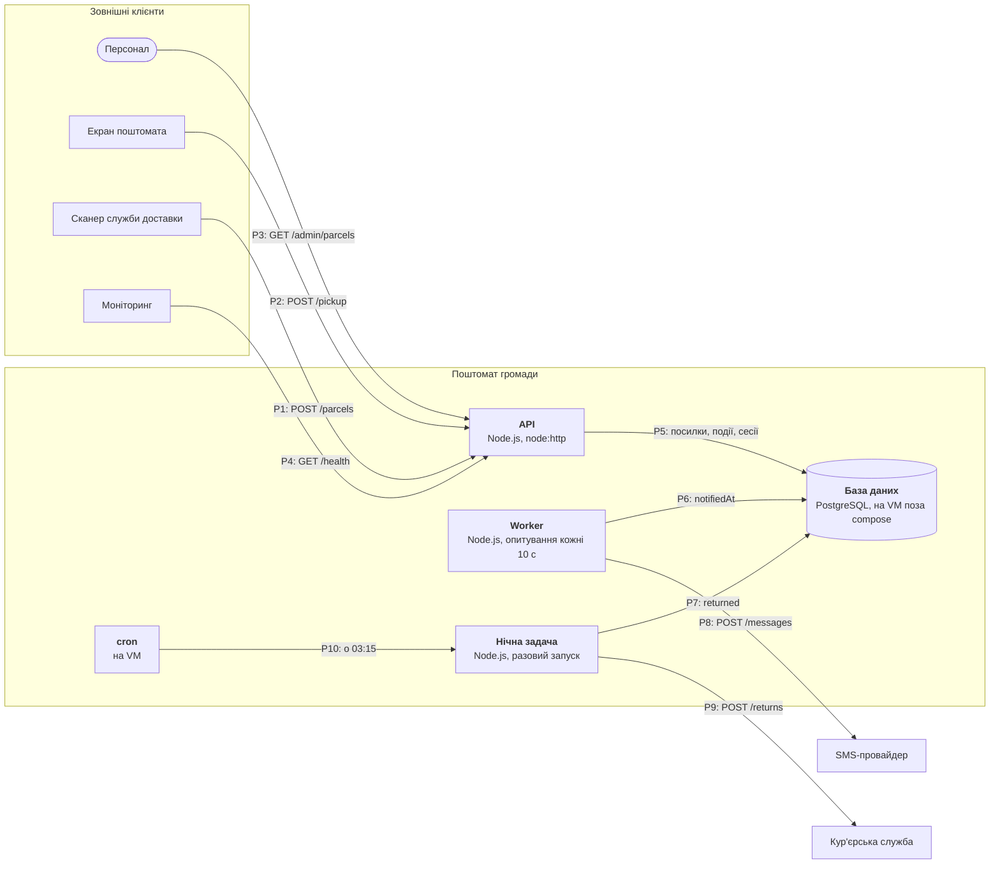

# Архітектура «Поштомата громади» — C4

Діаграми показують систему такою, якою вона є в коді. Номер на стрілці — це номер рядка в
таблиці доказів.

## Рівень 1 — System Context

«Мешканець» показаний двічі лише для читабельності: це одна людина.

## Рівень 2 — Container

## Стрілки і докази

| # | Стрілка (звідки → куди: що і як) | Доказ (`файл:рядок`) | AI з документації (`ai-runs/c4-from-docs.md`) | AI з коду (`ai-runs/c4-from-code.md`) |
|---|---|---|---|---|
| К1 | Мешканець → Екран: вводить код | `app/src/parcels.js:58` | є | є |
| К2 | Оператор → Сканер: сканує посилку | `app/src/parcels.js:34` | є | є |
| К3 | Екран → Система: надсилає код, HTTP/JSON | `app/src/server.js:42-46` | є | є |
| К4 | Сканер → Система: реєструє посилку, HTTP/JSON | `app/src/server.js:38-41` | є | є |
| К5 | Персонал → Система: список посилок, Bearer | `app/src/server.js:47-50`, `app/src/server.js:16` | є | є |
| К6 | Моніторинг → Система: стан, HTTP | `app/src/server.js:37`, `app/docs/ARCHITECTURE.md:17` | є | є |
| К7 | Система → SMS-провайдер: запит на SMS, HTTP/JSON, Bearer | `app/src/worker.js:28`, `app/src/sms.js:31-35` | є | є |
| К8 | SMS-провайдер → Мешканець: SMS з кодом | `app/src/worker.js:12`, `app/src/worker.js:28` | є | є |
| К9 | Система → Кур'єрська служба: запит на повернення, HTTP/JSON | `app/bin/expire-parcels.js:15`, `app/src/courier.js:7-16` | пропустив — кур'єра в документації немає | є |
| Р1 | Сканер → API: `POST /parcels` | `app/src/server.js:38-41` | є | є |
| Р2 | Екран → API: `POST /pickup` | `app/src/server.js:42-46` | є | є |
| Р3 | Персонал → API: `GET /admin/parcels`, Bearer | `app/src/server.js:47-50`, `app/src/server.js:16` | є | є |
| Р4 | Моніторинг → API: `GET /health` | `app/src/server.js:37`, `app/docs/ARCHITECTURE.md:17` | є | є |
| Р5 | API → БД: посилки й події, читає сесії | `app/src/parcels.js:43-44`, `app/src/parcels.js:61-67`, `app/src/parcels.js:74`, `app/src/server.js:18` | є | є |
| Р6 | Worker → БД: читає без сповіщення, пише `notifiedAt` | `app/src/worker.js:24`, `app/src/worker.js:33` | є | є |
| Р7 | Нічна задача → БД: читає прострочені, пише `returned` | `app/bin/expire-parcels.js:12`, `app/bin/expire-parcels.js:14`, `app/src/parcels.js:80`, `app/src/parcels.js:85-86` | є | є |
| Р8 | Worker → SMS-провайдер: `POST /messages`, Bearer | `app/src/worker.js:28`, `app/src/sms.js:31-35` | є | є |
| Р9 | Нічна задача → Кур'єрська служба: `POST /returns` | `app/bin/expire-parcels.js:15`, `app/src/courier.js:7-16` | пропустив — задача лише «Marks parcels… as returned» | є |
| Р10 | cron → Нічна задача: запуск о 03:15 | `app/bin/expire-parcels.js:2`, `app/package.json:11`, `docs/ops/backup-runbook.md:18-19` | пропустив — "the docs don't say what triggers the job" | пропустив — "cron on the VM" є лише підписом, стрілки немає |

**PostgreSQL:** у репо сховище працює в пам'яті. PostgreSQL на стрілках Р5–Р7 підтверджують
`app/src/db.js:1-2`, `app/README.md:23-24` і `main:deploy/compose.yaml:2`, але не код: `dbUrl`
завантажується (`app/src/config.js:7`), проте не використовується.

**Стрілок, яких немає, хоча їх легко припустити:**

- **API → SMS-провайдер:** `main:deploy/compose.yaml:18-20` передає API налаштування SMS, але
  `app/src/server.js` не створює SMS-клієнта.
- **API ↔ Worker:** прямого зв'язку немає. У коді репо спільної БД теж немає: API і worker
  кожен створюють свій `createPool` із власним сховищем у пам'яті (`app/src/server.js:91`,
  `app/src/worker.js:43`, `app/src/db.js:63`), тож worker не бачить посилок, записаних API.
  Спільна PostgreSQL, через яку вони працюють разом, — це опис production-середовища
  (`app/src/db.js:1-2`, `main:deploy/compose.yaml:2`), а не наявна модель коду.
- **SMS-провайдер → API:** маршруту для вебхука немає (`app/src/server.js:36-52`).

## Що AI вигадав / пропустив

| Прогін | Вигадав — стрілки й компоненти, яких у коді немає (і чим це перевірили) | Пропустив — стрілки з таблиці вище, яких немає в AI |
|---|---|---|
| з документації | Нічого. Усі його стрілки є в таблиці; `grep -rniE 'redis\|kafka\|rabbit\|webhook\|nginx\|proxy' app/src app/bin` нічого не знаходить | К9, Р9, Р10 |
| з коду | Нічого, та сама перевірка | Р10 |

**Разом:** з документації — вигадано 0, пропущено 3; з коду — вигадано 0, пропущено 1.

**Неправильні підписи на справжніх елементах** (не враховані в числах):

- **З документації, код:** "4-digit code", а в коді 6 цифр (`app/src/parcels.js:27`).
- **З документації, опитування:** "Every 30 seconds", а в коді 10 с (`app/src/worker.js:8`).
- **З документації, ролі:** "Delivery service courier" змішує оператора зі сканером
  (`app/src/parcels.js:34`) і кур'єрську службу (`app/src/courier.js:1`).

Обидві неточності в цифрах прийшли з `app/docs/ARCHITECTURE.md:18-19`, а кур'єра в цьому
файлі немає зовсім.

## Запропоноване (з ADR) — необов'язково

Не показано: діаграми описують лише наявну систему.
