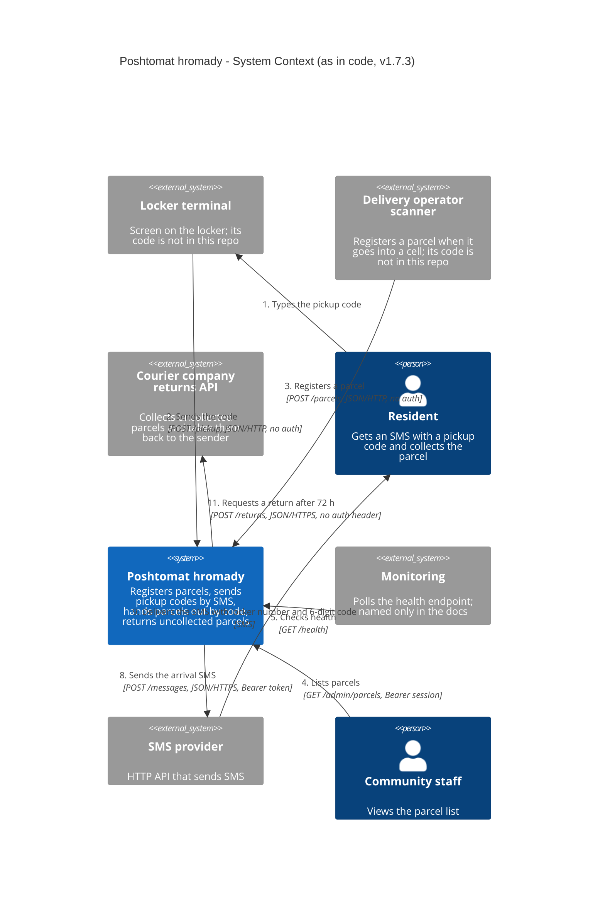
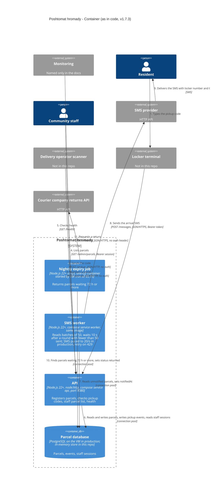

# Poshtomat hromady architecture — C4

> Task B. The diagrams show the system as it is in `app/` (version 1.7.3,
> `app/package.json:3`), not as `app/docs/ARCHITECTURE.md` describes it. Runtime values
> (the URL schemes on arrows 8 and 11, the SMS rate of 20/s) come from the production compose
> file at `c6800ab`, which overrides the code defaults; Task D later sets the rate to 5/s.
> `c6800ab:deploy/compose.yaml:34` is line 34 of `git show c6800ab:deploy/compose.yaml`. The
> database is the production PostgreSQL named in `app/src/db.js:1-2`; this repo has only an
> in-memory store (see the notes under Level 2). Every arrow carries a number; the same
> number is a row in "Arrows and evidence". `app/` is not modified.

## Level 1 — System Context

Arrows 6, 7 and 10 are inside the system and appear only on Level 2.

## Level 2 — Container

Notes on what the diagram shows:

- **Database.** Production runs the same interface on PostgreSQL (`app/src/db.js:1-2`,
  `app/README.md:23-24`), on the VM outside compose (`c6800ab:deploy/compose.yaml:2`). This repo
  contains only the in-memory store (`app/src/db.js:11-59`). Each process builds its own
  pool with a fresh store (`app/src/db.js:63`; called from `app/src/server.js:91`,
  `app/src/worker.js:43`, `app/bin/expire-parcels.js:24`), and `DATABASE_URL` is read
  (`app/src/config.js:7`) but not used: `grep -rn dbUrl app/src app/bin` returns only
  `app/src/config.js:7`. The diagram shows the production shape; a shared database is
  not in the code of this repo.
- **Nightly job.** Started by cron on the VM (`app/bin/expire-parcels.js:2`) at 03:15 as
  `docker compose run --rm worker npm run expire` (`docs/ops/backup-runbook.md:18-19`).
- **Locker terminal and scanner** are callers of the API, not part of it: the code
  names them only in comments (`app/src/parcels.js:34`, `app/src/parcels.js:58`), and
  `find app -type f` lists no client code.
- **Deployment.** The boundary on Level 2 is the software system. All its containers and
  the database run on one VM (`c6800ab:deploy/compose.yaml:1-2`, `docs/ops/backup-runbook.md:7`).
- **Protocols.** The API is plain HTTP (`app/src/server.js:1`, `app/src/server.js:93`);
  TLS is not in the code. The SMS and courier clients take the scheme from the base URL
  (`app/src/sms.js:31`, `app/src/courier.js:7`). The code defaults are `http://localhost`
  (`app/src/config.js:11`, `app/src/config.js:14`); the production compose file sets
  `https` URLs for both services (`c6800ab:deploy/compose.yaml:18`, `c6800ab:deploy/compose.yaml:21`,
  `c6800ab:deploy/compose.yaml:32`, `c6800ab:deploy/compose.yaml:35`). Arrows 8 and 11 are therefore
  HTTPS, in line with the production shape shown for the database. The worker's
  settings apply to the nightly job too, since it runs as `docker compose run --rm worker`.

## Arrows and evidence

One row per arrow. "Level": where the arrow appears in the diagrams above (L1 — System
Context, L2 — Container; on L1 the API, worker and job are one box). The AI columns:
**yes** — the run drew this arrow on at least one level (the level is named when it
drew it on only one); **missed** — the arrow is not in its diagrams.

| # | Arrow (from → to: what and how) | Level | Evidence (`file:line`) | AI from docs (`ai-runs/c4-from-docs.md`) | AI from code (`ai-runs/c4-from-code.md`) |
|---|---|---|---|---|---|
| 1 | Resident → Locker terminal: types the pickup code | L1, L2 | `app/src/parcels.js:58` ("The locker terminal sends the code the person typed") | yes | yes (L2 only) |
| 2 | Locker terminal → API: `POST /pickup` with `{code}`, JSON over HTTP, no authentication; on a match the parcel becomes `picked_up` | L1, L2 | `app/src/server.js:42-45`, `app/src/parcels.js:59-68` | yes | yes (on L1 as Resident → system, with the locker terminal left out) |
| 3 | Delivery operator scanner → API: `POST /parcels` with `lockerId`, `recipientPhone`, `sender`, JSON over HTTP, no authentication | L1, L2 | `app/src/server.js:38-40`, `app/src/parcels.js:34-55` | yes | yes (on L1 as a courier-staff person → system, with the scanner left out) |
| 4 | Community staff → API: `GET /admin/parcels` with `Authorization: Bearer <session id>`, roles `staff`/`admin`; codes removed, phones masked | L1, L2 | `app/src/server.js:14-19`, `app/src/server.js:47-49`, `app/src/parcels.js:15`, `app/src/parcels.js:72-75` | yes | yes |
| 5 | Monitoring → API: `GET /health`, returns status and version | L1, L2 | `app/src/server.js:37`; the caller is named only in `app/docs/ARCHITECTURE.md:17` | yes | yes |
| 6 | API → Database: inserts parcels, finds a waiting parcel by code, sets `picked_up`, writes a `picked_up` event, lists parcels, looks up staff sessions | L2 | `app/src/parcels.js:43-44`, `app/src/parcels.js:61`, `app/src/parcels.js:64-67`, `app/src/parcels.js:74`, `app/src/server.js:18` | yes | yes |
| 7 | SMS worker → Database: reads up to 50 waiting parcels without `notifiedAt`, sets `notifiedAt` after each sent SMS | L2 | `app/src/worker.js:9`, `app/src/worker.js:24`, `app/src/worker.js:33`, `app/src/db.js:40-45` | yes | yes |
| 8 | SMS worker → SMS provider: `POST {SMS_BASE_URL}/messages` with `{to, text}`, `Bearer SMS_TOKEN`, JSON over HTTPS in production, paced to `SMS_RATE_PER_SEC` (20/s in production at `c6800ab`, 5/s after Task D, 5/s code default), up to 4 attempts on HTTP 429 | L1, L2 | `app/src/worker.js:28`, `app/src/worker.js:44-49`, `app/src/config.js:13`, `app/src/sms.js:14`, `app/src/sms.js:21-25`, `app/src/sms.js:31-41`, `c6800ab:deploy/compose.yaml:32`, `c6800ab:deploy/compose.yaml:34` | yes | yes |
| 9 | SMS provider → Resident: SMS with the locker number and the 6-digit code, sent to `recipientPhone` (delivery itself happens outside the code) | L1, L2 | `app/src/worker.js:11-13`, `app/src/worker.js:28`, `app/src/parcels.js:27` | yes | yes (L1 only) |
| 10 | Nightly expiry job → Database: finds `waiting` parcels that arrived 72 h or more ago, sets status `returned` | L2 | `app/bin/expire-parcels.js:12-14`, `app/src/parcels.js:18`, `app/src/parcels.js:78-87` | yes | yes |
| 11 | Nightly expiry job → Courier company returns API: `POST {COURIER_BASE_URL}/returns` with `parcel_id`, `locker_id`, `sender`, `reason`, JSON over HTTPS in production; the request carries only a `content-type` header, no authentication header | L1, L2 | `app/bin/expire-parcels.js:15`, `app/bin/expire-parcels.js:26`, `app/src/courier.js:6-18`, `c6800ab:deploy/compose.yaml:35` | **missed** — the docs say only that the job marks parcels as returned (`app/docs/ARCHITECTURE.md:22-23`) | yes |

## What the AI invented / missed

Counting rule. An arrow or component a run drew is **invented** when the diagrams above
have no counterpart for it; those diagrams contain only what the code supports, plus the
monitoring caller named in `app/docs/ARCHITECTURE.md:17`. Three cases follow from this. A
component that the diagrams above show outside the system, but the run draws as a
container inside the system boundary, is invented in that form: a container inside the
boundary says the system runs it. An arrow between the same two parts as a row above,
with one end under another name, is that row, not an invented arrow. On L1, an arrow
from a person straight to the system, for a call that the diagrams above route through
the device the person uses, is the row of that device's call with the device left out,
not an invented arrow. Wrong labels on elements that are not invented are listed under
"Wrong details" and are not in the count.

| Run | Invented — arrows and components that are not in the code (and how this was checked) | Missed — rows from the table above that the run does not have |
|---|---|---|
| from docs | Nothing. Every arrow and component the run drew has a counterpart in the diagrams above. | #11 |
| from code | 3 components and 1 arrow. Components: `screen` (locker screen) and `scanner` (delivery scanner), drawn as `Container` inside the `vm` boundary, i.e. as parts of the system running on the VM; the system only serves them (`app/src/parcels.js:34`, `app/src/parcels.js:58`), `find app -type f` lists no client code, and the run's own assumption 2 says their code is not in the repo. `courierStaff`, a person who operates the scanner: the code names only "the delivery operator's scanner" (`app/src/parcels.js:34`) and mentions a courier only as the party the returns API asks to collect a parcel (`app/src/courier.js:5`); the docs name only the delivery service's scanner (`app/docs/ARCHITECTURE.md:10`, `app/docs/ARCHITECTURE.md:15`). Arrow: `courierStaff → scanner` on L2, which has no row above. On L1 the run's `resident → poshtomat` and `courierStaff → poshtomat` (`ai-runs/c4-from-code.md:31-32`) leave the device out, so they count as rows 2 and 3 (counting rule), not as invented arrows. | none (#1 only on L2, #9 only on L1) |

Wrong details on drawn elements (not arrows, not in the count):

- From docs: the worker runs "every 30 s" and sends a "4-digit" code. The code waits
  10 s between rounds (`app/src/worker.js:8`), with no wait after a full batch of 50
  (`app/src/worker.js:65-66`), and generates and accepts 6-digit codes
  (`app/src/parcels.js:27`, `app/src/parcels.js:60`). Both values come from
  `app/docs/ARCHITECTURE.md:18-19`.
- From code: the worker sends a "4-digit" code and polls "every 10 s". The run read
  `worker.js` and corrected the interval from 30 s to 10 s, but kept the code length from
  the docs, and, like the docs, gives a fixed period: after a full batch of 50 the worker
  goes again without waiting (`app/src/worker.js:65-66`).
- From code: the worker is limited to "5 SMS/s". That is the code default
  (`app/src/config.js:13`); production sets 20 (`c6800ab:deploy/compose.yaml:34`), which the run
  did not see.

Not counted — details the run neither listed as assumptions nor gave a source for:

- From code: `HTTPS` on the SMS and courier arrows (`ai-runs/c4-from-code.md:34-35`,
  `ai-runs/c4-from-code.md:73-74`). It matches production (`c6800ab:deploy/compose.yaml:32`,
  `c6800ab:deploy/compose.yaml:35`), which the run did not see. The `app/src` defaults are
  `http://localhost` (`app/src/config.js:11`, `app/src/config.js:14`); the only `https`
  URLs in the run's input are in its tests: `grep -rn 'https://' app` lists
  `app/test/config.test.js:19`, `:21`, `:26`, `:28` and `app/test/sms.test.js:26`, `:38`, `:51`.
  The run cites no source, so whether it took the scheme from them is unknown.

Neither run pointed out:

- `POST /parcels` and `POST /pickup` accept requests without any authentication
  (`app/src/server.js:38-46`); only `GET /admin/parcels` checks a session
  (`app/src/server.js:48`). Both runs drew these arrows without saying so.
- As the code stands, the API, the worker and the job do not share data: each has its
  own in-memory store and `DATABASE_URL` is unused (see the database note under Level 2).
  The code run says the repo has only the in-memory store, but not that the processes
  would not see each other's parcels.
- No code creates staff sessions: `grep -rn addSession app` finds only
  `app/src/db.js:52` and `app/test/server.test.js:63-64`. The API reads them (arrow 4,
  `app/src/server.js:18`), but whatever issues them is outside this repository, so the
  diagrams have no arrow for it.

**Total:** from docs — invented 0 (0 arrows, 0 components), missed 1 of 11 arrows; from
code — invented 4 (1 arrow, 3 components), missed 0 of 11 arrows.

The code run's count rests on one reading of the code. "The delivery operator's scanner"
(`app/src/parcels.js:34`) is read as the scanner of the delivery service, the
organisation, as the docs name it (`app/docs/ARCHITECTURE.md:10`,
`app/docs/ARCHITECTURE.md:15`); no line names a person who operates it, while the comment
on the locker terminal does name the person who types the code (`app/src/parcels.js:58`,
arrow 1). Read the other way, with "delivery operator" as a person, `courierStaff` and the
arrow `courierStaff → scanner` are not invented: the diagrams above would miss that arrow,
and the code run would have invented 2 (0 arrows, 2 components: `screen` and `scanner`
drawn inside the boundary).

## Proposed (from the ADR)

Not drawn. The diagrams contain only what exists in the code; the design in
`docs/adr/0001-notifications.md` is not part of them.
