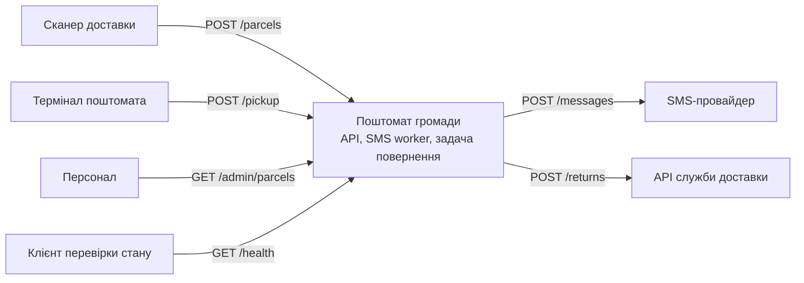
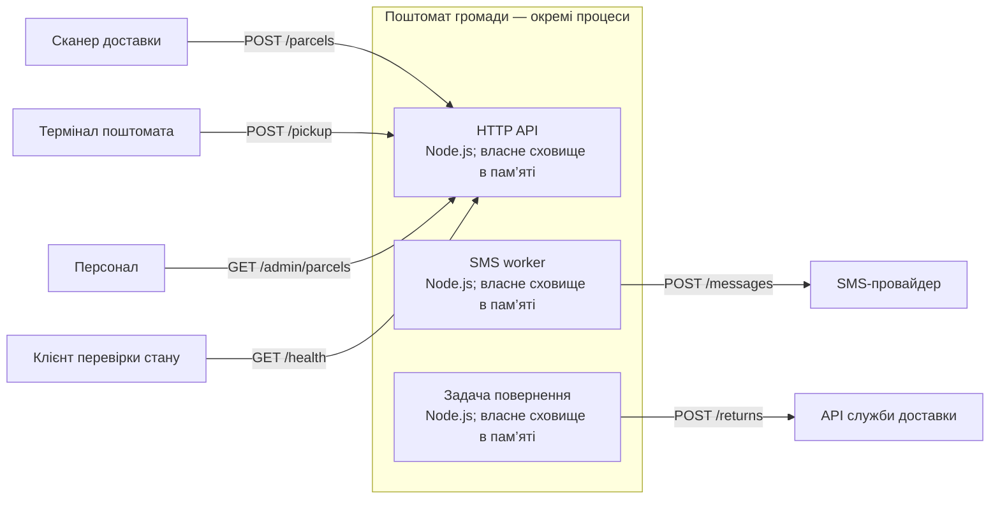

# Архітектура «Поштомата громади» — C4

Ці діаграми показують **реалізацію в `app/`**, а не описаний у `app/docs/ARCHITECTURE.md` продакшн. Зовнішні клієнти не входять до репозиторію: код підтверджує HTTP-контракти для сканера, термінала, персоналу й перевірки стану, але не реалізацію самих клієнтів. Різні процеси створюють власні екземпляри `createPool()` і сховища в пам’яті (`app/src/server.js:91`, `app/src/worker.js:43`, `app/bin/expire-parcels.js:24`, `app/src/db.js:63`). Спільного підключення до PostgreSQL у цьому коді немає.

## Рівень 1 — System Context

## Рівень 2 — Container

У процесі API запис посилки залишається в його локальному сховищі (`app/src/server.js:91-93`, `app/src/parcels.js:43-54`). Worker і задача повернення створюють **інші** локальні сховища (`app/src/worker.js:43`, `app/bin/expire-parcels.js:24`, `app/src/db.js:63`). Тому між цими процесами на діаграмі немає стрілок обміну даними. Це важлива межа нинішньої реалізації: worker, запущений окремим процесом, не прочитає посилку, яку API записав у свою пам’ять. `DATABASE_URL` зчитується в конфігурації (`app/src/config.js:7`), але `createPool()` не приймає URL і за замовчуванням створює `createStore()` (`app/src/db.js:63`).

Задача повернення виконується при запуску `bin/expire-parcels.js` (`app/bin/expire-parcels.js:21-30`). Коментар називає її нічною cron-задачею (`app/bin/expire-parcels.js:2`), але розклад запуску в коді `app/` не задано. Запит до API перевізника лише просить забрати посилку (`app/src/courier.js:5-18`); код не підтверджує її фізичне вилучення чи звільнення комірки.

## Стрілки і докази

Один рядок — одна стрілка діаграми. Для зовнішніх клієнтів код доводить **обробку відповідного запиту**, а не існування конкретного сканера, термінала або моніторингового процесу. «Є» означає, що прогін намалював цей зв’язок із тією ж дією; «пропустив» — що не намалював.

| # | Рівень | Стрілка | Доказ у коді | AI з документації | AI з коду |
|---|---|---|---|---|---|
| C1 | Context | Сканер → сервіс: `POST /parcels` | `app/src/server.js:38-40`, `app/src/parcels.js:34-35` | є | є |
| C2 | Context | Термінал → сервіс: `POST /pickup` | `app/src/server.js:42-45`, `app/src/parcels.js:58-59` | є | є |
| C3 | Context | Персонал → сервіс: `GET /admin/parcels` | `app/src/server.js:47-49`, `app/src/parcels.js:71-75` | є | є |
| C4 | Context | Клієнт перевірки → сервіс: `GET /health` | `app/src/server.js:37` | є | є |
| C5 | Context | Сервіс → SMS-провайдер: `POST /messages` | `app/src/worker.js:28`, `app/src/sms.js:31-35` | є | є |
| C6 | Context | Сервіс → API доставки: `POST /returns` | `app/bin/expire-parcels.js:15`, `app/src/courier.js:7-16` | пропустив | є |
| K1 | Container | Сканер → API: `POST /parcels` | `app/src/server.js:38-40`, `app/src/parcels.js:34-35` | є | є |
| K2 | Container | Термінал → API: `POST /pickup` | `app/src/server.js:42-45`, `app/src/parcels.js:58-59` | є | є |
| K3 | Container | Персонал → API: `GET /admin/parcels` | `app/src/server.js:47-49` | є | є |
| K4 | Container | Клієнт перевірки → API: `GET /health` | `app/src/server.js:37` | є | є |
| K5 | Container | Worker → SMS-провайдер: `POST /messages` | `app/src/worker.js:28`, `app/src/sms.js:31-35` | є | є |
| K6 | Container | Задача повернення → API доставки: `POST /returns` | `app/bin/expire-parcels.js:15`, `app/src/courier.js:7-16` | пропустив | є |

## Що AI вигадав / пропустив

Нижче «вигадав» означає **намалював стрілку без підтвердження її виконання кодом цього репозиторію**. Це не доводить, що зв’язок неможливий у зовнішній системі. Однаковий логічний зв’язок на двох рівнях рахується один раз; його появи на обох діаграмах наведено разом.

| Непідтверджений зв’язок | Прогін з документації | Прогін з коду | Перевірка |
|---|---|---|---|
| Працівник доставки → сканер: сканує посилку | є, Context + Container | є, Context | `app/src/parcels.js:34-35` описує сканер як клієнта API; реалізації сканера чи дії працівника в `app/` немає. |
| Мешканець → термінал: вводить код | є, Context + Container | є, Context + Container | `app/src/parcels.js:58-60` описує введений код і обробляє його; взаємодія мешканця з екраном поза кодом репозиторію. |
| SMS-провайдер → мешканець: доставляє SMS | є, Context + Container | є, Context + Container | `app/src/sms.js:31-43` підтверджує надсилання запиту провайдеру, але не фактичну доставку на телефон. |
| API → спільний PostgreSQL | є, Container | є, Container | `app/src/server.js:91`, `app/src/db.js:11-15`, `app/src/db.js:63`: API створює сховище в пам’яті. |
| Worker → спільний PostgreSQL | є, Container | є, Container | `app/src/worker.js:43`, `app/src/db.js:63`: worker створює окреме сховище в пам’яті. |
| Задача повернення → спільний PostgreSQL | є, Container | є, Container | `app/bin/expire-parcels.js:24`, `app/src/db.js:63`: задача створює окреме сховище в пам’яті. |
| Cron на VM → задача повернення: запускає вночі | немає | є, Container | `app/bin/expire-parcels.js:2` називає cron у коментарі, але виконуваний код `app/bin/expire-parcels.js:21-35` не налаштовує розклад. |

| Прогін | Вигадав / не підтвердив кодом | Пропустив із таблиці стрілок |
|---|---:|---|
| З документації | 6 унікальних зв’язків | C6 і K6 — один логічний зв’язок із перевізником |
| З коду | 7 унікальних зв’язків | немає |

**Разом:** з документації — **6 вигаданих, 1 пропущений** унікальний зв’язок; з коду — **7 вигаданих, 0 пропущених**. Якщо рахувати окремі зображені стрілки на обох діаграмах, це відповідно **9 вигаданих / 2 пропущені** і **9 вигаданих / 0 пропущених**.

Окремо від стрілок, прогін з документації повторив застарілі «30 секунд» для worker і PostgreSQL як спільне сховище; вихідний документ також називає код чотиризначним (`app/docs/ARCHITECTURE.md:18-20`). Виконуваний worker чекає 10 секунд між неповними пакетами (`app/src/worker.js:8`, `app/src/worker.js:65-66`), а код отримання шестизначний (`app/src/parcels.js:25-28`, `app/src/parcels.js:60`). Прогін з коду ці розбіжності помітив у тексті, але все одно намалював спільну PostgreSQL базу.
