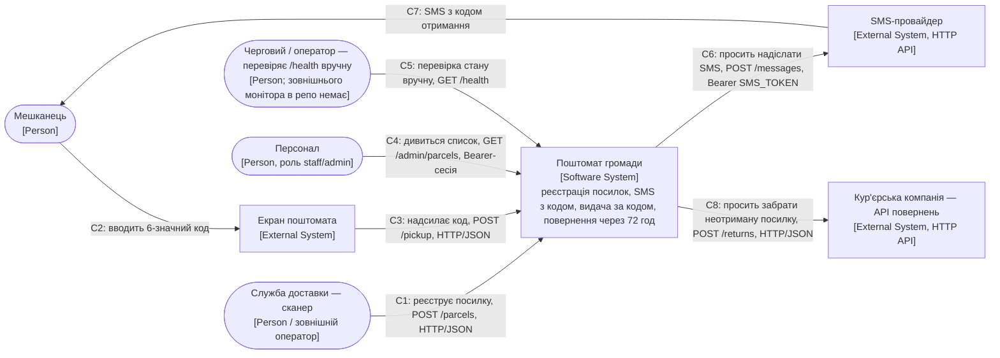
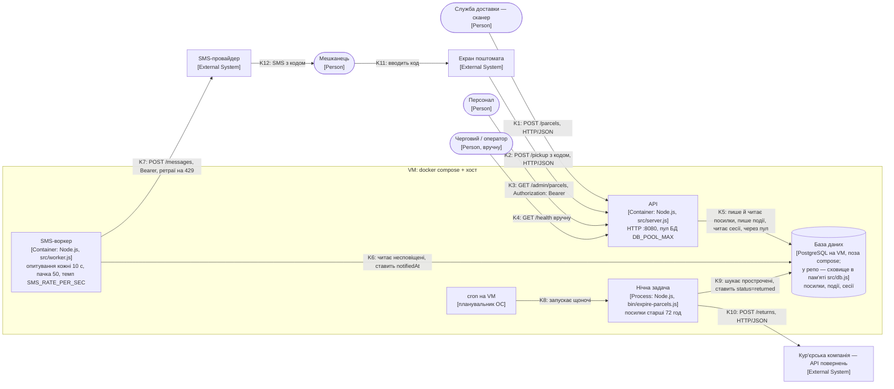

# Архітектура «Поштомата громади» — C4

> Task B. Діаграми показують систему **такою, якою вона є в коді** `app/` (а не в
> `app/docs/ARCHITECTURE.md`). Кожна стрілка має номер; номер = рядок у таблиці
> «Стрілки і докази». Рядки коду перевірено `grep -n` / `cat -n` у поточному стані `app/`.
> Розгортання береться з compose.yaml до змін Task D (гілка main):
> `git show main:deploy/compose.yaml`.
> Обидві діаграми рендеряться без помилок: кожен блок `mermaid` винесено в окремий файл і
> прогнано через `npx @mermaid-js/mermaid-cli` 12.2.0 (`mmdc -i d1.mmd -o d1.svg`, так само `d2`) — exit 0, SVG створено.

## Рівень 1 — System Context

## Рівень 2 — Container

Що варто знати, читаючи діаграми:

- **API, воркер і нічна задача не викликають одне одного.** Спільний у них лише стан у БД:
  кожен процес сам створює свій пул (`app/src/server.js:91`, `app/src/worker.js:43`,
  `app/bin/expire-parcels.js:24`). Черги між API і воркером немає — воркер опитує БД
  (`app/src/worker.js:24`, `app/src/worker.js:66`).
- **Вихідних HTTP-викликів у коді рівно два:** `grep -rn "fetch(" app/src app/bin` знаходить
  лише `app/src/sms.js:31` (SMS-провайдер) і `app/src/courier.js:7` (кур'єрський API).
- **БД у репо — заглушка.** `app/src/db.js:1-2`: у продакшні той самий інтерфейс працює
  поверх PostgreSQL, а тут сховище в пам'яті. `DATABASE_URL` читається
  (`app/src/config.js:7`), але ніде не використовується: `grep -rn "dbUrl" app/src app/bin`
  знаходить лише `app/src/config.js:7`. Тобто в цьому коді кожен процес має **власне**
  сховище в пам'яті; стрілки K5, K6, K9 відображають інтерфейс, яким код користується
  (`pool.withConnection`), а адреса PostgreSQL — з розгортання
  (compose.yaml до змін Task D, гілка main: `git show main:deploy/compose.yaml`, рядки 2 і 15).
- **Сесії персоналу лише читаються.** API шукає сесію за Bearer-токеном
  (`app/src/server.js:18`, `findSession`), але нічого в `app/` сесій не створює:
  `grep -rn "addSession" app` знаходить лише оголошення `app/src/db.js:52` і виклики в
  тесті `app/test/server.test.js:63-64`. Ендпоінта входу немає (`app/src/server.js:36-52`).
- **Нічна задача не є сервісом compose.** У compose лише `api` і `worker`
  (compose.yaml до змін Task D, гілка main: `git show main:deploy/compose.yaml`, рядки 4 і
  23); задачу запускає cron на VM (`app/bin/expire-parcels.js:2`).
- **Кур'єрська компанія і служба доставки в коді — різні сторони:** сканер «delivery
  operator» (`app/src/parcels.js:34`) і «courier company's returns API»
  (`app/src/courier.js:1`). Чи це одна фірма, код не каже — тому на діаграмі вони окремо.

## Стрілки і докази

Порівняння ведеться за рівнями: рядки C* — проти System Context кожного прогону, рядки
K* — проти Container кожного прогону. **є** — AI намалював цю стрілку (між тими самими
елементами, у тому самому напрямку); **пропустив** — такої стрілки в його діаграмі цього
рівня немає. Посилання на AI — номери рядків у відповідному файлі `ai-runs/`.

**Правило підрахунку** (застосовано до всіх рядків і до підсумку):

1. Стрілка AI до елемента, який зливає два наші (наприклад, «Служба доставки» = сканер +
   кур'єрський API) — **є** для відповідної нашої стрілки.
2. Стрілка AI, що перескакує проміжний елемент (наприклад, `Worker → Мешканець` повз
   SMS-провайдера) — **вигадав**; справжній ланцюжок (`SMS-провайдер → Мешканець`) — **пропустив**.
3. Неточний підпис на правильній стрілці (інтервал, довжина коду, які поля оновлюються)
   стрілку не скасовує — це **є**, а неточність іде в окремий список нижче.

### System Context

| # | Стрілка (звідки → куди: що і як) | Доказ (`файл:рядок`) | AI з документації (`ai-runs/c4-from-docs.md`) | AI з коду (`ai-runs/c4-from-code.md`) |
|---|---|---|---|---|
| C1 | Служба доставки (сканер) → Поштомат: реєстрація посилки, `POST /parcels`, HTTP/JSON | `app/src/server.js:38`, `app/src/parcels.js:34` | є (`:42`) | є (`:41`) |
| C2 | Мешканець → Екран поштомата: вводить код (6 цифр) | `app/src/parcels.js:58`, `app/src/parcels.js:60` | є (`:43`; але «4-значний» — у коді 6 цифр, `app/src/parcels.js:27`) | є (`:44`) |
| C3 | Екран поштомата → Поштомат: `POST /pickup` з кодом, HTTP/JSON | `app/src/server.js:42-44`, `app/src/parcels.js:58` | є (`:44`) | є (`:42`) |
| C4 | Персонал → Поштомат: `GET /admin/parcels`, `Authorization: Bearer <сесія>`, лише staff/admin | `app/src/server.js:47-48`, `app/src/server.js:16-18`, `app/src/parcels.js:73` | є (`:45`) | є (`:43`) |
| C5 | Черговий / оператор → Поштомат: `GET /health` вручну | ендпоінт — `app/src/server.js:37` (`server.js:75` — виключено з access-логу); хто викликає — `incident/oncall-chat.md:17` (черговий дивиться `/health` під час інциденту), `docs/ops/backup-runbook.md:35` (перевірка після відновлення). Зовнішньої системи моніторингу, що опитує `/health`, у `deploy/`, `pipeline/`, `materials/` немає. Автоматично `/health` викликає лише Docker `HEALTHCHECK` усередині контейнера api (`deploy/Dockerfile:18-19`, додано в Task D; на `main` його немає — `git show main:deploy/Dockerfile \| grep -c HEALTHCHECK` → `0`): це перевірка самого рушія контейнерів, не зовнішній учасник, тож окремої стрілки на діаграмі для неї немає | є (`:48`) | пропустив |
| C6 | Поштомат → SMS-провайдер: `POST {SMS_BASE_URL}/messages`, Bearer `SMS_TOKEN` | `app/src/sms.js:31-34`, `app/src/config.js:11-12` | є (`:46`) | є (`:45`) |
| C7 | SMS-провайдер → Мешканець: SMS «Посилка чекає… Код: …» на `recipientPhone` | `app/src/worker.js:28`, `app/src/worker.js:12` | пропустив (замість неї — `Поштомат → Мешканець` напряму, `:47`, див. «вигадав») | пропустив |
| C8 | Поштомат → Кур'єрська компанія: `POST {COURIER_BASE_URL}/returns`, причина `not_picked_up_72h` | `app/src/courier.js:7-8`, `app/src/courier.js:14`, `app/bin/expire-parcels.js:15` | пропустив | є (`:46`; ціль — «Служба доставки», злита зі сканером) |

### Container

| # | Стрілка (звідки → куди: що і як) | Доказ (`файл:рядок`) | AI з документації (`ai-runs/c4-from-docs.md`) | AI з коду (`ai-runs/c4-from-code.md`) |
|---|---|---|---|---|
| K1 | Служба доставки → API: `POST /parcels`, HTTP/JSON | `app/src/server.js:38-39` | є (`:79`) | є (`:77`) |
| K2 | Екран поштомата → API: `POST /pickup`, HTTP/JSON | `app/src/server.js:42-44` | є (`:80`) | є (`:78`) |
| K3 | Персонал → API: `GET /admin/parcels`, Bearer | `app/src/server.js:47-48`, `app/src/server.js:16` | є (`:81`) | є (`:79`) |
| K4 | Черговий / оператор → API: `GET /health` вручну | `app/src/server.js:37` (ендпоінт); викликач — як у C5: `incident/oncall-chat.md:17`, `docs/ops/backup-runbook.md:35` | є (`:82`) | пропустив |
| K5 | API → БД: пише й читає посилки, пише подію `picked_up`, лише читає сесії (`findSession`) — через пул | `app/src/parcels.js:43-44`, `app/src/parcels.js:61-67`, `app/src/parcels.js:74`, `app/src/server.js:18`, `app/src/server.js:91` | є (`:84`) | є (`:81`) |
| K6 | SMS-воркер → БД: `listUnnotified(50)`, потім `notifiedAt` | `app/src/worker.js:24`, `app/src/worker.js:33`, `app/src/worker.js:9` | є (`:85`) | є (`:82`) |
| K7 | SMS-воркер → SMS-провайдер: `POST /messages`, Bearer, темп `SMS_RATE_PER_SEC`, ретраї на 429 | `app/src/worker.js:28`, `app/src/sms.js:31-33`, `app/src/sms.js:36-40` | є (`:86`) | є (`:83`) |
| K8 | cron на VM → Нічна задача: запуск щоночі | `app/bin/expire-parcels.js:2` | є (`:88`) | пропустив (cron лише в описі контейнера, `:70`, стрілки немає) |
| K9 | Нічна задача → БД: `findExpired` (старші 72 год), `markReturned` | `app/bin/expire-parcels.js:12`, `app/bin/expire-parcels.js:14`, `app/src/parcels.js:80`, `app/src/parcels.js:85-86` | є (`:89`) | є (`:84`) |
| K10 | Нічна задача → Кур'єрська компанія: `POST /returns` | `app/bin/expire-parcels.js:15`, `app/bin/expire-parcels.js:26`, `app/src/courier.js:7` | пропустив | є (`:85`) |
| K11 | Мешканець → Екран поштомата: вводить код | `app/src/parcels.js:58` | пропустив (Мешканець є на діаграмі, `:60`, але стрілки до екрана немає) | пропустив (Мешканця на діаграмі немає) |
| K12 | SMS-провайдер → Мешканець: SMS з кодом | `app/src/worker.js:28`, `app/src/worker.js:12` | пропустив (замість неї — `Worker → Мешканець` напряму, `:87`, див. «вигадав») | пропустив |

## Що AI вигадав / пропустив

| Прогін | Вигадав — стрілки, яких у коді немає (і чим це перевірили) | Пропустив — стрілки з таблиць вище, яких немає в AI |
|---|---|---|
| з документації | **2:** (1) Context `Поштомат → Мешканець: SMS` (`ai-runs/c4-from-docs.md:47`); (2) Container `Worker → Мешканець: SMS з 4-значним кодом` (`ai-runs/c4-from-docs.md:87`). Система сама SMS не шле: `grep -rn "fetch(" app/src app/bin` дає лише два вихідні виклики — `app/src/sms.js:31` (провайдер) і `app/src/courier.js:7` (кур'єр); `grep -rniE "smpp\|gsm\|modem\|twilio" app/src app/bin` нічого не знаходить. До телефона мешканця SMS доходить лише через провайдера (C7/K12). | **5:** C7, C8, K10, K11, K12 |
| з коду | **0** — кожна стрілка обох діаграм (`ai-runs/c4-from-code.md:41-46`, `:77-85`) має відповідник у таблицях (C1–C4, C6, C8; K1–K3, K5–K7, K9, K10). | **6:** C5, C7, K4, K8, K11, K12 |

Неточності, що не є стрілками (у підсумок не входять, але показують, чого варта
документація):

- «кожні 30 секунд» (`ai-runs/c4-from-docs.md:72`) — у коді 10 с (`app/src/worker.js:8`);
  джерело помилки — `app/docs/ARCHITECTURE.md:18`.
- «4-значний код» (`ai-runs/c4-from-docs.md:43`, `:87`) — у коді 6 цифр
  (`app/src/parcels.js:27`, `app/src/parcels.js:60`); джерело — `app/docs/ARCHITECTURE.md:19`.
- Нічна задача лише «позначає як повернені» (`ai-runs/c4-from-docs.md:74`, `:89`) — у коді
  вона ще й шле `POST /returns` кур'єру (`app/bin/expire-parcels.js:15`); у
  `app/docs/ARCHITECTURE.md:22-23` кур'єрського API немає взагалі, звідси пропуск C8/K10.
- `worker → postgres: "Читає посилки без SMS; оновлює статус"` (`ai-runs/c4-from-docs.md:85`) —
  воркер статус не змінює, він ставить лише `notifiedAt` (`app/src/worker.js:33`); статус
  змінюють API (`app/src/parcels.js:65`) і нічна задача (`app/src/parcels.js:86`). Стрілка
  K6 при цьому лишається «є» (правило 3).
- AI з коду злив сканер служби доставки і кур'єрський API повернень в одну зовнішню систему
  (`ai-runs/c4-from-code.md:19`, `:36`) — код називає їх різними сторонами
  (`app/src/parcels.js:34`, `app/src/courier.js:1`); стрілки C1/C8 від цього не зникли.
- Обидва AI вважають БД спільним PostgreSQL; у цьому коді сховище в пам'яті, а
  `DATABASE_URL` не використовується (`app/src/db.js:1-2`, `app/src/config.js:7`) — див.
  примітку під Container-діаграмою.

Підрахунок — за правилом із розділу «Стрілки і докази»: злиття елементів дає «є»
(C1/C8 у прогоні з коду), перескок проміжного елемента — «вигадав» + «пропустив»
(C7/K12 у прогоні з документації).

**Разом:** з документації — вигадано 2, пропущено 5; з коду — вигадано 0, пропущено 6.

## Запропоноване (з ADR) — необов'язково

Діаграми вище показують лише **поточну** систему (код і `deploy/` на `main`). Пропозицію
ADR-0001 (`docs/adr/0001-notifications.md`, «Рішення (Decision)») на них не намальовано: нових
контейнерів вона не додає — таблиця завдань `parcel_jobs` живе в наявній PostgreSQL, виконує її
наявний `worker`, а нічна cron-задача повернення зникає.
