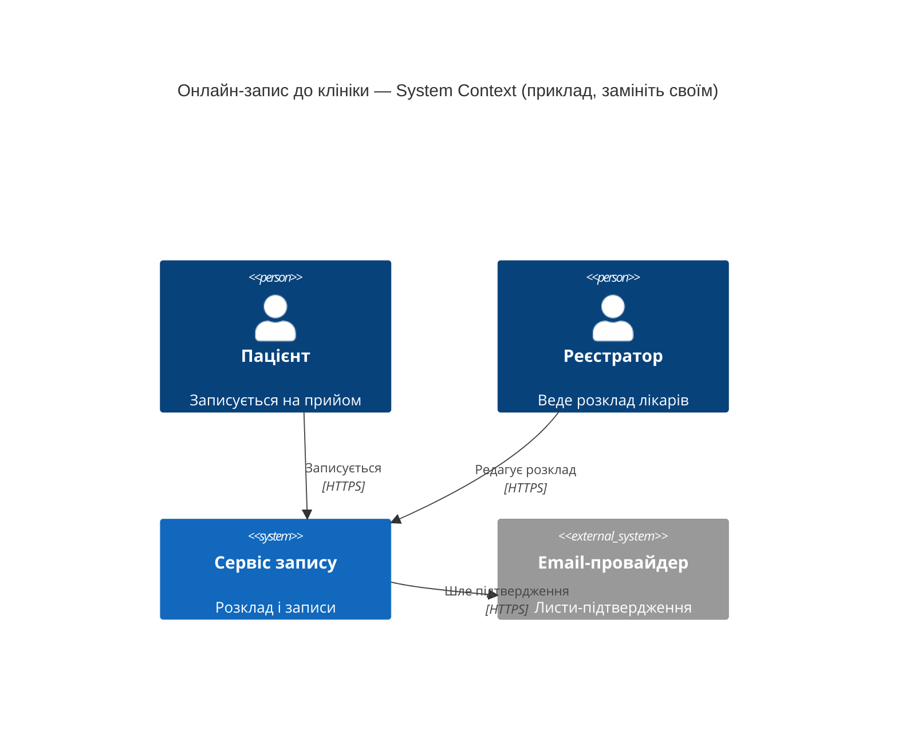
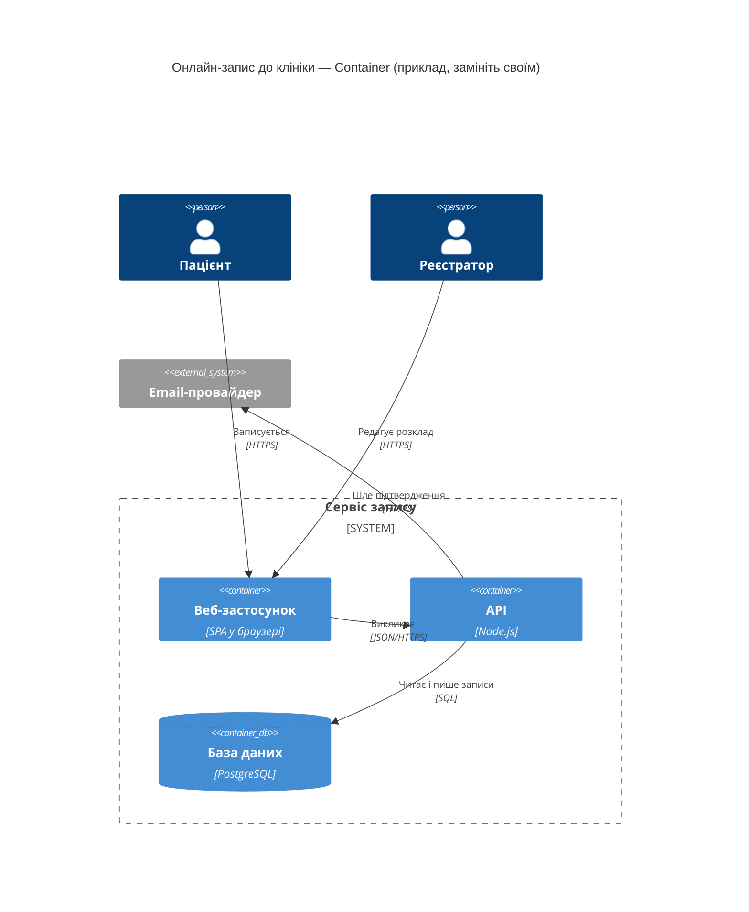

# Архітектура «Поштомата громади» — C4

> Task B. Скопіюйте у `docs/architecture.md`. Діаграми — Mermaid: `C4Context` /
> `C4Container` або `flowchart`. Кожну стрілку перевірте в коді. `app/` не редагуйте.
>
> Діаграми і приклади нижче — з **іншої** системи (онлайн-запис до клініки): вони показують
> синтаксис і рівень деталей. Замініть їх своїми.

## Рівень 1 — System Context

## Рівень 2 — Container

## Стрілки і докази

Один рядок — одна стрілка з ваших діаграм. «AI мав рацію?»: **є** — AI намалював цю
стрілку; **пропустив** — у його діаграмі її немає.

| # | Стрілка (звідки → куди: що і як) | Доказ (`файл:рядок`) | AI з документації (`ai-runs/c4-from-docs.md`) | AI з коду (`ai-runs/c4-from-code.md`) |
|---|---|---|---|---|
| 1 | <...> | `<файл>:<рядок>` | <є / пропустив> | <є / пропустив> |
| 2 | <...> | `<...>` | <...> | <...> |

_Приклад рядків: «1 | API → Email-провайдер: лист-підтвердження після запису, HTTPS |
`src/bookings.js:48` | є | є»; «2 | API → БД: читає розклад лікарів, SQL |
`src/schedule.js:12` | пропустив — за README розклад приходить з HR-системи | є»._

## Що AI вигадав / пропустив

| Прогін | Вигадав — стрілки й компоненти, яких у коді немає (і чим це перевірили) | Пропустив — стрілки з таблиці вище, яких немає в AI |
|---|---|---|
| з документації | <...> | <номери рядків таблиці> |
| з коду | <...> | <...> |

_Приклад: «з документації — вигадав API → Redis: кешу в коді немає,
`grep -rni redis src` нічого не знаходить»._

**Разом:** з документації — вигадано <…>, пропущено <…>; з коду — вигадано <…>, пропущено <…>.

## Запропоноване (з ADR) — необов'язково

<Якщо показуєте на діаграмі частину з вашого ADR — позначте її «запропоновано» (окремий
колір, підпис або окрема діаграма), а доказом дайте розділ `docs/adr/0001-notifications.md`.>
