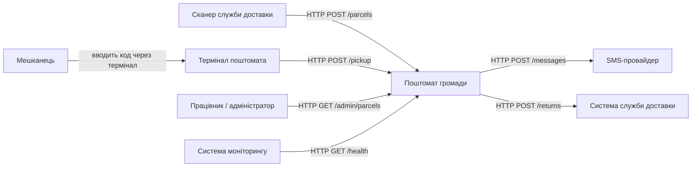
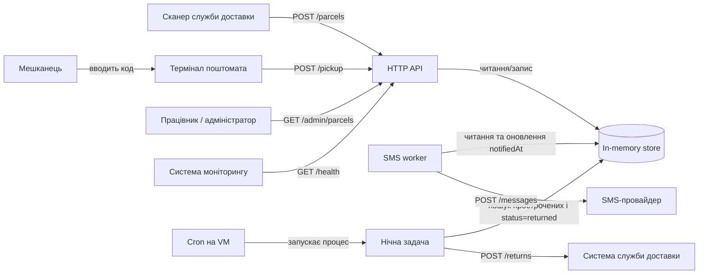

# Архітектура сервісу «Поштомат громади»

Цей опис відображає реалізацію в `app/`, а не заплановану production-інфраструктуру. Сховище під час виконання — in-memory (`app/src/db.js:1-2,11-15`); PostgreSQL у README та `app/docs/ARCHITECTURE.md` є припущенням про production і тут не показаний.

## System Context

## Container

## Докази стрілок і порівняння

Позначення: «так» — еквівалентна стрілка є; «ні» — її немає або зміст не відповідає реалізації.

| # | Взаємодія | Рівень | Точний доказ | `c4-from-docs` | `c4-from-code` |
|---:|---|---|---|:---:|:---:|
| 1 | Сканер доставки → API: реєстрація | SC, C | `app/src/parcels.js:33-55`; `app/src/server.js:38-41` | так | так |
| 2 | Мешканець → термінал: вводить код | SC, C | `app/src/parcels.js:58-68` | так | так |
| 3 | Термінал → API: `POST /pickup` | SC, C | `app/src/server.js:42-45` | так | так |
| 4 | Працівник → API: `GET /admin/parcels` | SC, C | `app/src/server.js:47-50`; `app/src/parcels.js:71-75` | так | так |
| 5 | Моніторинг → API: `GET /health` | SC, C | `app/src/server.js:36-37` | так | ні |
| 6 | API → in-memory store | C | `app/src/server.js:88-93`; `app/src/parcels.js:43-55,61-68,74-75`; `app/src/db.js:11-15,19-58` | так (але PostgreSQL) | так (але PostgreSQL) |
| 7 | Worker → in-memory store | C | `app/src/worker.js:23-34`; `app/src/db.js:40-44` | так (але PostgreSQL) | так (але PostgreSQL) |
| 8 | Нічна задача → in-memory store | C | `app/bin/expire-parcels.js:11-16`; `app/src/parcels.js:78-87` | так (але PostgreSQL) | так (але PostgreSQL) |
| 9 | Worker → SMS: `POST /messages` | SC, C | `app/src/worker.js:27-34`; `app/src/sms.js:28-35` | так | так |
| 10 | Нічна задача → courier: `POST /returns` | SC, C | `app/bin/expire-parcels.js:13-16`; `app/src/courier.js:5-18` | так | так |
| 11 | Cron → нічна задача | C | `docs/ops/backup-runbook.md:18-19` (cron о 03:15 виконує `docker compose run --rm worker ...`) | ні | так |

У System Context внутрішні стрілки 6–8 і 11 не дублюються: вони деталізуються лише на Container.

## Аналіз попередніх описів

### `ai-runs/c4-from-docs.md`

Вигадано **1** стрілку: `API → API` для health у Container (реалізація має зовнішній виклик до API, `app/src/server.js:36-37`). «SMS-провайдер → мешканець» у попередньому описі — непідтверджена зовнішня поведінка провайдера: код підтверджує лише запит сервісу до провайдера з номером отримувача (`app/src/sms.js:28-35`), але не підтверджує доставку SMS. Тому цю заяву не класифікую як взаємодію сервісу, якої немає в реалізації, і не включаю до підрахунку вигаданих стрілок. PostgreSQL є помилковим типом сховища, але не вигаданим зв’язком: реалізація справді має API/worker/expirer → спільне сховище, лише воно in-memory (`app/src/db.js:1-2,11-15`).

Пропущено **1** стрілку: моніторинг → `/health` (таблиця 5). Нічна задача → courier у попередньому описі є; cron → expirer там не показаний. Тому `API → API` є вигаданою стрілкою, а правильна взаємодія моніторинг → API — пропущена.

### `ai-runs/c4-from-code.md`

Вигадано **1** стрілку: `API → API` для health у Container. Реалізація має зовнішній виклик до API (`app/src/server.js:36-37`), а не API-виклик самого себе. Його `expirer → courier /returns` підтверджено `app/bin/expire-parcels.js:13-16` та `app/src/courier.js:5-18`; назва PostgreSQL замість in-memory (`app/src/db.js:1-2`) є помилкою компонента, не окремою стрілкою.

Пропущено **1** стрілку: моніторинг → `/health` (таблиця 5). Cron → expirer у ньому показаний, але реальний доказ запуску походить не з executable-скрипту, а з `docs/ops/backup-runbook.md:18-19`.

## Перевірка Mermaid

Обидва блоки використовують стандартний GitHub Mermaid `flowchart LR`, прості ідентифікатори вузлів і не використовують C4-розширення чи небезпечні переноси в labels; вони придатні до рендерингу на GitHub.
