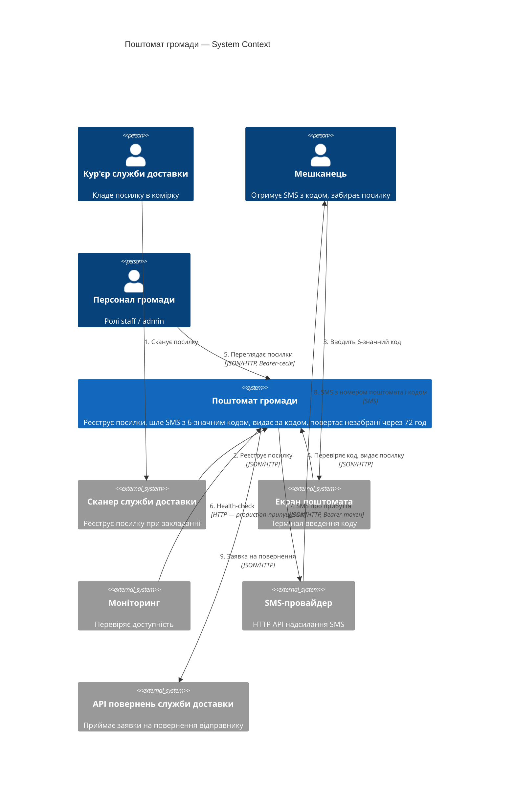
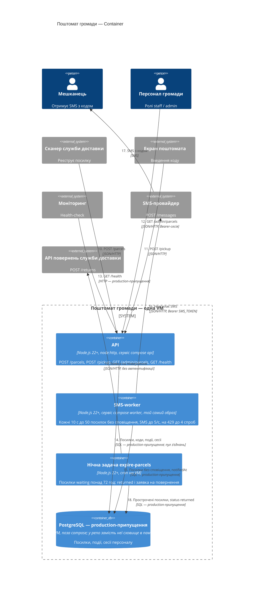

# Архітектура «Поштомата громади» — C4

Діаграми показують систему за кодом `app/` (версія 1.7.3, `app/package.json:3`), а не за
`app/docs/ARCHITECTURE.md` (v1.5). Номери біля стрілок — рядки таблиці доказів нижче.
Запропоноване в ADR-0001 на діаграмах не показано. На діаграмах є два види елементів:

- **Перевірене в коді** — усе, крім двох пунктів нижче: кожна така стрілка має `файл:рядок`.
- **Production-припущення, кодом не перевірене** — позначене на діаграмі словами
  «production-припущення»:
  - **PostgreSQL** і стрілки до нього з міткою SQL (14, 15, 18). Код доводить лише, що API,
    worker і нічна задача ходять у сховище через інтерфейс `app/src/db.js` (`pool.withConnection`).
    У репо це сховище в пам'яті, окреме в кожному процесі (`app/src/db.js:1-2`), а
    `DATABASE_URL` читається (`app/src/config.js:7`), але ніде не використовується. Що в
    продакшні за інтерфейсом — спільна PostgreSQL на тій самій VM, — відомо лише з коментаря
    «in production the same interface sits on PostgreSQL» (`app/src/db.js:1`), документації
    (`app/docs/ARCHITECTURE.md:20`) і конфігу деплою (`deploy/compose.yaml:1`).
  - **Хто опитує `/health`** (стрілки 6, 13 з міткою «HTTP — production-припущення»): у коді є
    лише ендпоінт, «моніторинг» — з `app/docs/ARCHITECTURE.md:17`.

## Рівень 1 — System Context

## Рівень 2 — Container

API і worker напряму не спілкуються: у коді немає ні черги, ні іншого каналу між ними —
worker лише опитує сховище (`app/src/worker.js:24`). Що це сховище в продакшні спільне для
обох процесів — частина production-припущення про PostgreSQL (див. вище); у репо кожен
процес має власне сховище в пам'яті.

## Стрілки і докази

Один рядок — одна стрілка з діаграм вище. «AI мав рацію?»: **є** — AI намалював цю
стрілку; **пропустив** — у його діаграмі її немає.

| # | Стрілка (звідки → куди: що і як) | Доказ (`файл:рядок`) | AI з документації (`ai-runs/c4-from-docs.md`) | AI з коду (`ai-runs/c4-from-code.md`) |
|---|---|---|---|---|
| 1 | Кур'єр → Сканер: сканує посилку при закладанні | `app/src/parcels.js:34` («Called by the delivery operator's scanner when a parcel goes into a cell») | є | є |
| 2 | Сканер → Поштомат: реєструє посилку, JSON/HTTP | `app/src/server.js:38-40`, `app/src/parcels.js:34-35` | є | є |
| 3 | Мешканець → Екран: вводить 6-значний код | `app/src/parcels.js:58` («the code the person typed»), `:60` (`/^\d{6}$/`) | є — але підпис «Вводить 4-значний код» хибний | є |
| 4 | Екран → Поштомат: перевіряє код і видає посилку, JSON/HTTP | `app/src/server.js:42-45`, `app/src/parcels.js:58-68` | є | є |
| 5 | Персонал → Поштомат: список посилок, Bearer-сесія | `app/src/server.js:13-19`, `:47-49`, `app/src/parcels.js:71-75` | є | є |
| 6 | Моніторинг → Поштомат: health-check, HTTP. **Хто опитує — production-припущення** | Ендпоінт: `app/src/server.js:37`. Що його опитує моніторинг — лише `app/docs/ARCHITECTURE.md:17` | є | є |
| 7 | Поштомат → SMS-провайдер: SMS про прибуття, JSON/HTTP, Bearer | `app/src/worker.js:28`, `app/src/sms.js:31-34` | є | є |
| 8 | SMS-провайдер → Мешканець: SMS з номером поштомата і кодом | `app/src/worker.js:11-13` | є | є |
| 9 | Поштомат → API повернень служби доставки: заявка на повернення | `app/bin/expire-parcels.js:15`, `app/src/courier.js:7-15` | **пропустив** — у документації цієї зовнішньої системи немає | є |
| 10 | Сканер → API: `POST /parcels` | `app/src/server.js:38-40` | є | є |
| 11 | Екран → API: `POST /pickup` | `app/src/server.js:42-45` | є | є |
| 12 | Персонал → API: `GET /admin/parcels`, Bearer-сесія | `app/src/server.js:16`, `:47-49` | є | є |
| 13 | Моніторинг → API: `GET /health`. **Хто опитує — production-припущення** | Ендпоінт: `app/src/server.js:37`. Що його опитує моніторинг — лише `app/docs/ARCHITECTURE.md:17` | є | є |
| 14 | API → сховище: посилки, коди, події, сесії. **Що сховище — PostgreSQL по SQL — production-припущення** | Виклики сховища: `app/src/parcels.js:43-54`, `:61-67`, `:74`; `app/src/server.js:18`. PostgreSQL — лише `app/src/db.js:1` (коментар), `app/docs/ARCHITECTURE.md:20`, `deploy/compose.yaml:1` | є | є |
| 15 | Worker → сховище: посилки без сповіщення, ставить `notifiedAt`. **PostgreSQL — production-припущення** | Виклики сховища: `app/src/worker.js:24`, `:33`. PostgreSQL — як у рядку 14: `app/src/db.js:1`, `app/docs/ARCHITECTURE.md:20` | є | є |
| 16 | Worker → SMS-провайдер: `POST {SMS_BASE_URL}/messages`, Bearer `SMS_TOKEN`, до 5/с, на 429 до 4 спроб | `app/src/worker.js:28`, `:44-49`; `app/src/sms.js:10`, `:14`, `:31-41`; `smsBaseUrl` у коді використовує лише worker (`app/src/worker.js:45`) | є | є |
| 17 | SMS-провайдер → Мешканець: SMS з кодом | `app/src/worker.js:11-13` | є | є |
| 18 | Нічна задача → сховище: шукає прострочені, ставить `returned`. **PostgreSQL — production-припущення** | Виклики сховища: `app/bin/expire-parcels.js:12`, `:14`; `app/src/parcels.js:78-88`. PostgreSQL — `app/src/db.js:1`, `app/docs/ARCHITECTURE.md:20` | є | є |
| 19 | Нічна задача → API повернень: `POST {COURIER_BASE_URL}/returns`, без автентифікації | `app/bin/expire-parcels.js:15`, `:26`; `app/src/courier.js:7-9` (лише `content-type`); `courierBaseUrl` у коді використовує лише нічна задача (`app/bin/expire-parcels.js:26`) | **пропустив** — нічна задача в нього лише «позначає прострочені як повернені» | є |

## Що AI вигадав / пропустив

| Прогін | Вигадав — стрілки й компоненти, яких у коді немає (і чим це перевірили) | Пропустив — стрілки з таблиці вище, яких немає в AI |
|---|---|---|
| з документації | Стрілок і компонентів — нічого. Хибні підписи з застарілої документації: «4-значний код» (рядок 3; у коді 6 цифр — `app/src/parcels.js:27`, `:60`) і «кожні 30 с» в описі worker (у коді 10 с — `app/src/worker.js:8`) | 9, 19 |
| з коду | Нічого: кожну його стрілку підтверджено рядками 1–19. Додаткові стрілки «Мешканець → Екран» на рівні Container — ті самі, що рядок 3, не вигадані | — |

**Разом:** з документації — вигадано 0, пропущено 2; з коду — вигадано 0, пропущено 0.

Що це показує: документація не бреше про те, що є, але відстала від коду. Інтеграцію зі
службою доставки (`app/src/courier.js`) у неї так і не дописали, тому AI з документації не
знав про цілу зовнішню систему, а параметри (довжина коду, інтервал) взяв застарілі. AI з
коду сам знайшов ці розбіжності й перелічив їх наприкінці відповіді.

Ще дві деталі прогону з коду, які правильні щодо `app/`, але не щодо продакшну: «пул до 4
з'єднань» і «SMS до 5/с» — це значення за замовчуванням (`app/src/config.js:9`, `:13`), а в
тодішньому продакшн-конфігу v1.7.3 задано 20 і 20 (`incident/changes/v1.8.0.diff:86`, `:93` —
рядки старої версії). Каталогу `deploy/` прогін не бачив.
