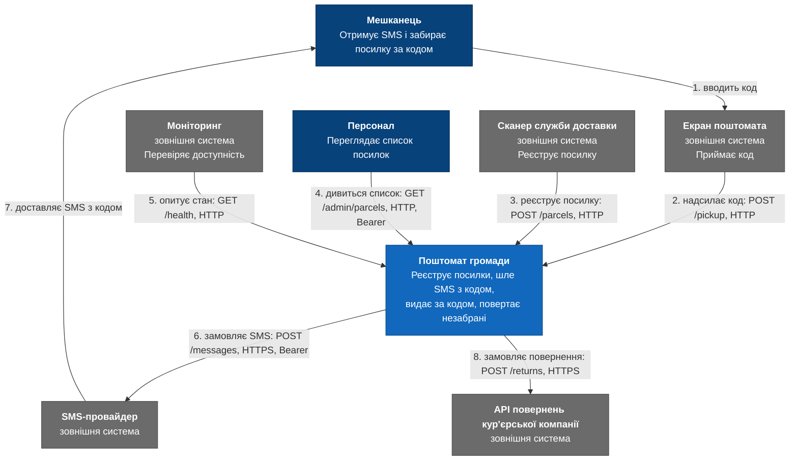
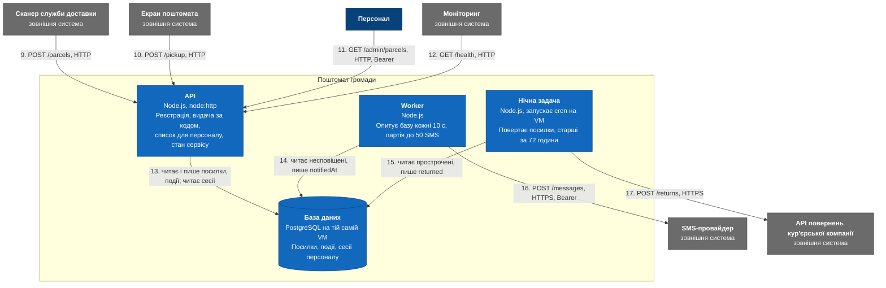

# Архітектура «Поштомата громади» — C4

Діаграми показують систему такою, якою вона є в коді (`app/`, версія 1.7.3). Номер на стрілці —
це номер рядка в таблиці «Стрілки і докази».

## Рівень 1 — System Context

## Рівень 2 — Container

**Що варто знати, читаючи діаграми:**

- **База.** У репо сховище працює в пам'яті, а в продакшні той самий інтерфейс працює поверх
  PostgreSQL (`app/src/db.js:1-2`, `deploy/compose.yaml:2`). Докази стрілок 13–15 — виклики цього
  інтерфейсу; самого SQL у репо немає.
- **API не шле SMS.** Клієнт створює лише воркер (`app/src/worker.js:44`), тому стрілки API → SMS-провайдер немає. У
  початковому конфігу `api` отримував змінні SMS (`git show main:deploy/compose.yaml`, рядки 18–20), але не використовував
  їх; після Task D їх там немає.
- **HTTPS** для стрілок 6, 8, 16, 17 видно лише з конфігу (`deploy/compose.yaml:84,91`): код бере
  адресу зі змінної. Виклик служби повернень не має автентифікації (`app/src/courier.js:9`).
- **Cron** показано в підписі нічної задачі, а не стрілкою: це спосіб запуску, а не зв'язок між
  частинами системи (`app/bin/expire-parcels.js:2`, `docs/ops/backup-runbook.md:18-19`).

## Стрілки і докази

**є** — AI намалював цю стрілку; **пропустив** — у його діаграмі цього рівня її немає.

| # | Стрілка (звідки → куди: що і як) | Доказ (`файл:рядок`) | AI з документації (`ai-runs/c4-from-docs.md`) | AI з коду (`ai-runs/c4-from-code.md`) |
|---|---|---|---|---|
| 1 | Мешканець → Екран поштомата: вводить код | `app/src/parcels.js:58` | є | є |
| 2 | Екран поштомата → Поштомат: код, `POST /pickup`, HTTP | `app/src/server.js:42-46`, `app/src/parcels.js:58` | є | є |
| 3 | Сканер → Поштомат: реєстрація, `POST /parcels`, HTTP | `app/src/server.js:38-41`, `app/src/parcels.js:34` | є | є |
| 4 | Персонал → Поштомат: список, `GET /admin/parcels`, HTTP, Bearer | `app/src/server.js:47-50`, `app/src/server.js:14-19` | є | є |
| 5 | Моніторинг → Поштомат: стан, `GET /health`, HTTP | `app/src/server.js:37`, `app/docs/ARCHITECTURE.md:17` (хто опитує, сказано лише тут) | є | є |
| 6 | Поштомат → SMS-провайдер: SMS, `POST /messages`, HTTPS, Bearer | `app/src/sms.js:31-35`, `app/src/worker.js:28` | є | є |
| 7 | SMS-провайдер → Мешканець: SMS з кодом | `app/src/worker.js:11-13`, `app/src/worker.js:28` (номер одержувача і текст із кодом) | є | є |
| 8 | Поштомат → API повернень: `POST /returns`, HTTPS | `app/src/courier.js:7-16`, `app/bin/expire-parcels.js:15` | пропустив — за документацією задача лише позначає посилки (`app/docs/ARCHITECTURE.md:22-23`) | є |
| 9 | Сканер → API: `POST /parcels`, HTTP | `app/src/server.js:38-41` | є | є |
| 10 | Екран поштомата → API: `POST /pickup`, HTTP | `app/src/server.js:42-46` | є | є |
| 11 | Персонал → API: `GET /admin/parcels`, HTTP, Bearer | `app/src/server.js:47-50`, `app/src/server.js:14-19` | є | є |
| 12 | Моніторинг → API: `GET /health`, HTTP | `app/src/server.js:37`, `app/docs/ARCHITECTURE.md:17` | є | є |
| 13 | API → База: читає і пише посилки та події, читає сесії | `app/src/parcels.js:43-44`, `app/src/parcels.js:61-67`, `app/src/parcels.js:74`, `app/src/server.js:18` | є | є |
| 14 | Worker → База: читає несповіщені, пише `notifiedAt` | `app/src/worker.js:24`, `app/src/worker.js:33` | є — у підписі лише читання | є |
| 15 | Нічна задача → База: читає прострочені, пише `returned` | `app/bin/expire-parcels.js:12`, `app/bin/expire-parcels.js:14`, `app/src/parcels.js:80`, `app/src/parcels.js:85-87` | є | є |
| 16 | Worker → SMS-провайдер: `POST /messages`, HTTPS, Bearer | `app/src/worker.js:28`, `app/src/worker.js:44-49`, `app/src/sms.js:31-35` | є | є |
| 17 | Нічна задача → API повернень: `POST /returns`, HTTPS | `app/bin/expire-parcels.js:15`, `app/bin/expire-parcels.js:26`, `app/src/courier.js:7-16` | пропустив — той самий застарілий опис | є |

## Що AI вигадав / пропустив

| Прогін | Вигадав — стрілки й компоненти, яких у коді немає (і чим це перевірили) | Пропустив — стрілки з таблиці вище, яких немає в AI |
|---|---|---|
| з документації | Стрілок і компонентів не вигадав | 8, 17 |
| з коду | 1 стрілка і 1 компонент: `Rel(carrier, scanner, "Сканує посилку")` і людина «Кур'єр служби доставки». У коді є лише сканер (`app/src/parcels.js:34`), а кур'єр згадується тільки як той, хто забирає посилку на повернення (`app/src/courier.js:5`). Перевірка: `grep -rniE "carrier\|кур.єр" app/src app/bin` нічого не знаходить. Прогін сам назвав це своїм висновком | Нічого |

**Разом:** з документації — вигадано 0, пропущено 2; з коду — вигадано 1, пропущено 0.

Прогін за документацією пропустив цілу зовнішню інтеграцію, бо `app/docs/ARCHITECTURE.md`
застарів; прогін за кодом знайшов її і сам вказав на розходження.

**Неправильні деталі, а не стрілки** (у число вище не входять):

- **З документації:** «Кожні 30 с шле SMS з 4-значним кодом». У коді опитування кожні 10 с
  (`app/src/worker.js:8`) і 6 цифр (`app/src/parcels.js:27`). Помилка прийшла із застарілого
  `app/docs/ARCHITECTURE.md:18-19`.
- **З документації:** нічна задача лише «Позначає посилки… як повернені», хоча вона ще й викликає
  службу повернень (`app/bin/expire-parcels.js:15`).
- **З коду:** зовнішні виклики підписано `JSON/HTTP`, а в продакшні це HTTPS
  (`deploy/compose.yaml:84,91`). Прогін не бачив `deploy/` і сам про це попередив.

## Запропоноване (з ADR) — необов'язково

Запропонованих частин на діаграмах немає: обидві показують поточну систему. Зміни з
`docs/adr/0001-notifications.md` тут не відображено.
