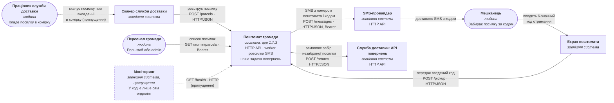
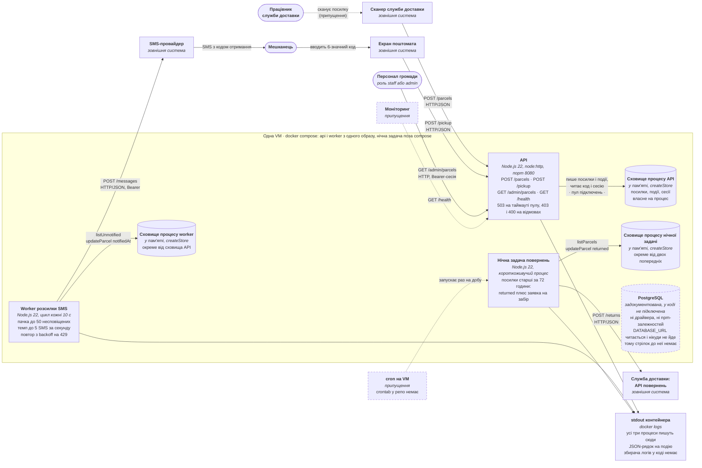
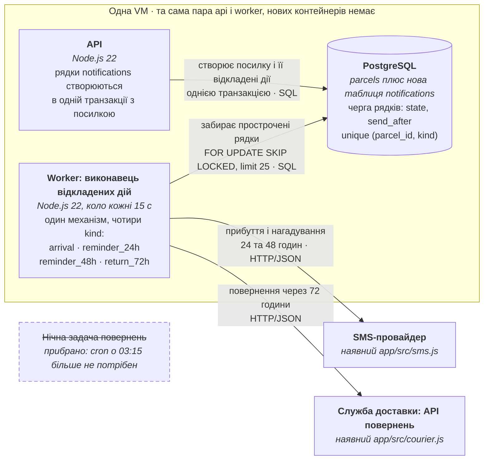

# Архітектура «Поштомата громади» — C4

Діаграми нижче описують систему **такою, якою вона є в коді** `app/` (версія
`app/package.json` — 1.7.3), а не такою, як її описує `app/docs/ARCHITECTURE.md`
(оновлений у червні 2026, v1.5). Де код і документація розходяться — перемагає код,
розбіжності виписані окремим розділом.

**Правило доказу.** Стрілка лишається на діаграмі, тільки якщо є рядок коду, який її
виконує. Стрілка вважається підтвердженою, якщо збігаються **і початок, і кінець, і
суть**: «процес → власне сховище в пам'яті» і «процес → спільна PostgreSQL» — це
**різні** стрілки, бо в першому випадку дані між процесами не ходять, а в другому ходять.
Те, що не має доказу в коді, або викреслено, або позначено як припущення — пунктиром на
діаграмі й окремою вказівкою джерела в таблиці.

**Нотація.** Рівні — C4 (System Context і Container), але намальовані звичайним
`flowchart`, а не `C4Context`/`C4Container` (обидва варіанти дозволені умовою). Причина
практична: на 16 стрілках рівня 2 C4-рендерер Mermaid кладе підписи один на одного і
виносить частину тексту за межу полотна. `flowchart` ще й дає пунктир — тобто візуально
відрізнити підтверджене кодом від припущення.

## Рівень 1 — System Context



_Пунктирна стрілка і пунктирна рамка = припущення: доказу в коді немає, джерело названо
в таблиці нижче. Суцільні — підтверджені рядком коду._

## Рівень 2 — Container



_Позначки ті самі, що й на рівні 1: пунктир — припущення (актор `Моніторинг`, `cron`, дія
працівника служби доставки) або задокументоване, але відсутнє в коді (`PostgreSQL`);
суцільне — підтверджене рядком коду.
Три сховища намальовані окремо навмисно — див. зауваження нижче._

> **Головне, що видно на діаграмі 2 і чого немає ні в документації, ні в жодній з двох
> відповідей AI: спільного сховища в коді немає.** `createPool` створює власний
> `createStore()` за замовчуванням (`app/src/db.js:63`), і жоден з трьох входів
> аргумент `store` не передає (`app/src/server.js:91`, `app/src/worker.js:43`,
> `app/bin/expire-parcels.js:24`). Тобто в репозиторії як є worker ніколи не побачить
> посилку, яку зареєстрував API, а нічна задача — жодної посилки взагалі. Перевірка —
> у розділі «Як це перевірено». `app/README.md:23-24` каже, що в продакшні той самий
> інтерфейс працює поверх PostgreSQL, тож це спрощення репозиторію, а не баг продакшну —
> але на діаграмі «як у коді» спільної БД бути не може.

## Стрілки і докази

«AI мав рацію?»: **є** — AI намалював цю стрілку; **пропустив** — у його діаграмі її
немає. Стрілки, що є на обох рівнях (на L1 — до системи як до чорної скриньки, на L2 —
уточнені до контейнера `API`), займають один рядок.

| # | Рівень | Стрілка (звідки → куди: що і як) | Доказ (`файл:рядок`) | AI з документації (`ai-runs/c4-from-docs.md`) | AI з коду (`ai-runs/c4-from-code.md`) |
|---|---|---|---|---|---|
| 1 | L1, L2 | Працівник служби доставки → Сканер: сканує посилку при вкладанні в комірку **(припущення)** | `app/src/parcels.js:34` — **комментар**, не виконуваний код, тому стрілка пунктирна | пропустив — актора-людини немає, служба доставки намальована лише як система | є |
| 2 | L1, L2 | Сканер → API: реєструє посилку, `POST /parcels`, HTTP/JSON | `app/src/server.js:38-41`, `app/src/parcels.js:35-55` | є | є |
| 3 | L1, L2 | Мешканець → Екран поштомата: вводить 6-значний код отримання | `app/src/parcels.js:58`, `app/src/parcels.js:60`, генерація коду — `app/src/parcels.js:27` | є — але код названо 4-значним | є |
| 4 | L1, L2 | Екран поштомата → API: передає введений код, `POST /pickup`, HTTP/JSON | `app/src/server.js:42-46`, `app/src/parcels.js:59-68` | є | є |
| 5 | L1, L2 | Персонал → API: `GET /admin/parcels` з `Authorization: Bearer <session id>`, телефони замасковані | `app/src/server.js:47-49`, `app/src/server.js:13-19`, `app/src/parcels.js:72-76` | є | є |
| 6 | L1, L2 | Моніторинг → API: `GET /health` **(припущення: актор)** | ендпоїнт — `app/src/server.js:37`; сам актор доказу в коді не має, узятий з `app/docs/ARCHITECTURE.md:17` | є | є |
| 7 | L1, L2 | Worker → SMS-провайдер: `POST {SMS_BASE_URL}/messages`, Bearer-токен, темп ≤ 5/с, повтор з backoff на 429 | `app/src/worker.js:28`, `app/src/sms.js:31-35`, `app/src/sms.js:33`, `app/src/sms.js:17,21-25`, `app/src/sms.js:36-41`, URL — `app/src/config.js:11` | є | є |
| 8 | L1, L2 | SMS-провайдер → Мешканець: SMS з номером поштомата і кодом | `app/src/worker.js:11-13` | є | є |
| 9 | L1, L2 | Нічна задача → API повернень служби доставки: `POST {COURIER_BASE_URL}/returns`, `reason: not_picked_up_72h` | `app/bin/expire-parcels.js:15`, `app/src/courier.js:7-16`, `app/src/courier.js:14`, URL — `app/src/config.js:14` | **пропустив** — ні системи, ні стрілки: у документації їх немає | є |
| 10 | L2 | API → власне сховище в пам'яті: пише посилки і події, читає код отримання і сесію персоналу | `app/src/server.js:91-92`, `app/src/db.js:63`, `app/src/parcels.js:43-44`, `app/src/parcels.js:61,64-67`, `app/src/server.js:18` | **пропустив** — намалював стрілку до спільної PostgreSQL | **пропустив** — те саме |
| 11 | L2 | Worker → власне сховище в пам'яті: `listUnnotified`, `updateParcel(notifiedAt)` | `app/src/worker.js:43`, `app/src/worker.js:24`, `app/src/worker.js:33`, `app/src/db.js:63` | **пропустив** — до спільної PostgreSQL | **пропустив** — те саме |
| 12 | L2 | Нічна задача → власне сховище в пам'яті: `listParcels`, `updateParcel(returned)` | `app/bin/expire-parcels.js:24`, `app/bin/expire-parcels.js:12,14`, `app/src/parcels.js:80-81`, `app/src/parcels.js:85-86`, `app/src/db.js:63` | **пропустив** — до спільної PostgreSQL | **пропустив** — те саме |
| 13 | L2 | cron на VM → Нічна задача: запуск раз на добу **(припущення)** | `app/bin/expire-parcels.js:2` — лише комментар у коді, самого crontab у репозиторії немає | є | **пропустив** — стрілки немає; cron згаданий у підписі контейнера і припущенні 8 |
| 14 | L2 | API → stdout: JSON-рядок на подію (5xx завжди, решта 1 зі 100) | `app/src/log.js:17`, `app/src/log.js:24`, виклики — `app/src/server.js:74-75`, `app/src/server.js:95` | пропустив | пропустив — свідомо, припущення 5 |
| 15 | L2 | Worker → stdout: JSON-рядок на подію | `app/src/log.js:17,24`, виклики — `app/src/worker.js:30,36,57` | пропустив | пропустив — свідомо, припущення 5 |
| 16 | L2 | Нічна задача → stdout: JSON-рядок на подію | `app/src/log.js:17,24`, виклик — `app/bin/expire-parcels.js:17` | пропустив | пропустив — свідомо, припущення 5 |

Два рядки спираються на **комментар**, а не на виконуваний код, — 1 і 13. За правилом
доказу цього документа обидва пунктирні: комментар називає дію, але не виконує її, тому
суцільної стрілки не заслуговує жоден з них. Різниця між ними в тому, що саме лишається
підтвердженим: у рядка 1 підтверджена сусідня ланка — виклик `POST /parcels` у коді таки
є (рядок 2), і припущенням є лише те, **хто** його ініціює (`app/src/parcels.js:34`
каже «сканер служби доставки», і більше ніде цього не видно); а `cron` (рядок 13) — це
елемент інфраструктури, якого в репозиторії немає взагалі: ні crontab, ні сервісу в
`deploy/compose.yaml` (там `api`, `worker` і разова `expire` під профілем `jobs`, яку
`up` не піднімає; сам crontab, що її запускає, лишається поза репозиторієм), тож запуск
нічної задачі нічим, окрім комментаря, не підтверджений.

## Що AI вигадав / пропустив

| Прогін | Вигадав — стрілки й компоненти, яких у коді немає (і чим це перевірили) | Пропустив — стрілки з таблиці вище, яких немає в AI |
|---|---|---|
| з документації | **3 стрілки** до спільної `ContainerDb(db, "PostgreSQL")` — `api → db`, `worker → db`, `expirer → db` (`ai-runs/c4-from-docs.md:92-94`). У коді PostgreSQL немає: ні драйвера, ні залежностей (`app/package.json` — жодної `dependencies`), `DATABASE_URL` читається в `app/src/config.js:7` і не використовується більше ніде (`grep -rnE "dbUrl\|DATABASE_URL" app/src app/bin` → один рядок, саме це оголошення). **Плюс 1 компонент**: `Container(kiosk, "Екран поштомата")` **всередині** межі системи (`ai-runs/c4-from-docs.md:79`) — коду кіоску в `app/` немає, тому в мене це зовнішня система. Окремо (не стрілки, а неправдиві атрибути, перенесені з документації): «4-значний код» проти 6-значного в `app/src/parcels.js:27,60` і «кожні 30 с» проти 10 с у `app/src/worker.js:8` | рядки **1, 9, 10, 11, 12, 14, 15, 16** — разом **8 стрілок із 16** |
| з коду | **3 стрілки** до спільної `ContainerDb(db, "База даних")` з підписом «PostgreSQL (на тій самій VM, поза контейнерами)» — `api → db`, `worker → db`, `expire → db` (`ai-runs/c4-from-code.md:79`, `:92-94`), ті самі й з тим самим доказом відсутності. На відміну від прогону 1, прогін 2 сам позначив це припущенням 2 («у самому коді сховище in-memory… діаграма описує продакшн, а не те, що запускається з репозиторію») — припущення назване чесно, але на діаграмі «як у коді» стрілка все одно вигадана. Більше нічого вигаданого: логіну не придумав, а його відсутність помітив (припущення 6) | рядки **10, 11, 12, 13, 14, 15, 16** — разом **7 стрілок із 16** |

**Разом:** з документації — вигадано **3 стрілки** (і 1 компонент, якого в коді немає),
пропущено **8 з 16**; з коду — вигадано **3 стрілки** (усі три позначені як припущення),
пропущено **7 з 16**.

Що з цього варто запам'ятати:

- **Документація дала рівно те, чого в ній не було.** Уся зовнішня система «API повернень
  служби доставки» (`app/src/courier.js`, `COURIER_BASE_URL`) у `app/docs/ARCHITECTURE.md`
  не згадана — і прогін 1 її не намалював. Це не помилка моделі: у неї не було звідки це
  взяти. Код цю стрілку віддав одразу.
- **Різниця між прогонами — лише 1 стрілка (8 проти 7 пропущених), і це не те, що здається.**
  Прогін 2 знайшов `courier` і виправив атрибути (6 знаків, 10 с, версія 1.7.3), але
  **додав** пропуск: стрілку `cron → нічна задача` він проговорив текстом і на діаграму не
  виніс. Доступ до коду прибрав вигадки про деталі, а не пропуски.
- **Спільну PostgreSQL вигадали обидва прогони — і це найдорожча помилка з усіх.** Три
  процеси з трьома окремими сховищами в пам'яті і три процеси зі спільною базою — це
  системи з різною поведінкою. Жоден прогін цього не побачив, хоча прогін 2 мав `src/db.js`
  перед очима і навіть процитував `createStore`. Докази стрілок у таблиці — не формальність:
  саме перевірка «а хто тут кому передає дані» це й виявила.
- **Логи не намалював ніхто.** Прогін 2 — свідомо («збирача логів у коді немає, тому я його
  не малювала»). Але `app/src/log.js:17` пише в stdout, і це єдиний канал спостереження за
  системою: на діаграмі він потрібен хоча б для того, щоб було видно, що збирача немає.

## Розбіжності документації з кодом

Знайдено під час перевірки стрілок. `app/` і `app/docs/` за умовою не редагую — виписую тут.

| `app/docs/ARCHITECTURE.md` (v1.5) | Код (`app/package.json` — 1.7.3) |
|---|---|
| «кожні 30 секунд бере посилки без сповіщення» (`:18`) | `POLL_INTERVAL_MS = 10_000` — 10 с, пачка до 50; на повній пачці наступний раунд без паузи (`app/src/worker.js:8-9`, `:66`) |
| «SMS з 4-значним кодом» (`:19`) | 6-значний: `padStart(6, "0")` і перевірка `/^\d{6}$/` (`app/src/parcels.js:27`, `:60`) |
| Нічна задача «позначає посилки… як повернені» (`:22-23`) | Ще й викликає зовнішній API повернень служби доставки (`app/bin/expire-parcels.js:15`, `app/src/courier.js:7`). Ні цієї системи, ні `COURIER_BASE_URL` у документації немає |
| «**PostgreSQL** — на тій самій VM, поза контейнерами» (`:20`) | У коді не підключена; сховище — у пам'яті процесу (`app/src/db.js:11,63`). Сам `app/README.md:23-24` це і визнає |
| `_Оновлено: червень 2026 (v1.5)_` (`:3`) | `app/package.json` — `1.7.3` |

## Як це перевірено

Кожна стрілка — з `grep`/читання файлу за посиланнями в таблиці. Два твердження, які
читанням не довести, перевірені запуском:

**1. Три процеси не мають спільного сховища.** Скрипт відтворює рівно те, що роблять
`app/src/server.js:91` і `app/src/worker.js:43`. Виконувати з кореня репо (нічого в
репозиторій не додає, `app/` не змінює):

```bash
node --input-type=module -e '
import { createPool } from "./app/src/db.js";
import { createParcels } from "./app/src/parcels.js";
const poolApi = createPool({ max: 4, waitMs: 2000 });      // як у src/server.js:91
const poolWorker = createPool({ max: 4, waitMs: 2000 });   // як у src/worker.js:43
const parcels = createParcels({ pool: poolApi });
const p = await parcels.registerParcel({ lockerId: 7, recipientPhone: "+380501234567", sender: "Служба доставки" });
console.log("API зареєстрував посилку id =", p.id);
console.log("бачить пул API    :", (await poolApi.withConnection((db) => db.listUnnotified(50))).length);
console.log("бачить пул worker :", (await poolWorker.withConnection((db) => db.listUnnotified(50))).length);
'
```

Вивід:

```text
API зареєстрував посилку id = 1
бачить пул API    : 1
бачить пул worker : 0
```

**2. PostgreSQL у коді немає зовсім:**

```bash
grep -rn "dbUrl\|DATABASE_URL" app/src app/bin
grep -rni "postgres\|pg-\|\bsql\b" app/src app/bin
grep -c "dependencies" app/package.json
```

Разом дають чотири рядки — два унікальні місця і `0`, і жодне з них не є зверненням до
бази (`app/src/config.js:7` виходить двічі, бо містить і `DATABASE_URL`, і `postgres://`,
тобто підпадає під обидва пошуки):

```text
app/src/config.js:7:    dbUrl: env.DATABASE_URL || "postgres://poshtomat@localhost:5432/poshtomat",
app/src/db.js:1:// Data access. In production the same interface sits on PostgreSQL; here the
app/src/config.js:7:    dbUrl: env.DATABASE_URL || "postgres://poshtomat@localhost:5432/poshtomat",
0
```

Тобто `DATABASE_URL` читається в конфіг і нікуди далі не йде, єдина інша згадка Postgres —
комментар, а `dependencies` у `app/package.json` немає взагалі (`0`), отже й драйвера бази
в образі немає.

## Запропоноване (з ADR-0001) — необов'язково

`docs/adr/0001-notifications.md` змінює дві речі на діаграмі 2 і **не додає жодного
контейнера** (`docs/adr/0001-notifications.md:85-96`):



| Що змінюється | Доказ (розділ ADR) |
|---|---|
| Контейнер «Нічна задача повернень» і `cron` о 03:15 зникають — їхню роботу бере на себе `worker` | `docs/adr/0001-notifications.md:85-91` |
| Нова таблиця `notifications` у тій самій базі — черга відкладених дій, без телефону і без коду в рядку | `docs/adr/0001-notifications.md:98-142` |
| `worker` опитує раз на 15 с і забирає пачку по 25 через `FOR UPDATE SKIP LOCKED`; worker лишається один, бо пейсинг пер-процесний | `docs/adr/0001-notifications.md:183-247` |
| `worker` ходить і в SMS-провайдера, і в API повернень — обидві стрілки через наявні `app/src/sms.js` і `app/src/courier.js` | `docs/adr/0001-notifications.md:183-216`, `docs/adr/0001-notifications.md:306-333` |

Решта стрілок діаграми 2 не змінюється. Ця діаграма — **запропонований** стан; доказ для
неї — розділи ADR, а не код: у коді цього ще немає.
